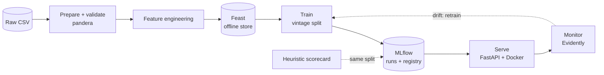

# Architecture

How the pipeline fits together and which tools were chosen over which alternatives.

Solid arrows carry data. Dashed arrows are control: the baseline comparison and the drift signal. Raw data and models now live in Cloud Storage, training also runs on Vertex AI and the API runs on Cloud Run. See [Target architecture](gcp/overview.md).

## Stages

| # | Stage | Tool | Code | Status |
| --- | --- | --- | --- | --- |
| 1-2 | Storage + access | CSV behind a `DataSource` port | `src/data/` | shipped |
| 3-4 | Prepare, validate | pandas, pandera | `src/features/`, `src/data/schema.py` | shipped |
| 5 | Feature engineering | pandas | `src/features/` | shipped |
| 6 | Feature store | Feast | `feature_repo/` | shipped (offline only) |
| 7 | Train | scikit-learn, XGBoost, LightGBM, Optuna | `src/models/` | shipped |
| 8 | Track + register | MLflow locally; Vertex AI in the cloud | `mlflow.db`, `src/gcp/` | shipped |
| 9 | Serve | FastAPI + Docker on Cloud Run | `src/api/`, `docker/` | shipped (batch, private) |
| 10 | Monitor | Evidently | `src/monitoring/` | shipped |
| - | Data versioning | Cloud Storage object versioning (DVC was not adopted) | `infra/main.tf` | shipped |
| - | CI/CD | GitHub Actions | `.github/workflows/` | shipped |
| - | Baseline | heuristic scorecard | `src/models/` | shipped |

Storage is swappable: `prepare.py` accepts anything with `read() -> DataFrame`, so a new database is one adapter and one config change.

## Tool decisions

| Chosen | Not chosen | Reason |
| --- | --- | --- |
| pandera | Great Expectations | pandera answers "is this row valid?"; Evidently answers "does this batch look like earlier ones?". Nothing is left for GX. |
| MLflow | Weights & Biases | Same category, but MLflow also gives the model registry. W&B's strengths (big sweeps, deep-learning lineage) do not apply to a tabular model with few runs. |
| Cloud Storage object versioning | DVC | DVC was considered for the CSV but not adopted. Warehouse time travel would make it redundant, and `dvc exp` overlaps MLflow. |
| GitHub Actions | Airflow | One Python process, a few seconds, a 1.4 MB file. No schedule, multi-system or backfill need yet. If one appears, Dagster fits ML assets better than Airflow. |
| Feast, Evidently, FastAPI, pydantic | - | Each owns a job nothing else covers. |

!!! note
    `hydra-core` is declared in `pyproject.toml` but unused: configuration is YAML parsed into pydantic models. Adopt it for sweeps or drop it.

## Answers from the business

Recorded 2026-09-16.

| Question | Answer | Effect |
| --- | --- | --- |
| When is the DataCrédito block pulled? | At origination, not at extract time. | Its features are decision-time, so the heuristic's Gini 0.352 stands. `saldo_mora` and `tiene_mora_bureau` left the withheld list. |
| Units of bureau balances? | Thousands of COP. | `clean()` scales to pesos; median `saldo_total` goes from 16 178 to 16 178 000. |
| "No" versus "unknown" in derived flags? | Must be distinguished. | `cuota_supera_salario` and `tiene_mora_bureau` are nullable; `falta_*` flags cover eight columns, lifting default 1.18x to 1.54x over the 4.75 % base. |
| Client identifier? | Exists, will be added to the extract. | None of the 23 columns is unique per row, so stage 6 waits on the re-export. |

Still open: is `saldo_mora` observed at the same moment as the rest of the bureau block? It drifts weakly with loan age (corr +0.051, on only 55 loans), the one signal inconsistent with an origination-time pull.
