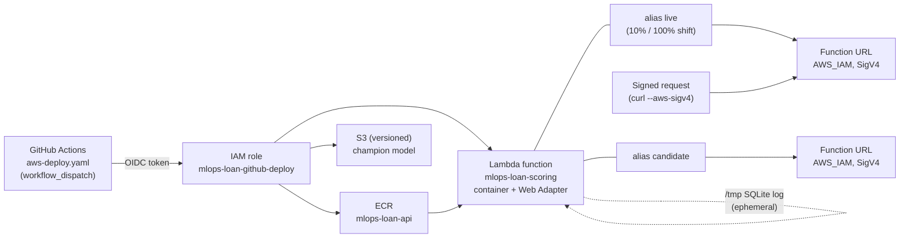

# The same API on AWS (Phase 3 hands-on comparison)

This page records a quick, real deployment of the loan-default scoring API on AWS. It was built so the cloud comparison rests on experience and not only on reading documentation. Everything here was done on 2026-11-11 in one session of about 30 minutes, with `us-east-1` as the only region.

**What this is not.** It is not a full AWS version of the project. Training on SageMaker, the BigQuery prediction log, drift monitoring and the CodeDeploy canary were **not** built. The GitHub Actions workflow was **written and linted but never run on GitHub**, so the OIDC login from CI is untested. The AWS profile used had broad administrator rights through SSO; the guard rails below were self-imposed (name prefix, tags, no public access), not enforced by AWS.

## What was built



| Piece | Choice | Why |
| --- | --- | --- |
| Compute | Lambda container image, with the AWS Lambda Web Adapter extension | The FastAPI code does not change. `docker/Dockerfile.lambda` is the normal Dockerfile plus the adapter and `PREDICTIONS_DB_PATH=/tmp/predictions.db`. |
| Entry point | Lambda Function URL, `AWS_IAM` auth | Private by default: an unsigned request gets `403 Forbidden`. The caller signs with SigV4. No API Gateway needed. |
| Canary | Two aliases, `live` and `candidate`, with weighted routing on `live` | Same flow as Cloud Run: candidate URL for the smoke test, 10 % on live, then 100 %, rollback by pointing the alias back. CodeDeploy was **not** used (one more service to learn). |
| Model | Copy of `models/` in a versioned S3 bucket; the workflow downloads it before the build | Same role as `make fetch-champion` from Cloud Storage. |
| IaC | OpenTofu in `infra-aws/`, local state (gitignored) | `tofu plan` was read before every `apply`. |
| CI login | Existing GitHub OIDC provider in the account (read with a data source) + role trusted only for `repo:rosvend/MLOps:ref:refs/heads/main` | Same idea as Workload Identity Federation. The role can push to one ECR repository, update one function and read one bucket. |
| Prediction log | SQLite under `/tmp` | Lambda's only writable path. **It is ephemeral**: it disappears when the execution environment is recycled and is not shared between instances. Drift monitoring and BigQuery are **not** part of the AWS version. |

Everything is named `mlops-loan-*` and tagged `project=mlops-loan-cdp`.

The only Python change (test first, `tests/monitoring/test_predictions_log.py`) is the `PREDICTIONS_DB_PATH` environment variable, in `src/monitoring/spec.py`, next to the existing `PREDICTIONS_LOG_TYPE` override.

## Commands

```bash
# 1. Registry and bucket first: the function needs an image to exist before it can be created
cd infra-aws && tofu init
tofu plan -out=p1 -target=aws_ecr_repository.api -target=aws_s3_bucket.models \
  -target=aws_s3_bucket_versioning.models -target=aws_s3_bucket_public_access_block.models \
  -target=aws_ecr_lifecycle_policy.api && tofu apply p1

# 2. Build and push (provenance off: Lambda rejects the image index that newer Docker pushes by default)
docker build --provenance=false -f docker/Dockerfile.lambda -t "$ECR_URL:bootstrap" .
aws ecr get-login-password | docker login --username AWS --password-stdin "${ECR_URL%%/*}"
docker push "$ECR_URL:bootstrap"

# 3. Everything else
tofu plan -out=p2 && tofu apply p2

# 4. A signed request (curl >= 7.75)
eval "$(aws configure export-credentials --format env)"
curl --aws-sigv4 "aws:amz:us-east-1:lambda" --user "$AWS_ACCESS_KEY_ID:$AWS_SECRET_ACCESS_KEY" \
  -H "x-amz-security-token: $AWS_SESSION_TOKEN" "$LIVE_URL/health"
scripts/aws_smoke_test.sh "$LIVE_URL"      # health + one prediction

# 5. Canary by hand (what the workflow does)
NEW=$(aws lambda update-function-code --function-name mlops-loan-scoring --image-uri "$ECR_URL:v2" --publish --query Version --output text)
aws lambda wait function-updated-v2 --function-name mlops-loan-scoring --qualifier "$NEW"
aws lambda update-alias --function-name mlops-loan-scoring --name candidate --function-version "$NEW"
aws lambda update-alias --function-name mlops-loan-scoring --name live --function-version 1 \
  --routing-config "{\"AdditionalVersionWeights\":{\"$NEW\":0.1}}"
aws lambda update-alias --function-name mlops-loan-scoring --name live --function-version "$NEW" \
  --routing-config '{"AdditionalVersionWeights":{}}'
```

To use the workflow, set the repository variables `AWS_REGION`, `AWS_DEPLOY_ROLE_ARN`, `AWS_MODELS_BUCKET` (outputs `deploy_role_arn`, `models_bucket`). The ECR registry host comes from the `amazon-ecr-login` action.

## Proof (real signed requests)

An unsigned request to the live URL returned `{"Message":"Forbidden"}` with HTTP 403. Signed:

```text
health:  {"status":"ok","model_loaded":true,"model_name":"logistic","threshold":0.0822820968972167,"n_features":35,"git_sha":"87b31a3",...}
predict: {"model":"logistic","threshold":0.0822820968972167,"flagged":1,"predictions":[{"application_id":"SMOKE-TEST","probability_default":0.7258075096667593,"review_flag":true,...}]}
smoke test passed
```

The request body is `config/ci/smoke_request.json`, the same loan as the README sample. Same model, same answer as on Cloud Run.

## Measured numbers

| Measure | Result |
| --- | --- |
| Image size (uncompressed) | 1.49 GB |
| Cold start, first request ever (version 1) | 33 s total. Lambda's init phase hit its 10 s limit, then re-ran inside the request: 22 s |
| Cold start, new version 2 (candidate alias) | the first request got `502` (a 30 s timeout while loading), the retry succeeded; the smoke test took 53 s in all |
| Warm latency, 20 sequential signed `POST /predict/batch` from my laptop | min 0.36 s, median 0.37 s, p95 0.41 s, max 0.68 s (mostly network to us-east-1; the function itself took about 3 ms warm for `/health`) |
| Canary at 10 % | over 30 `/health` calls, 28 were served by version 1 and 5 by version 2 in the logs (small sample, includes smoke calls, so roughly 10-15 %) |
| Rollback | `update-alias live` back to version 1: one command, a few seconds |
| `update-function-code` + wait for the new version | about 21 s |
| Warm start after idle | Cold start of version 2 after about 10 minutes idle: 9.0 s (the image was already cached by AWS); the next request 0.26 s. So the 22 to 53 s cold starts were mostly the first load of a new version. |

Cold starts are the weak spot of this design: a 1.5 GB image with pandas, scikit-learn and Evidently loads slowly, and 1 GB of memory gives it little CPU. Not tried: more memory (more CPU), provisioned concurrency, lazy imports, a smaller image.

## Experience log

Times are UTC wall clock on one day. "Minutes" is the real elapsed time of the step.

| # | Step | Minutes | Friction |
| --- | --- | --- | --- |
| 1 | Check the identity, region, existing ECR / Lambda / S3 / IAM / OIDC | 1 | The profile is an SSO `AdministratorAccess` role: nothing could block me, so safety depended only on my own rules. The account is shared with another project (its own Lambda functions, buckets and a CDK bootstrap). It already has the GitHub OIDC provider, so creating one would have failed with "already exists"; I had to read it with a data source. |
| 2 | Test-first env var `PREDICTIONS_DB_PATH` | 1 | None. The existing `PREDICTIONS_LOG_TYPE` pattern made it a 2-line change. |
| 3 | `docker/Dockerfile.lambda` and local build | 2 | Documentation for the Web Adapter is short and clear (copy a binary into `/opt/extensions`, set `AWS_LWA_PORT` and the readiness path). My first local `curl` came too early and returned nothing; not an AWS issue. |
| 4 | Write the OpenTofu code | 3 | A function that points at an image that does not exist yet cannot be created: it needs a two-step apply (registry first with `-target`). GCP's Cloud Run had the same shape, but I had to think about it here. The existing OIDC provider (step 1) shaped the code. |
| 5 | `tofu plan` + `apply` for ECR and bucket | 1 | The apply of a blind `plan && apply` one-liner was blocked by my sandbox, which is a fair reminder to read the plan. No AWS errors. |
| 6 | Build and push the image | 2 | Pushing took 10 s. The classic trap is that recent Docker pushes an image index that Lambda rejects; I built with `--provenance=false` from the start, so I did not hit it, but I only knew because I had read about it. |
| 7 | `tofu apply` of the other 10 resources (function, 2 aliases, 2 URLs, 2 roles, log group) | 1 | No errors at all, which was a surprise. No API to enable, no propagation delay, unlike the GCP `SERVICE_DISABLED` problem. |
| 8 | First signed request | 1 | Unsigned: a bare `403 Forbidden`, no hint about SigV4. `curl --aws-sigv4` worked on the first try with the SSO temporary credentials, but the session token needs its own header, which is easy to forget. First request took 33 s (cold start). |
| 9 | Latency sample and logs | 1 | Logs show `Init Duration ... Status: timeout`: the 10 s init limit is not in any default I would have looked at. |
| 10 | Manual canary (publish, candidate alias, 10 %, 100 %, rollback) | 4 | The CLI shorthand for `--routing-config` failed with `Expected: '=', received: '"'`; JSON works. A 502 on the candidate's first request (cold start timeout) was absorbed by retries in the smoke script. To get a "tag URL" like Cloud Run's candidate I needed a second alias and a second Function URL. |
| 11 | Workflow `aws-deploy.yaml` and `actionlint` | 2 | Clean. The workflow was not run on GitHub. I checked the deploy role with `iam simulate-principal-policy`: it may update aliases and code, and is denied `DeleteFunction`, `iam:CreateRole` and `s3:PutObject`. |
| 12 | Cost check | 1 | Cost Explorer returned 0 USD for the tag: it lags by up to a day and tags need activating as cost-allocation tags. So the cost below is calculated. |
| 13 | Documentation and teardown | see below | |

Quotas, region availability and permissions caused **no** problems in this account (concurrent executions limit was 400). That is not typical of a brand-new account, where the limit can be very low.

Separate concepts I had to use: ECR repository and lifecycle policy; image and the Lambda Web Adapter; Lambda function, version and alias; Function URL and `AWS_IAM` auth; SigV4 signing; the execution role and a separate deploy role; the IAM OIDC provider and the trust-policy conditions; S3 bucket, versioning and public access block; CloudWatch log group. About nine, without counting IAM policy syntax.

## GCP piece to AWS piece

| GCP piece | AWS piece | Easier or harder on AWS |
| --- | --- | --- |
| Artifact Registry | ECR | Same. ECR login is a token pipe to `docker login`; image scanning and a lifecycle policy are one block each. |
| Cloud Run service | Lambda container + Web Adapter | **Harder.** Cloud Run runs the Dockerfile as is; Lambda needs the adapter, a writable-path change, and a 10 s init limit. Cold start was much worse here (22 to 53 s) with the same image. |
| Private service with an ID token | Function URL with `AWS_IAM` + SigV4 | Mixed. Nothing public by default, no extra service. Signing is more work than a bearer token: curl needs three options and the session token. |
| Revision, `--no-traffic --tag candidate`, `update-traffic` | Version, `candidate` alias, weighted `live` alias | About equal for the shift; slightly **harder** to get the tag URL (second alias and second URL). Rollback is one command in both. |
| Workload Identity Federation | IAM OIDC provider + role trust policy | **Easier** here only because the provider already existed. The trust policy `sub` condition is simple. Scoping the role needed an explicit list of actions. |
| Service accounts | IAM roles (runtime and deploy) | Similar. Wildcard-free policies are verbose. |
| Cloud Storage bucket (versioned) | S3 bucket (versioned) | Same. Bucket names are global, so I hashed the account into the name; a public access block is a separate resource. |
| `infra/*.tf` with APIs to enable | `infra-aws/*.tf`, no APIs to enable | **Easier**: no `google_project_service` and no propagation errors. |
| BigQuery prediction log and Evidently drift | SQLite in `/tmp` | Not equivalent. The AWS version loses the log and so the drift check. |
| Cloud Billing budget | Cost Explorer / Budgets (not built) | Cost data lags about a day; GCP had no billing export either. |
| Vertex AI pipelines and AutoML | SageMaker | Not done. |

## Cost

**Calculated, not read from a bill.** Cost Explorer showed 0 USD (data lags). By list price, this session used: about 100 Lambda requests with roughly 2 minutes of 1 GB execution (about 120 GB-seconds, well under the free tier, otherwise about 0.002 USD); ECR storage of two images of about 0.5 GB compressed for under an hour (a fraction of a cent); S3 of 0.6 MB; CloudWatch logs of a few KB. **Total: under 0.05 USD.** Nothing in the design bills while idle except ECR storage and S3 storage (cents per month), which is the real strength of the Lambda choice.

## Teardown

`tofu plan -destroy` listed 15 resources, all `mlops-loan-*`; `tofu apply` removed them in under a minute with no errors. Checked afterwards with the CLI: no `mlops-loan` ECR repository, Lambda function, S3 bucket, IAM role or log group remains. `force_delete` on the ECR repository and `force_destroy` on the bucket removed the images and every object version, and the log group was managed by OpenTofu so it was removed too. The shared GitHub OIDC provider and the other project's resources were only read, never changed. Left behind: nothing in AWS. Locally: the OpenTofu state file (gitignored), the Docker images were removed. Cost Explorer data for the session may still appear as a few cents for a day.

## What was not done

- SageMaker training, and any AutoML or pipeline on AWS.
- CodeDeploy (`LambdaCanary10Percent5Minutes`) and a CloudWatch alarm for automatic rollback. The workflow rolls back only when a smoke test fails.
- The GitHub workflow was not run, so OIDC from GitHub Actions to AWS is untested. The role was only checked with the policy simulator.
- Drift monitoring and a durable prediction log.
- ECS Express Mode, which would avoid the cold start problem; not compared.
- No attempt to fix the cold start.
