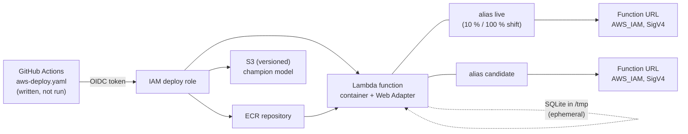

# The same API on AWS (Phase 3 hands-on comparison)

A quick, real deployment of the loan-default scoring API on AWS, done on 2026-11-11 in one session of about 30 minutes in `us-east-1`, so the [cloud comparison](cloud-comparison.md) rests on experience. It is a serving test, not a full AWS version of the project. The GitHub Actions workflow (`aws-deploy.yaml`) was **written and linted but never run on GitHub**, so the OIDC login from CI is untested. The AWS profile was a broad administrator role, so the guard rails (name prefix, tags, no public access) were self-imposed.

## Architecture

The FastAPI code does not change: `docker/Dockerfile.lambda` is the normal Dockerfile plus the Lambda Web Adapter and `PREDICTIONS_DB_PATH=/tmp/predictions.db`. Infrastructure is OpenTofu in `infra-aws/` with local state. An unsigned request gets `403 Forbidden`; a SigV4-signed one returned the same health and prediction as on Cloud Run.

## Measured numbers

One-off samples, not benchmarks.

| Measure | Result |
| --- | --- |
| Image size (uncompressed) | 1.49 GB |
| Cold start, first request ever | 33 s (init hit its 10 s limit, then re-ran inside the request) |
| Cold start, new version | first request got a `502` after a 30 s timeout; retry worked; 53 s in all |
| Cold start after about 10 min idle | 9.0 s, then 0.26 s |
| Warm latency, 20 signed `POST /predict/batch` from a laptop | median 0.37 s, p95 0.41 s (mostly network) |
| Canary at 10 % | 30 `/health` calls: version 2 served roughly 10 to 15 % (small sample) |
| Rollback | alias back to version 1: one command, a few seconds |
| Cost | under USD 0.05, calculated from list prices (Cost Explorer lagged and showed 0) |

## Experience log (most informative steps)

| Step | Friction |
| --- | --- |
| Check the identity | The profile was an administrator role in a shared account; safety depended only on my own rules. The GitHub OIDC provider already existed, so it was read with a data source |
| Write the OpenTofu | A function that points at a missing image cannot be created, so the apply is two-step (registry and bucket first with `-target`) |
| Apply the other resources | No errors at all: no API to enable, no propagation delay, unlike the GCP `SERVICE_DISABLED` race |
| First signed request | Unsigned gave a bare 403 with no hint about SigV4; `curl --aws-sigv4` needs the session token in its own header |
| Manual canary | The CLI shorthand for `--routing-config` failed, JSON worked; a candidate URL needed a second alias and a second Function URL |
| Workflow and role | `actionlint` clean; the role was checked only with the IAM policy simulator (may update code and aliases, denied `DeleteFunction`, `iam:CreateRole`, `s3:PutObject`) |

About nine concepts were needed, with IAM and SigV4 heaviest. Total wall clock for serving plus IaC was about 20 minutes.

## What was not done

- SageMaker training and Autopilot are not part of this serving test; they were run separately, see [AWS training](aws-training.md).
- CodeDeploy and a CloudWatch alarm: the workflow rolls back only on a failed smoke test.
- Running the workflow on GitHub, so OIDC from Actions is untested.
- Drift monitoring and a durable prediction log; ECS Express Mode; fixing the cold start.

## Teardown

`tofu destroy` removed all 15 `mlops-loan-*` resources with no errors, and a CLI check found nothing left in AWS. The shared OIDC provider was only read.
