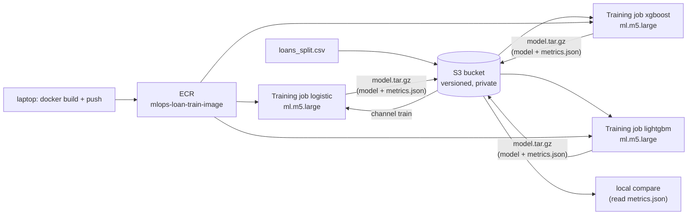

# Model training on AWS (SageMaker) vs Google Cloud

Written from a real run on 2026-11-11 (region `us-east-1`, everything named `mlops-loan-train-*`, tagged `project=mlops-loan-cdp`). The whole task had a hard time box of about 40 minutes, so some parts were **not** done; see "What I could not do".

## Architecture (what ran)

The three jobs were created from a laptop script (`src/aws/run.py`) with the API call `CreateTrainingJob`, **in parallel**. I did **not** use SageMaker Pipelines: three plain jobs plus a local compare was the allowed fallback and was faster to build under the time box. So the "pipeline" comparison below is jobs vs a Vertex Pipeline, not pipeline vs pipeline.

The training code is the same project code as on Vertex: `src/gcp/data.py` (`split_frame`), `src/gcp/evaluate.py` (`build_candidate`, `train_and_evaluate`) and the tuned parameters in `config/gcp_pipeline/default.yaml`. Only the entry point is new (`src/aws/train.py`, 25 lines). The image is the unchanged `docker/Dockerfile.train`; the command is set in the job (`ContainerEntrypoint`), so no SageMaker-specific Dockerfile was needed. Fit uses TRAIN+VALIDATE (7,713 loans); TEST (3,050 loans, 101 defaults) is only scored.

## Vertex piece -> SageMaker piece

| Vertex AI | SageMaker | Note from doing it |
| --- | --- | --- |
| Cloud Storage bucket | S3 bucket | Same idea. Bucket names are global, so I added a short hash. |
| Artifact Registry | ECR repository | Needs `docker login` with a token from the CLI. |
| Service account of the pipeline | IAM role trusted by `sagemaker.amazonaws.com` | I wrote a narrow policy (one bucket, one repo, SageMaker log groups). |
| Vertex Pipelines (KFP) | SageMaker Pipelines | **Not used.** |
| CustomJob / pipeline component | Training job (`CreateTrainingJob`) | Data arrives as a "channel" mounted at `/opt/ml/input/data/train`; results go to `/opt/ml/model`. |
| Machine type e2-standard-2 | `ml.m5.large` (2 vCPU, 8 GiB) | Same size class. |
| AutoML Tabular | SageMaker Autopilot (`CreateAutoMLJobV2`) | Launched and **stopped on purpose**, see below. |

## Results on the same TEST rows (3,050 loans, 101 defaults, top 15.7 % flagged)

| Model | PR-AUC | ROC-AUC | Gini | F1 | Accuracy |
| --- | --- | --- | --- | --- | --- |
| SageMaker logistic | 0.129 | 0.664 | 0.327 | 0.117 | 0.832 |
| SageMaker XGBoost | 0.091 | 0.653 | 0.305 | 0.117 | 0.832 |
| SageMaker LightGBM | 0.102 | 0.640 | 0.280 | 0.114 | 0.831 |
| Vertex pipeline (GCP, earlier) | logistic 0.129 / XGBoost 0.091 / LightGBM 0.102 | | | | |
| Vertex AutoML v2 (GCP, earlier) | 0.215 | 0.790 | 0.581 | | |
| SageMaker Autopilot | not run to the end | | | | |

The three PR-AUC values are the same as on Google Cloud to three decimals: same code, same data, same seed, so the platform does not change the model. Accuracy is computed from the confusion matrix (logistic: 2,504 true negatives + 34 true positives out of 3,050).

## Timings (per job, three jobs started together)

| Phase | Logistic | XGBoost | LightGBM |
| --- | --- | --- | --- |
| Starting (instance + image pull) | 39.4 s | 40.3 s | 38.8 s |
| Downloading (data from S3) | 30.9 s | 30.8 s | 30.8 s |
| Training (container running, includes the fit) | 10.4 s | 10.4 s | 10.4 s |
| Uploading | 12.4 s | 12.4 s | 12.4 s |
| Submit to completed | 93.1 s | 93.9 s | 92.3 s |
| Start-up overhead (Starting + Downloading) | 70.3 s | 71.0 s | 69.5 s |
| BillableTimeInSeconds | 54 | 54 | 54 |

Whole run, from the first `create_training_job` to the last job done: 111 s (my script polls every 15 s). The model fit itself takes 0.2 s (logistic), 0.9 s (XGBoost), 1.7 s (LightGBM) according to `fit_seconds`. So about 75 % of the wall clock is start-up, not training. On Vertex the whole pipeline took about 6 minutes; here the three jobs together took under 2 minutes, but that excludes the compare step and the Pipelines scheduling overhead, so it is not a like-for-like number.

## Cost (computed, not from the bill)

Price: `ml.m5.large` training, US East (N. Virginia), USD 0.115 per hour, read from the AWS Price List API (service `AmazonSageMaker`, publication 2026-11-12, effective 2026-11-01). The billed time is `BillableTimeInSeconds` (54 s per job, Starting is not billed but Downloading, Training and Uploading are: 30.9 + 10.4 + 12.4 is about 54).

| Item | Computed cost |
| --- | --- |
| Three training jobs: 3 x 54 s x USD 0.115/h | USD 0.0052 |
| ECR storage of the image (a few hundred MB for under an hour), S3 (a few MB) | negligible, less than USD 0.01 |
| Autopilot, stopped by me: 10 processing jobs on `ml.r5.16xlarge`, 1,114 s of total run time x USD 4.838/h | USD 1.50 (computed from `ProcessingStartTime`/`ProcessingEndTime`; billing may round per job) |
| Total | about USD 1.51 |

For comparison, the Vertex pipeline cost about USD 0.15 per run. The AWS number is lower mostly because billing is per second of the job only, and because there was no pipeline orchestration cost. The GCP number includes pipeline run overhead.

## Autopilot: launched, then stopped by me

I launched `CreateAutoMLJobV2` (tabular, BinaryClassification, mode ENSEMBLING, `MaxCandidates` 10, `MaxAutoMLJobRuntimeInSeconds` 1500, objective `AUC`) on TRAIN+VALIDATE rows only (7,713 rows, 5.3 % defaults; the `split` column dropped and no TEST rows). Two facts:

- **Objective metric.** The documented list for binary classification is Accuracy, AUC, BalancedAccuracy, F1, Precision, Recall. There is **no PR-AUC**, so I chose AUC (the closest, a ranking metric). Vertex AutoML offered `maximize-au-prc`.
- **No predefined split.** Autopilot takes one file and makes its own internal validation split, not our time-ordered one. Vertex took the `split` column.

About 10 seconds after the job started, it created **ten parallel processing jobs on `ml.r5.16xlarge`** (64 vCPU, 512 GiB), one per candidate. `ml.r5.16xlarge` processing costs USD 4.838 per hour (Price List API). Ten of them for the 1,500 s cap is 10 x 4.838 x 1500/3600 = **USD 20.2 worst case, over my USD 12 limit**. I had not computed this before starting because the instance type is chosen by Autopilot and is not in the request; I only saw it by listing the jobs. I stopped the AutoML job and its processing jobs about two minutes after the start; they had run about 110 s each (1,114 s in total, about USD 1.50 computed). I did not score TEST with Autopilot, so I cannot say whether the 884-row failure of Vertex v1 occurs on AWS.

Lesson for the comparison: on AWS the cost bound of Autopilot is the runtime cap **times a number of parallel big machines you do not choose**; on Vertex the cap is the node-hours budget, so the worst case is known before you start.

## Experience log

| Step | Start (UTC) | End (UTC) | Minutes | Friction |
| --- | --- | --- | --- | --- |
| Read quotas for training instances | 03:03 | 03:08 | 5 | `ml.m5.large` training quota is 20, enough. Quotas are per instance type and per use (training, processing, transform, endpoint are separate lists), so there are many numbers to check. `ml.m5.12xlarge` for training and processing is 0. |
| OpenTofu: S3 + ECR + role | 03:08 | 03:12 | 4 | Plan read before apply (6 resources). Writing a narrow IAM policy took the most thought. |
| Build and push the image | 03:11 | 03:14 | 3 | The first build started before my new files existed and had to be restarted (my mistake). `--provenance=false` as in the Lambda work. |
| Write job spec, entry point, tests | 03:12 | 03:14 | 2 | 5 unit tests, no network. The container needs `ContainerEntrypoint` because a custom image is started with `train` by default; setting it avoided a second Dockerfile. |
| Run the three training jobs | 03:14 | 03:17 | 2 | No errors. About 70 s start-up per job before any code runs. |
| Read results from S3 | 03:17 | 03:17 | 1 | Output is a `model.tar.gz`; metrics have to be unpacked. No metric UI without extra work (CloudWatch logs or a tracking server). |
| Autopilot launch and stop | 03:17 | 03:20 | 3 | The API accepted the request without any cost estimate. Role needed `sagemaker:*` on the job names plus ECR pulls from AWS-owned images. Instance types are not in the request or the first response. |

Number of concepts needed for this path: IAM role + trust, S3, ECR, training job + channels + `/opt/ml` paths, entrypoint, quotas. For Vertex it was service account, bucket, Artifact Registry, pipeline components.

## What I could not do

- **SageMaker Pipelines** (three parallel steps plus a compare step): not built; plain jobs and a local compare instead.
- **Autopilot to the end, scoring with batch transform, comparison with Vertex AutoML 0.215**: not done (cost). Settings I would run: ENSEMBLING mode, objective AUC, `MaxCandidates` 3 to 5 and a budget agreed after accepting roughly USD 2 to 5 for parallel `ml.r5.16xlarge` processing.
- Model explainability and the candidate notebooks of Autopilot: not inspected.
- Real bill: Cost Explorer lags a day; all costs are computed.

## Teardown

See the end of this file (filled in after the destroy).

### Teardown result

`tofu destroy` removed the 6 resources (bucket with all object versions, ECR repository with the image, IAM role and its policy). Checked afterwards with the CLI: no bucket, repository or role named `mlops-loan-train*`, no endpoints, no models, no jobs in progress. Left as metadata that SageMaker does not allow deleting and that costs nothing: the 3 training jobs, 10 stopped Autopilot processing jobs and the stopped AutoML job `mlops-loan-train-autopilot-1`. The local Docker image tag remains on the laptop. The GCP and earlier AWS work were not touched.
