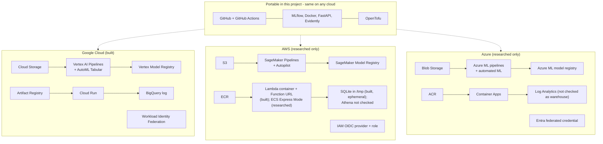

# Cloud comparison: AWS, Azure and Google Cloud

This page is a reflective comparison of three clouds for the loan-default MLOps pipeline. It answers the 14 points of the Phase 3 assignment.

## Method and limits (read this first)

**Google Cloud was built and run end to end** in this project: training, AutoML, registry, serving, monitoring and CI/CD. **AWS got a hands-on serving deployment only** (2026-11-11, `us-east-1`, about 30 minutes in one session): the same API as a Lambda container image with a canary and a teardown. AWS had **no** training, no managed monitoring and no run of its workflow on GitHub. The evidence is in [The same API on AWS](aws-pipeline.md). **Azure was not built or run at all.** Everything said about Azure, and about AWS beyond that serving test, comes from official documentation and pricing pages read on 2026-11-11. Where this page says "according to the documentation", nobody at this project has checked that claim by doing it.

Every statement carries one of these tags:

| Tag | Meaning |
| --- | --- |
| **[hands-on GCP]** | It happened in this project on Google Cloud. The evidence is in `docs/gcp/*.md` or `infra/*.tf`. |
| **[hands-on AWS]** | It happened in the AWS serving test, and is recorded in [The same API on AWS](aws-pipeline.md). Only serving was tried. |
| **[researched AWS]** | Read in official AWS documentation or pricing pages (URL in [Sources](#sources)). Not tried. |
| **[researched Azure]** | Read in official Azure documentation or pricing pages (URL in [Sources](#sources)). Not tried. |
| **[not verified]** | Could not be confirmed from an official page, or only recalled. Treat it as a question, not a fact. |

Other limits:

- **Prices** are quoted only when found on an official page or official price API. Each has the region and the access date. Prices change; check them again before relying on them.
- **Costs in this project are estimates from list prices**, on GCP and on AWS. The project has no GCP billing export (see [AutoML run](gcp/automl.md)), and AWS Cost Explorer showed 0 USD because its data lags by up to a day. Nothing was read from an invoice.
- **The AWS test is small and one-off.** One person, one afternoon session, one region, an account with broad administrator rights, a shared account with another project. Numbers such as cold starts are single measurements, not benchmarks.
- **Names change.** Two examples found while researching: AWS says SageMaker Model Monitor and App Runner are "no longer open to new customers", and Google's console now shows Vertex AI under a new brand while the API is still `aiplatform`. Check names before you build.
- **One person, one project, one small dataset** (about 10,000 loans). Several enterprise points (many roles, audits, regulation) were never exercised on GCP or AWS. The page says so where it applies.

## 1. Service equivalence

Names checked against current documentation on 2026-11-11. "Used here" means the service was actually used in this project.

| Need | Google Cloud (used here) | AWS | Azure |
| --- | --- | --- | --- |
| Object storage | Cloud Storage [hands-on GCP] | Amazon S3 [researched AWS] | Azure Blob Storage [researched Azure] |
| Container registry | Artifact Registry [hands-on GCP] | Amazon ECR [researched AWS] | Azure Container Registry (ACR) [researched Azure] |
| AutoML for tables | Vertex AI AutoML Tabular [hands-on GCP] | SageMaker Autopilot (AutoML API; the UI moved to SageMaker Canvas) [researched AWS] | Azure Machine Learning automated ML [researched Azure] |
| Pipeline orchestration | Vertex AI Pipelines (KFP) [hands-on GCP] | SageMaker Pipelines [researched AWS] | Azure Machine Learning pipelines (also Azure Pipelines for CI/CD, Azure Data Factory for data) [researched Azure] |
| Model registry | Vertex AI Model Registry, versions and aliases [hands-on GCP] | SageMaker Model Registry: model groups, versions, approval status [researched AWS] | Azure ML model registry: name and version, tags; Azure ML registries to share across workspaces [researched Azure] |
| Experiment tracking | Vertex AI Experiments; MLflow used locally [hands-on GCP] | SageMaker managed MLflow (MLflow Apps and Tracking Servers) [researched AWS] | Azure ML jobs grouped into experiments; MLflow models supported [researched Azure] |
| Serverless containers | Cloud Run [hands-on GCP] | Hands-on path: AWS Lambda container image with the Lambda Web Adapter, behind a Function URL [hands-on AWS]. Not tried: Amazon ECS Express Mode on Fargate. AWS App Runner is closed to new customers and AWS recommends ECS Express Mode [researched AWS] | Azure Container Apps [researched Azure] |
| Warehouse for the prediction log | BigQuery [hands-on GCP] | Not built: the AWS test kept the prediction log in SQLite under `/tmp`, which is ephemeral [hands-on AWS]. Amazon Athena appears in AWS's own monitoring examples; Redshift not checked [researched AWS] [not verified] | Log Analytics workspace appears in Azure docs for logs; Synapse or Fabric not checked [researched Azure] [not verified] |
| CI to cloud login without keys | Workload Identity Federation with GitHub OIDC [hands-on GCP] | IAM OIDC identity provider plus an IAM role. Structure confirmed in the AWS test: the provider is one per account and may already exist (it did, so it was read with a data source, not created), and the role trust needs `aud` and `sub` conditions. The role was written and checked with the IAM policy simulator but **never assumed from GitHub** [hands-on AWS]. The `aws-actions/configure-aws-credentials` action is from the documentation [researched AWS] | Microsoft Entra app registration plus a federated credential, with `azure/login` [researched Azure] |
| Identity and audit | Cloud IAM, Cloud Audit Logs [hands-on GCP: IAM only] | AWS IAM [hands-on AWS]; AWS CloudTrail [researched AWS] | Azure RBAC with Microsoft Entra, Azure Activity Log [researched Azure] |
| Budgets and cost alerts | Cloud Billing budget [hands-on GCP] | AWS Budgets [researched AWS] | Cost Management budgets [researched Azure] |
| Model and data drift monitoring | Evidently run inside our own API; Vertex Model Monitoring exists but was not used [hands-on GCP] [not verified] | SageMaker Model Monitor (closed to new customers); AWS suggests Evidently plus MLflow plus CloudWatch [researched AWS] | Azure ML model monitoring with data drift, prediction drift, data quality signals [researched Azure] |

A reading tip: GCP, AWS and Azure each have **one ML platform** (Vertex AI, SageMaker, Azure Machine Learning) that bundles AutoML, pipelines, registry and tracking, plus **generic services** (storage, containers, CI identity, audit) around it. The platforms are the hard-to-port part.

## 2. The pipeline on the three clouds

The GCP box was built end to end. In the AWS box, the registry, serving, model bucket and login role were built in the serving test; the SageMaker parts and a durable log were not. The Azure box is a mapping from documentation, not a tested design.

## 3. One section per assignment point

### 3.1 Ease of setup

**[hands-on GCP]** Setup was done as code with OpenTofu (`infra/*.tf`): enable APIs, bucket, registry, budget, identities. What went wrong, in order of how surprising it was:

- Creating the budget right after enabling its API failed with `SERVICE_DISABLED`; the API said "enabled" before every backend agreed. Fix: run `tofu apply` again.
- Local credentials carried another project's *quota project*, so bucket reads failed with `User project specified in the request is invalid`. The Makefile now sets `GOOGLE_CLOUD_QUOTA_PROJECT`.
- The CI identity could not bill a quota project, and the last two commits in the history are about clearing it in the workflows.
- A typo in an API name (`iamcredetials`) passed `plan` and failed on `apply`.
- Vertex's service agent needed `artifactregistry.reader`, otherwise the first pipeline run failed with a permission error.

**[hands-on AWS]** Setup was also OpenTofu (`infra-aws/`). Unlike GCP, there were no APIs to enable and no propagation errors: the apply of the function, two aliases, two URLs, two roles and a log group had no errors at all. Quotas, region availability and permissions caused no problems, but that was a long-established account with a concurrent-executions limit of 400, which is not typical of a brand-new account. Frictions: a Lambda function cannot be created before its image exists, so the apply is two-step (registry and bucket first with `-target`, push an image, then the rest); the GitHub OIDC provider already existed, so creating one would have failed with "already exists"; and recent Docker pushes an image index that Lambda rejects, avoided with `--provenance=false` only because it had been read about.

**According to the documentation:**

| | AWS [researched AWS] | Azure [researched Azure] |
| --- | --- | --- |
| First thing to create | An account, then IAM roles and an S3 bucket. SageMaker needs execution roles | A subscription, then a workspace (the top-level Azure ML resource) |
| Hidden companions | The docs for managed MLflow say the artifact store is an S3 bucket in your account | A workspace needs a storage account, Key Vault, Application Insights and optionally ACR; they are created automatically if you do not bring your own |
| Warnings in the docs | App Runner and Model Monitor closed to new customers | A resource lock on the workspace's resource group can stop compute clusters from scaling; ACR creation fails if the subscription forces tags on resources |

Reading: all three need identity and permissions to be right before anything runs. GCP's version was experienced fully, AWS's for serving only. The Azure workspace model (one container with its supporting resources) looks more bundled than GCP's "enable an API per service", but this is from reading, not doing.

### 3.2 Graphical interface

**[hands-on GCP]** The work was mostly done with code and the `gcloud` CLI. The console was used to read results: Vertex AI > Model Registry (versions, aliases, labels), Vertex AI > Experiments, and Billing reports. The console now shows the Vertex AI area under a new brand (Gemini Enterprise Agent Platform) while the API name stays `aiplatform`. This is a real cost of using a console: screenshots and tutorials age quickly. A fair summary is that the console was *used little*, so this project cannot rank it.

**According to the documentation:**

- AWS: SageMaker Pipelines can be built with a drag-and-drop UI or the SDK; Autopilot's UI moved to SageMaker Canvas [researched AWS].
- Azure: Azure Machine Learning studio (`ml.azure.com`) offers a no-code web experience for automated ML and a Designer for pipelines [researched Azure].

Both clouds document a visual route for AutoML and pipelines. Whether it is better than GCP's console is **[not verified]**.

### 3.3 Learning curve

**[hands-on GCP]** The hard parts were not ML code. They were identity (service accounts, who may act as whom, the Vertex service agent), the pipeline container (image, IAM, `.gcloudignore` dropping `src/models` by mistake), and reading AutoML's output (its headline PR-AUC of 0.970 is not comparable with ours). The local logistic model took about 2.5 minutes to tune. The cloud wrapper around the same model needed an image, IAM and a pipeline definition (setup time was not recorded).

**[hands-on AWS]** Serving the same API needed about nine separate concepts: ECR repository and lifecycle policy; the image and the Lambda Web Adapter; function, version and alias; Function URL and `AWS_IAM` auth; SigV4 signing; the execution role and a separate deploy role; the IAM OIDC provider and its trust conditions; S3 bucket, versioning and public access block; a CloudWatch log group. IAM and SigV4 were the heaviest. An unsigned request gets a bare `403 Forbidden` with no hint about SigV4. The AWS test did not include SageMaker, so the ML-platform learning curve on AWS is still unknown.

**According to the documentation:** both AWS and Azure list a similar set of concepts to learn: roles or RBAC, a workspace or domain, compute, a registry, endpoints. The AWS docs list many sub-topics for pipelines concepts (parameters, steps, caching, retry, selective execution, scheduling, local mode) [researched AWS]. Azure splits pipelines into three technologies (Azure ML pipelines, Data Factory, Azure Pipelines) and says which persona uses each [researched Azure]. That split is useful, but it is also three things to learn. How steep each curve is for a beginner is **[not verified]**.

### 3.4 Total implementation time of each pipeline

**[hands-on GCP]** Run times that were recorded:

| Pipeline | Recorded time |
| --- | --- |
| Local Python (tuning) | about 2.5 minutes |
| Vertex custom pipeline (3 tiny training steps + compare) | about 6 minutes per run, mostly VM start-up for each step |
| Vertex AutoML Tabular | 03:55 to 06:10 UTC, about 2 h 15 min, for a 1 node-hour budget |
| AutoML batch prediction on TEST | 13:07 to 13:29 UTC, about 22 minutes |

The time it took to *write* each pipeline (hours of the student) was not recorded, so no number is given. Several first runs failed on IAM or on the image before one succeeded.

**[hands-on AWS]** Serving plus infrastructure as code on AWS took about 20 minutes of wall clock (the whole session was about 30 minutes including documentation and teardown). That was a *serving* deployment of an existing container, done after the GCP version existed, by someone who already knew the API. **The GCP serving setup was not timed**, so no like-for-like figure exists, and 20 minutes should not be set against the whole GCP project, which also includes training, registry and monitoring. Training was not built on AWS.

**Azure:** nothing was built. **[not verified]** is the honest answer to "which is faster to implement" for training pipelines on AWS or Azure. The only documented hint is on Azure: creating a compute cluster is described as taking "approximately five minutes" [researched Azure], which says nothing about a whole pipeline.

### 3.5 Training and deployment costs

See the table in [section 4](#4-cost-table). The main lesson **[hands-on GCP]**: the custom pipeline cost cents (estimate: under $0.25 for all attempts), while AutoML at its minimum budget cost more than 80 times as much (estimate: up to about $22 with batch prediction) and did not clearly beat the local logistic model. Deployment on Cloud Run scales to zero when idle, so an idle API costs about nothing; the exact amount was not measured. **[hands-on AWS]** The AWS serving experiment cost under $0.05, **calculated from list prices, not read from a bill** (about 100 requests, roughly 120 GB-seconds of Lambda, two images in ECR for under an hour, a few KB of logs). Nothing in that design bills while idle except ECR and S3 storage (cents per month).

According to the documentation, AWS and Azure do not add a fee for the AutoML or pipeline *feature*; you pay for the compute and storage underneath [researched AWS] [researched Azure]. GCP charges a node-hour rate for AutoML tabular on top (about $21.252, see section 4). Whether the total for the same task would be lower elsewhere is **[not verified]**, because the number of node-hours AutoML would use on another cloud is not known.

### 3.6 Resource usage (CPU/GPU)

**[hands-on GCP]** No GPU was used. Each Vertex pipeline step ran on a short-lived `e2-highmem-2` VM (2 vCPU, 16 GB; Vertex picked it from a request of 2 CPU / 8 GB). Batch prediction used one `n1-standard-2`. The models are logistic regression, XGBoost and LightGBM on 7,713 rows, which need no GPU. Cloud Run ran the API on CPU.

**According to the documentation:**

- Azure: compute clusters can be CPU or GPU, scale down to zero nodes when `min_instances` is 0, and low-priority VMs are cheaper but can be preempted [researched Azure]. Container Apps price tables list GPU meters (T4 and A100) [researched Azure].
- AWS: SageMaker training and processing run on chosen instance types; ECS Express Mode runs on Fargate [researched AWS].

GPU price and availability comparisons were **not** done **[not verified]**. For this dataset the point is moot.

### 3.7 Execution time

**[hands-on GCP]** Cloud training was *slower* than local training for this small data, because each Vertex step waits for a new VM. Three tiny steps took about 6 minutes, while the model fit itself took 0.7 to 5.8 seconds. Cloud execution pays off for large data, schedules and audit, not for speed on 10,000 rows (this is also written in [Design decisions](gcp/decisions.md)).

**[hands-on GCP] [hands-on AWS] Cold starts of the serving API.** These are one-off measurements, not benchmarks, and the images differ (GCP: the Cloud Run image; AWS: a separate 1.49 GB Lambda image with the Web Adapter and 1 GB of memory).

| | Cold start measured |
| --- | --- |
| Cloud Run (GCP) | 34 s on the first call after idle in the Newman test; the project docs also record a smoke test timing out on a cold revision. A figure of about 30 s was also reported to me from another occasion, but it is not in the files I read [not verified] |
| Lambda container (AWS) | 33 s for the very first request (Lambda's 10 s init limit was hit, then init re-ran inside the request); a new version's first request got a `502` after a 30 s timeout and the retry worked, 53 s in all; 9 s after about 10 minutes idle with the image already cached; then 0.26 s |

So the cold starts are of the same order on both clouds in these samples. The AWS doc concludes the long ones were mostly the first load of a new version. Warm latency on AWS was a median of 0.37 s from a laptop, mostly network to `us-east-1` [hands-on AWS]; the GCP sequential calls took about 300 ms [hands-on GCP], but they came from a different network path, so the two are not comparable. Not tried on AWS: more memory, provisioned concurrency, a smaller image.

**According to the documentation:** Azure notes that compute clusters scale up when a job is submitted and give "idle seconds before scale down" [researched Azure]. SageMaker Pipelines offers step caching and local mode [researched AWS]; Azure pipelines "reuse outputs from unchanged steps" [researched Azure]. These are ways to cut start-up and repeat work, but their real effect was not measured **[not verified]**.

### 3.8 Storage and execution costs

**[hands-on GCP]** Storage was a few MB in Cloud Storage and Artifact Registry, which the project docs call negligible. The BigQuery prediction log is far inside the free tier according to the project docs (an estimate, not a bill). Execution cost: see 3.5. **[hands-on AWS]** Storage on AWS was the same shape: two images of about 0.5 GB compressed in ECR for under an hour, 0.6 MB in S3, a few KB of logs; a fraction of a cent. Both clouds charge storage in cents and bill nothing for the idle serverless service.

**According to the documentation:** the verified price points for storage and containers are in [section 4](#4-cost-table). In short, Hot-tier blob storage in East US and S3 Standard are close per GB (cents per GB-month). A registry is a different shape: ACR Basic is a flat daily fee including 10 GB, while ECR charges per GB-month [researched AWS] [researched Azure].

### 3.9 Price comparison of equivalent services

This is the cost table in [section 4](#4-cost-table). Honest summary: of the three equivalent *AutoML* services, only the GCP price (per node-hour) is a published feature fee; AWS and Azure say there is none beyond underlying compute. For storage and serverless containers the prices are of the same order of magnitude, and a fair comparison needs real usage that this project does not have.

### 3.10 CI/CD integration

**[hands-on GCP]** GitHub Actions was used for four workflows: CI (tests, folder structure, metric floor), deploy (build image, canary at 10 %, smoke tests, 100 %, rollback), training (Vertex pipeline, gate, human approval, promote) and a daily drift check. Login uses Workload Identity Federation: a short-lived token exchange with an `attribute_condition` that limits the pool to `rosvend/MLOps`. The `github-ci` account holds only the roles it needs. Surprises: a wrong claim name in the mapping (`assertion.hub` instead of `assertion.sub`) did not fail until the first login attempt, and fork pull requests get no token so cloud steps are skipped. The training, drift-check and approval workflows have now **run on GitHub** (2026-11-11). Along the way a push-triggered run failed because the workflow set a quota project that the federated identity cannot bill, and the first drift run failed on its last step because `gh` did not know the repository (see [Training workflow](gcp/training-workflow.md)). The redeploy after a forced promotion was not completed: it coincided with a GitHub platform incident, so it is recorded as a platform failure to retry, not as a verified defect.

**[hands-on AWS]** An AWS deploy workflow (`aws-deploy.yaml`) was written and passed `actionlint`, but **was never run on GitHub**, so the OIDC login from CI to AWS is untested. The deploy role was only checked with `iam simulate-principal-policy` (it may update aliases and code; it is denied `DeleteFunction`, `iam:CreateRole` and `s3:PutObject`). By inspection, it differs from the GCP workflows mainly in the login step and the deploy commands.

**According to the documentation:**

| | AWS [researched AWS] | Azure [researched Azure] |
| --- | --- | --- |
| Keyless login from GitHub | IAM identity provider for `token.actions.githubusercontent.com`, audience `sts.amazonaws.com`, a role trust policy with a `sub` condition, and `id-token: write` in the workflow | Entra app registration, a federated credential (subject claim checked, at least one condition required), then `azure/login` with `id-token: write` |
| Native CI/CD | The Model Registry page lists "Automate model deployment with CI/CD" | The ML docs describe Azure Pipelines integration and Event Grid events for registration, deployment and drift |

The idea is the same on all three (GitHub OIDC token exchanged for a short-lived credential, restricted by a repository condition). The workflow files would change mostly in the login step and the deploy commands. That is the expected result of the documentation, **not** a tested port.

### 3.11 Native tools for monitoring, model versioning and governance

| | Google Cloud [hands-on GCP] | AWS [researched AWS] | Azure [researched Azure] |
| --- | --- | --- | --- |
| Versioning | Model Registry: one entry `loan-default-scorer`, new version per registration, versions never overwritten, movable aliases `challenger` and `champion` | Model Groups with versions and approval status; Collections to group them. Managed MLflow can register into the SageMaker registry | Name and version, version increments on same name; tags; cannot delete a model used in an active deployment; registries to share across workspaces |
| Experiment tracking | Vertex Experiments received one run per candidate (logged after the fact, because a power loss interrupted the first attempt) | Managed MLflow, with CloudTrail logging and EventBridge events | Jobs and experiments in the workspace; job history keeps a snapshot of code, data and compute |
| Drift monitoring | Evidently inside our API, reading a BigQuery log; a daily workflow calls it | Model Monitor: data quality, model quality, bias drift, feature attribution drift, **closed to new customers**; replacement is open-source Evidently + MLflow + CloudWatch | Built-in signals: data drift, prediction drift, data quality, feature attribution drift (preview), model performance (preview); alerts via Event Grid |
| Lineage and governance | Labels (git sha, run id) on registry versions; our own gate and human approval in GitHub | Registry shows lineage and Model Cards | Lineage metadata and event notifications on registration, deployment, drift |

Two observations. First, **[hands-on GCP]** we did not use Vertex's own model monitoring; we ran Evidently ourselves, so we cannot say how Vertex's would compare. Second, AWS's own recommended replacement for the retired Model Monitor is built from open-source parts (Evidently, MLflow), which is the same idea as this project's monitoring. That supports keeping monitoring cloud-neutral.

### 3.12 Automation and continuous deployment

**[hands-on GCP]** The deploy workflow builds an image tagged with the commit SHA, deploys a Cloud Run revision with `--no-traffic --tag candidate`, smoke-tests it with an ID token (the service is private), moves 10 % of traffic, tests again, then 100 %. At 10 % the canary now reads **Cloud Monitoring**: it sends probe requests to both revisions for about 2.5 minutes, then compares each revision's request count, share of 5xx responses and p95 latency, and rolls back if the candidate fails. On a real deploy it passed: candidate 45 requests, 0 % 5xx, p95 153 ms, against the previous revision 41 requests, 0 %, 308 ms. A first attempt failed because of a tagging bug of ours, which also exercised the rollback; the rollback has fired for real (2026-11-11). Most of the traffic judged is probe traffic, and the check looks at errors and speed, not prediction quality. A model change must pass the gate and a human approval (GitHub Environment `production`) before the champion file changes. That path ran with `force_promote`, registering version 2 and moving the `champion` alias. The redeploy that follows was interrupted by a GitHub incident, and a natural `promote` decision has never happened (every candidate equals the champion).

**[hands-on AWS]** A weighted Lambda alias canary was executed by hand: a `candidate` alias for the smoke test, 10 % on the `live` alias, then 100 %, plus a rollback (alias back to version 1, a few seconds) and a roll forward. With 30 `/health` calls, version 2 served roughly 10 to 15 % (small sample). The AWS workflow's rollback triggers only on a failed smoke test, **not on a CloudWatch alarm**; CodeDeploy plus an alarm was not built, so the AWS canary has less automatic analysis than the GCP one now has. Getting a separate candidate URL needed a second alias and a second Function URL.

**According to the documentation:**

- Azure: Container Apps supports multiple revisions and traffic splitting for blue/green and A/B [researched Azure]; Azure ML online endpoints support controlled rollout by traffic percentage between deployments [researched Azure].
- AWS (not tried): ECS Express Mode creates a Fargate service, a load balancer, auto scaling and monitoring from an image and two roles [researched AWS]. Canary behavior for it was not checked **[not verified]**.

### 3.13 Access control, auditing and regulatory compliance

**[hands-on GCP]** Access control was designed with least privilege in `infra/ci.tf`: `github-ci` has artifact writer only on one repository, `run.developer` (not admin), `serviceAccountUser` only on `scoring-api`, bucket viewer or object user on one bucket. The API runs as a separate account (`scoring-api`) with BigQuery rights on one dataset only. The Vertex pipeline runs as its own `vertex-pipeline` account, not the default compute account. **Auditing and regulatory compliance were not exercised** in this project: Cloud Audit Logs were not read, and no compliance report was used.

**[hands-on AWS]** A Function URL with `AWS_IAM` auth is private by default: an unsigned request got a bare `{"Message":"Forbidden"}` (403) and no other service was needed. Signing with SigV4 is heavier than a Cloud Run ID token: curl needs three options and the session token in its own header, which is easy to forget. The runtime and deploy roles are separate, and the deploy role was policy-simulated to be least privilege. **The profile used was an administrator role in a shared account**, so nothing could block a mistake and the safety was self-imposed (a name prefix, tags and no public access), not enforced by AWS. CloudTrail was not read.

**According to the documentation:**

| | Google Cloud | AWS [researched AWS] | Azure [researched Azure] |
| --- | --- | --- | --- |
| Audit of admin actions | Admin Activity and System Event logs are always written and cannot be disabled; Data Access logs are off by default except BigQuery [researched, Google docs] | CloudTrail Event history keeps 90 days of management events; trails to S3 or CloudTrail Lake for longer (up to about 7 to 10 years in Lake) | Activity Log keeps 90 days by default; export to Log Analytics to keep longer (up to 12 years). It is not an authentication or authorization audit log |
| Compliance documents | Not checked [not verified] | AWS Artifact: on-demand ISO, PCI and SOC reports, free of charge | Not checked [not verified] |

The Google row comes from Google's documentation, not from use. Default retention periods for Cloud Audit Logs were not found on the page read **[not verified]**.

### 3.14 Working in enterprise environments with many roles

**[hands-on GCP]** Only one real person and several service accounts were involved. So multi-role work was *simulated* by separating machine identities (CI, API runtime, pipeline), and by a GitHub Environment with a required reviewer (self-review allowed on purpose, because there is one person). The state file of OpenTofu is local; a team would need a shared, locked bucket (written in [Design decisions](gcp/decisions.md)). Real organization policies, folders, groups and separate environments were not used. **[hands-on AWS]** The AWS test ran in a shared account with another project, which showed one real enterprise-like effect: existing resources (the OIDC provider) shaped the code, and only self-imposed rules kept the two projects apart.

**According to the documentation:**

- Azure: workspaces serve as containers for access, cost and data isolation; roles for data scientist, ML engineer, admin; assign access to Entra groups; one workspace per project for per-project cost reporting; hub workspaces for central governance [researched Azure].
- AWS: with consolidated billing, member accounts can create their own budgets, and IAM policies control who may create or edit them [researched AWS]. Multi-account setup via AWS Organizations is mentioned in CloudTrail docs [researched AWS].

Which one is easier for a large company depends on the company's existing identity system (Entra, AWS IAM Identity Center, Google Workspace). That is a reasoned guess, **[not verified]**.

## 4. Cost table

### 4.1 What this project spent on Google Cloud (estimates, not invoices)

| Item | Estimate | Source |
| --- | --- | --- |
| AutoML Tabular training, 1 node-hour minimum | up to about $21.25 | [AutoML run](gcp/automl.md) [hands-on GCP] |
| AutoML batch prediction (1 x `n1-standard-2`, about 18 min) | under $1 | same page [hands-on GCP] |
| Custom pipeline, all attempts (3 runs at about $0.03, a few minutes of `e2-highmem-2`, 3 Cloud Build runs inside the free minutes) | under $0.25 total; the project docs also give about $0.15 per run | [Custom pipeline run](gcp/custom-pipeline.md) [hands-on GCP] |
| Storage, registry, BigQuery log | cents or less | project docs [hands-on GCP] |
| Budget alerts configured | 50 % and 90 % of the budget; they warn but do not stop spending | `infra/main.tf`, [Foundations](gcp/foundations.md) |

**AWS serving test (estimate, not an invoice):** under $0.05 for about 100 requests, two images in ECR for under an hour and a few KB of logs; idle cost is ECR and S3 storage only [hands-on AWS]. Everything was torn down afterwards: 15 resources removed and checked with the CLI [hands-on AWS].

### 4.2 Price points found on official pages

All prices are USD list prices, read on 2026-11-11.

| Service | Google Cloud | AWS | Azure |
| --- | --- | --- | --- |
| Object storage, per GB-month | [not verified] (Google's page did not load; a recalled value was not accepted) | S3 Standard, first 50 TB, **US West (Oregon): $0.023** [researched AWS]. US East (N. Virginia) was not read | Blob Hot LRS, first 50 TB, **East US: $0.0208** [researched Azure] |
| Container registry | [not verified] | ECR private: **$0.10 per GB-month** (region not shown on the page text read) [researched AWS] | ACR Basic, East US: **$0.1666 per day**, 10 GB included; extra storage **$0.10 per GB-month** [researched Azure] |
| AutoML tabular | **$21.252 per node-hour** quoted in Google pricing pages as shown by a search result; 1 node-hour minimum in this project [hands-on GCP]. I did not open the pricing page itself (too large) | No separate Autopilot fee: "you pay only for the underlying compute and storage" [researched AWS] | "No additional charge to use Azure Machine Learning"; example VM price: 10 x DS14 v2 at **$1.196 per machine-hour**, West US 2 [researched Azure] |
| Pipelines run fee | about $0.03 per run (project estimate) [hands-on GCP] | No Pipelines charge found on the SageMaker pricing page [researched AWS] [not verified] | No Azure ML charge beyond compute [researched Azure] |
| Serverless containers | Cloud Run: [not verified]; scale to zero seen in practice, cost not measured [hands-on GCP] | Lambda container, AWS serving test: **under $0.05 in total, calculated from list prices** (Cost Explorer showed 0 USD because of its lag); no per-unit Lambda price was read from a pricing page, so none is quoted here [hands-on AWS]. Fargate Linux x86, **US East (N. Virginia): $0.0404784 per vCPU-hour, $0.004446 per GB-hour** [researched AWS]. ECS Express Mode adds no fee itself, but its resources (Fargate, load balancer, logs, transfer) are billed [researched AWS] | Container Apps, Standard, East US: **$0.000024 per active vCPU-second, $0.000003 per active GiB-second, $0.40 per million requests**; idle meters $0.000003 each [researched Azure]. Monthly free grant: 180,000 vCPU-s, 360,000 GiB-s, 2 million requests. No charge when scaled to zero |
| Managed experiment tracking | Vertex Experiments: no cost seen; an empty Tensorboard instance was created and costs nothing until it holds data [hands-on GCP] | MLflow tracking server example: Small at **$0.60 per hour** (region not stated on the page) [researched AWS] | No separate charge listed [researched Azure] |
| Drift monitoring | Evidently in our own API: no extra service [hands-on GCP] | Model Monitor example: ml.m5.4xlarge **$0.922 per hour** (region not stated); 30 hours of built-in rules free [researched AWS]. Service closed to new customers | Not found [not verified] |

How to read the table:

- **Not like for like.** A per-day registry fee, a per-second container fee and a per-node-hour AutoML fee cannot be summed into one winner without a usage model. No such model was built.
- **A big caution on AutoML.** "No extra fee" on AWS and Azure does not mean "cheaper". The trials still run on billed VMs, and the number of VM hours AutoML would use for this dataset on those clouds is **[not verified]**.
- Sources for each number are in [Sources](#sources). The Azure prices come from Microsoft's public retail price API because the pricing web pages did not render their numbers.

## 5. Closing reflection

### Which cloud for which scenario

These are opinions based on one cloud's experience plus documentation reading.

| Scenario | Leaning | Why (and the evidence level) |
| --- | --- | --- |
| **Student project** | Google Cloud, or whichever gives credits | It worked end to end here and costs were small except AutoML [hands-on GCP]. A more important rule is to pick the cloud you already have credits and an account for. AWS and Azure student offers were not checked [not verified] |
| **Small startup** | Whichever cloud the team already knows; keep the model code portable | Cloud Run scaled to zero [hands-on GCP]. Azure Container Apps scales to zero with a monthly free grant [researched Azure]. AWS's simple container service (App Runner) is closed to new customers; ECS Express Mode is the recommended path, with a load balancer billed under it [researched AWS] |
| **Regulated enterprise** | The cloud that matches the company's identity and compliance setup | Documented building blocks exist on AWS (CloudTrail, Artifact) and Azure (Activity Log, Entra groups, workspaces, hub governance) [researched AWS] [researched Azure]. GCP's audit logging was not exercised here. Real regulatory fit needs a compliance review that this project did not do [not verified] |

### Main trade-offs

- **Convenience vs control.** AutoML cost more than 80 times the custom pipeline (about $21 against under $0.25, both estimates) and refused to score rows with empty numeric cells, our local pipeline imputes them [hands-on GCP]. The managed option was less transparent. AWS documents that Autopilot generates notebooks showing the code used, which is a different trade-off [researched AWS]; this was not tried.
- **Managed platform vs your own parts.** We kept serving on Cloud Run and monitoring in Evidently instead of Vertex endpoints and monitoring [hands-on GCP]. That kept the code portable and cost less when idle, but meant more to build and maintain.
- **Cold starts.** Both serverless services cold-started in tens of seconds with a large scientific-Python image (see 3.7), and Lambda needed an adapter, a writable-path change and a 10 s init limit that a plain Dockerfile on Cloud Run did not [hands-on GCP] [hands-on AWS]. A smaller image or a warm instance would help; neither was tried.
- **Speed.** For 10,000 rows the cloud added start-up delay and cost with no better model [hands-on GCP].
- **Services move.** Two AWS services in this comparison are closed to new customers, and the Google console was rebranded. The more a design depends on a service name, the more this hurts [researched AWS] [hands-on GCP].

### Lock-in seen in this project

| Portable (works on another cloud with small changes) | Tied to Google Cloud (would be rewritten) |
| --- | --- |
| MLflow tracking and the local pipeline | Vertex AI Pipelines definition and `submit.py` (KFP itself is open source, but the submit and IAM are Vertex) |
| Docker images and the FastAPI app (ran unchanged on Lambda with an adapter and one new Dockerfile) [hands-on AWS] | AutoML Tabular job code and its input contract |
| The `PredictionsStore` config switch: one environment variable (`PREDICTIONS_DB_PATH`) was the only Python change for AWS [hands-on AWS] | BigQuery log and the Evidently drift check: on AWS the log fell back to ephemeral SQLite, so drift monitoring was lost [hands-on AWS]. Vertex Model Registry code (`src/gcp/register.py`): aliases and labels |
| OpenTofu as a tool (but not the `google_*` resources) | `google_*` resources, Workload Identity Federation pool, service-account roles |
| GitHub Actions workflows and the gate logic | Login steps, `gcloud run` deploy commands, ID-token smoke tests |
| Config-driven design (`config/*`) | Cloud Run revision and traffic-tag mechanics used for the canary; BigQuery client for the log |

The FastAPI app, Docker image and `PredictionsStore` switch are **confirmed portable to AWS Lambda** by the serving test [hands-on AWS]. The other left-column items are **[hands-on GCP]** observations about the repository's structure; that they would work on Azure, or on AWS beyond serving, is **[not verified]** until tried. Also: the GitHub OIDC pattern and OpenTofu carried over in shape, but the AWS login was never exercised from GitHub.

### What the student would still need to try hands-on

1. Run the same custom training in **SageMaker Pipelines** and **Azure ML pipelines** and time the whole run, including start-up.
2. Run one AutoML job on **Autopilot** and **Azure automated ML** with the same split file and compare cost *and* behavior on empty numeric cells.
3. Run the written AWS workflow on GitHub so the **IAM OIDC** role is really assumed (today it is only policy-simulated), and port the login to **Entra federated credentials** and note which errors appear late.
4. Deploy the API on **Azure Container Apps** and **ECS Express Mode**; on AWS also try CodeDeploy with a CloudWatch alarm for rollback, and fix the Lambda cold start (memory, provisioned concurrency, smaller image). Repeat the cold-start measurements more than once on every cloud.
5. Register a model in each registry and see whether an alias-like workflow (`champion`) is natural.
6. Read a real bill on each cloud. The GCP and AWS numbers here are only estimates from list prices (Cost Explorer lags about a day).
7. Turn on and read Cloud Audit Logs, CloudTrail and the Activity Log for one deployment, and try a multi-user role setup.

## Sources

All pages accessed on **2026-11-11**.

**AWS**

- SageMaker AI pricing: https://aws.amazon.com/sagemaker/ai/pricing/
- SageMaker Autopilot: https://docs.aws.amazon.com/sagemaker/latest/dg/autopilot-automate-model-development.html
- SageMaker Pipelines overview: https://docs.aws.amazon.com/sagemaker/latest/dg/pipelines-overview.html
- SageMaker Model Registry: https://docs.aws.amazon.com/sagemaker/latest/dg/model-registry.html
- SageMaker Model Monitor and its availability change: https://docs.aws.amazon.com/sagemaker/latest/dg/model-monitor.html and https://docs.aws.amazon.com/sagemaker/latest/dg/model-monitor-availability-change.html
- SageMaker managed MLflow: https://docs.aws.amazon.com/sagemaker/latest/dg/mlflow.html
- AWS App Runner (closed to new customers): https://docs.aws.amazon.com/apprunner/latest/dg/what-is-apprunner.html
- ECS Express Mode: https://docs.aws.amazon.com/AmazonECS/latest/developerguide/express-service-overview.html
- Fargate pricing (US East N. Virginia, Linux x86): https://aws.amazon.com/fargate/pricing/
- ECR pricing: https://aws.amazon.com/ecr/pricing/
- S3 pricing; the US West (Oregon) $0.023 figure was read in the price data file behind the pricing page: https://b0.p.awsstatic.com/pricing/2.0/meteredUnitMaps/s3/USD/current/s3.json (the N. Virginia section of this file was not reached; the S3 pricing page itself did not show its table: https://aws.amazon.com/s3/pricing/)
- AWS Budgets: https://docs.aws.amazon.com/cost-management/latest/userguide/budgets-managing-costs.html
- AWS CloudTrail: https://docs.aws.amazon.com/awscloudtrail/latest/userguide/cloudtrail-user-guide.html
- AWS Artifact: https://docs.aws.amazon.com/artifact/latest/ug/what-is-aws-artifact.html
- GitHub OIDC in AWS: https://docs.github.com/en/actions/how-tos/secure-your-work/security-harden-deployments/oidc-in-aws

**Azure**

- Azure Machine Learning pricing: https://azure.microsoft.com/en-us/pricing/details/machine-learning/
- Azure retail prices API (Blob Hot LRS East US, ACR Basic East US, Container Apps Standard East US), queried with filters on service name and region: https://prices.azure.com/api/retail/prices
- Container Apps pricing page (free grants, scale to zero): https://azure.microsoft.com/en-us/pricing/details/container-apps/
- ACR and Blob pricing pages (included storage tiers; numbers did not render): https://azure.microsoft.com/en-us/pricing/details/container-registry/ and https://azure.microsoft.com/en-us/pricing/details/storage/blobs/
- Automated ML: https://learn.microsoft.com/en-us/azure/machine-learning/concept-automated-ml?view=azureml-api-2
- ML pipelines: https://learn.microsoft.com/en-us/azure/machine-learning/concept-ml-pipelines?view=azureml-api-2
- MLOps and model management: https://learn.microsoft.com/en-us/azure/machine-learning/concept-model-management-and-deployment?view=azureml-api-2
- Model monitoring: https://learn.microsoft.com/en-us/azure/machine-learning/concept-model-monitoring?view=azureml-api-2
- Workspaces: https://learn.microsoft.com/en-us/azure/machine-learning/concept-workspace?view=azureml-api-2
- Compute clusters: https://learn.microsoft.com/en-us/azure/machine-learning/how-to-create-attach-compute-cluster?view=azureml-api-2
- Azure Container Apps overview: https://learn.microsoft.com/en-us/azure/container-apps/overview
- Activity Log: https://learn.microsoft.com/en-us/azure/azure-monitor/essentials/activity-log
- Cost Management budgets: https://learn.microsoft.com/en-us/azure/cost-management-billing/costs/tutorial-acm-create-budgets
- GitHub OIDC in Azure: https://docs.github.com/en/actions/how-tos/secure-your-work/security-harden-deployments/oidc-in-azure

**Google Cloud (outside this project's own files)**

- Cloud Audit Logs: https://docs.cloud.google.com/logging/docs/audit
- Vertex AI pricing (the $21.252 node-hour figure was seen in a web search result quoting Google's pricing pages; the page was too large to open): https://cloud.google.com/vertex-ai/pricing
- Cloud Storage and Cloud Run pricing pages did not load their tables, so no figure is quoted: https://cloud.google.com/storage/pricing and https://cloud.google.com/run/pricing

**This project**: `docs/aws-pipeline.md` (the AWS serving test), `docs/gcp/deployment-flow.md`, `docs/gcp/*.md` and `infra/*.tf` (overview, foundations, training, custom pipeline, AutoML, CI/CD, decisions, Model Registry, prediction log, training workflow).
