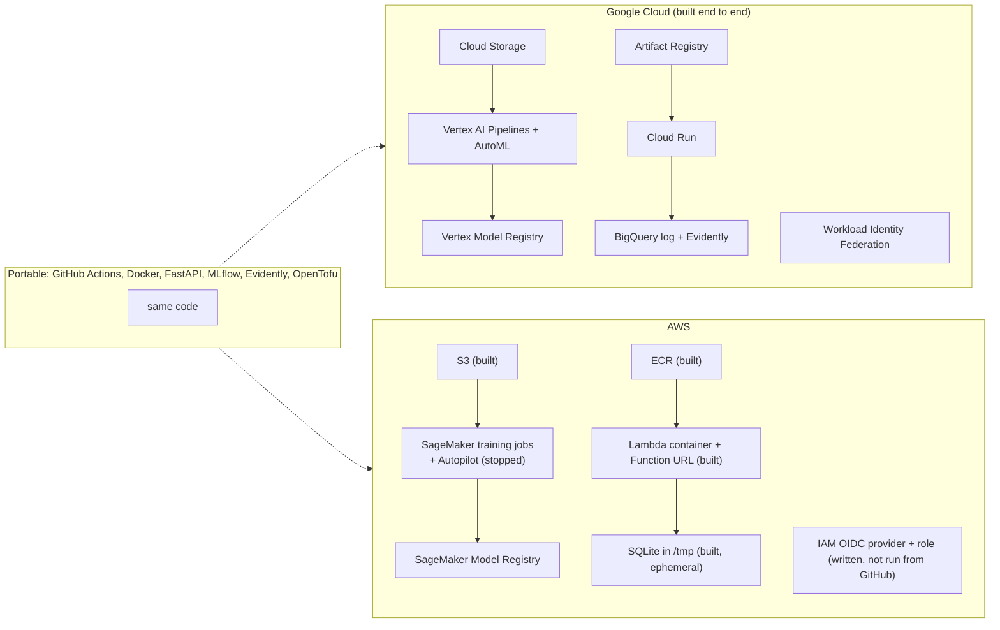

# Cloud comparison: AWS versus Google Cloud

Purpose: compare what it took to build and run the loan-default MLOps pipeline on Google Cloud (GCP) and AWS, for infrastructure, deployment, CI/CD, training performance and cost.

**How to read the tags**

- **[hands-on GCP]**: it happened in this project on GCP (training, AutoML, registry, serving, monitoring, CI/CD).
- **[hands-on AWS]**: it happened in the AWS test of 2026-11-11 in `us-east-1`, recorded in [The same API on AWS](aws-pipeline.md). The serving part was a roughly 30-minute session; training results are marked where they come from other pages.
- **[researched AWS]**: read in official AWS documentation, not tried. **[not verified]**: could not be confirmed from an official source.

Costs here are estimates from list prices, not invoices. The AWS test was one person, one region, one-off measurements, so numbers are samples, not benchmarks.

## The same pipeline on both clouds

## Comparison

| Topic | Google Cloud | AWS |
| --- | --- | --- |
| Setup | OpenTofu; enable one API per service; budget and IAM race errors needed a re-apply [hands-on GCP] | OpenTofu; no APIs to enable, no propagation errors; two-step apply because a function needs an image first [hands-on AWS] |
| Learning curve | Hard parts were identity (service accounts, the Vertex service agent), the pipeline container, and reading AutoML output [hands-on GCP] | About 9 concepts to serve the API; IAM and SigV4 heaviest [hands-on AWS]. ML-platform curve not measured here |
| Time to implement | Serving setup not timed; run times recorded: pipeline about 6 min per run, AutoML about 2 h 15 min [hands-on GCP] | About 20 min for serving plus IaC, built after the GCP version existed [hands-on AWS] |
| Serving (serverless containers) | Cloud Run runs the Dockerfile as is; scales to zero [hands-on GCP] | Lambda container plus the Lambda Web Adapter, a writable-path change and a 10 s init limit [hands-on AWS]. App Runner is closed to new customers; ECS Express Mode is recommended, not tried [researched AWS] |
| Cold start | 34 s on the first call after idle [hands-on GCP]. A figure of about 30 s was reported elsewhere [not verified] | 33 s first request; 53 s for a new version; 9 s after 10 min idle; warm 0.37 s median from a laptop [hands-on AWS] |
| Canary and rollback | Revision tag, 10 % then 100 %; reads Cloud Monitoring (candidate 45 requests, 0 % 5xx, p95 153 ms vs previous 41, 0 %, 308 ms); rollback fired for real [hands-on GCP] | Weighted alias canary 10 % then 100 %, rollback and roll forward by hand; the workflow rolls back only on a failed smoke test, not on an alarm [hands-on AWS] |
| CI login without keys | Workload Identity Federation with an `attribute_condition`; a wrong claim name failed only at first login [hands-on GCP]; workflows ran on GitHub [hands-on GCP] | IAM OIDC provider (one per account) and a role with `aud` and `sub` conditions; policy-simulated, never assumed from GitHub; workflow only linted [hands-on AWS] |
| Access control | Least-privilege service accounts per workflow; private service needs an ID token [hands-on GCP] | Private Function URL gives a bare 403; SigV4 signing is heavier than an ID token; the test used an administrator role in a shared account, so safety was self-imposed [hands-on AWS] |
| Cost of serving | Scales to zero; cost not measured [hands-on GCP] | Under $0.05 for the whole test, calculated; idle cost is ECR and S3 storage only [hands-on AWS] |
| Training (custom) | Vertex Pipelines: 3 models in about 6 min, under $0.25 for all attempts, about $0.03 per run (estimates); each step waits for a VM [hands-on GCP] | SageMaker: 3 parallel jobs on `ml.m5.large`, 93 s each, 70 s of it start-up and download, fit 0.2 to 1.7 s; about $0.005 computed ($0.115/h, 54 billable s per job). Same PR-AUC as GCP (0.129, 0.091, 0.102) [hands-on AWS] |
| AutoML | Vertex AutoML: 1 node-hour minimum, about $21; 2 h 15 min; refused rows with empty numeric cells [hands-on GCP] | Autopilot: started and stopped after 2 min by us. It launched 10 parallel `ml.r5.16xlarge` jobs ($4.838/h each; worst case about $20 for a 1,500 s cap), about $1.50 spent. Optimises AUC or F1 (no PR-AUC) and takes no predefined split. Not scored on TEST [hands-on AWS] |
| Model registry and experiments | Versions and movable aliases (`challenger`, `champion`); Vertex Experiments [hands-on GCP] | Model groups, versions, approval status; managed MLflow [researched AWS] |
| Monitoring and drift | Evidently in our API reading a BigQuery log, called daily by a workflow [hands-on GCP] | Not built; log was ephemeral SQLite [hands-on AWS]. Model Monitor is closed to new customers; AWS suggests Evidently, MLflow and CloudWatch [researched AWS] |
| Portability and lock-in | Tied: Vertex pipeline and registry code, `google_*` resources, BigQuery log [hands-on GCP] | FastAPI app, Docker image and the `PredictionsStore` switch ran unchanged on Lambda (one env var, a new Dockerfile) [hands-on AWS]; BigQuery log and drift check did not carry over [hands-on AWS] |

## What surprised us

- **GCP setup races.** The budget failed with `SERVICE_DISABLED` right after its API was enabled and needed a re-apply; local credentials carried another project's quota project (`User project specified in the request is invalid`), and the federated CI identity could not bill a quota project [hands-on GCP].
- **AWS apply order.** A Lambda function cannot be created before its image exists, so the apply is two-step; recent Docker pushes an index that Lambda rejects without `--provenance=false` [hands-on AWS].
- **Cold starts on both clouds** were tens of seconds with a large scientific-Python image; images differ in size (the AWS image was 1.49 GB) and these are single samples [hands-on GCP] [hands-on AWS].
- **SigV4 versus an ID token.** Calling the private AWS endpoint needed three curl options plus the session token; on GCP a bearer ID token was enough [hands-on AWS] [hands-on GCP].
- **The administrator role.** The AWS test ran as an administrator in a shared account, so nothing could block a mistake; the guard rails (name prefix, tags, no public access) were our own [hands-on AWS].

## Cost

Estimates from list prices; AWS Cost Explorer showed 0 USD because it lags about a day. Prices read on 2026-11-11, USD.

| Item | Price | Source |
| --- | --- | --- |
| GCP AutoML tabular training | $21.252 per node-hour (seen in a search result quoting Google's pricing; page not opened) | Vertex AI pricing |
| AWS Fargate Linux x86, N. Virginia | $0.0404784 per vCPU-hour, $0.004446 per GB-hour [researched AWS] | AWS Fargate pricing |
| AWS ECR private storage | $0.10 per GB-month (region not shown) [researched AWS] | AWS ECR pricing |
| AWS S3 Standard, first 50 TB, Oregon | $0.023 per GB-month [researched AWS] | AWS price data file |
| AWS Autopilot | No separate fee; you pay the underlying compute and storage [researched AWS] | AWS SageMaker pricing |

GCP Cloud Storage, Artifact Registry and Cloud Run prices were not verified. Project totals: GCP custom pipeline under $0.25, AutoML up to about $22 with batch prediction, AWS serving under $0.05 [hands-on GCP] [hands-on AWS].

## Which one for what

- **Student project:** use the cloud where you already have credits and an account. GCP worked end to end here; the serving part took about 20 minutes on AWS [hands-on GCP] [hands-on AWS].
- **Small startup:** keep model code and the container portable, and pick the cloud the team knows. Both serverless options idle at almost no cost [hands-on GCP] [hands-on AWS].
- **Regulated enterprise:** audit and compliance were not exercised on either cloud, so no recommendation is claimed. Documentation lists CloudTrail and AWS Artifact [researched AWS].

Still to try: run the AWS workflow on GitHub so the role is really assumed; add CodeDeploy with a CloudWatch alarm; a smaller image or provisioned concurrency for cold starts; read a real bill on each cloud.

## Sources

Accessed 2026-11-11. AWS: https://aws.amazon.com/fargate/pricing/ , https://aws.amazon.com/ecr/pricing/ , https://aws.amazon.com/sagemaker/ai/pricing/ , https://b0.p.awsstatic.com/pricing/2.0/meteredUnitMaps/s3/USD/current/s3.json , https://docs.aws.amazon.com/sagemaker/latest/dg/model-monitor.html , https://docs.aws.amazon.com/sagemaker/latest/dg/model-registry.html , https://docs.aws.amazon.com/apprunner/latest/dg/what-is-apprunner.html , https://docs.aws.amazon.com/AmazonECS/latest/developerguide/express-service-overview.html , https://docs.github.com/en/actions/how-tos/secure-your-work/security-harden-deployments/oidc-in-aws . Google: https://cloud.google.com/vertex-ai/pricing . Project pages: `docs/aws-pipeline.md`, `docs/gcp/*.md`.
