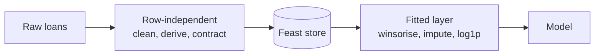

# Feature engineering (stage 5)

Turns the validated loans into model-ready columns. Everything is declared in `config/features/default.yaml` and checked by `FeatureSpec`; no column list or threshold is a Python literal.



The first layer gives the same values for a loan alone or inside a portfolio, and is what `make features` writes. The fitted layer (`src/features/engineering.py`) learns a p99 cap and a median, so it is refit on each training split and stays out of the store. Storing winsorised values would bake whole-book statistics into every future split.

## Column roles

| Role | Column | Why it is not a feature |
| --- | --- | --- |
| Entity key | `cliente_id` | Join key. Surrogate until the business exports the real ID. |
| Event timestamp | `fecha_prestamo` | It is the vintage. Feast needs it; a model must not read it. |
| Target | `Pago_atiempo` | The label. |
| Withheld | `puntaje` | Leakage: 87 % share the maximum value and none defaulted. |
| Withheld | `mes_prestamo` | Censoring control derived from the timestamp. |

!!! note
    `fecha_prestamo` once reached the model and was coerced to a number that correlated 1.0000 with the loan date. The highest correlation between any engineered column and the loan date is now 0.12.

## The fitted layer

Order: winsorise, then impute, then log1p. Imputing before the log keeps the filled value on the same scale as its median. Only columns with a real tail are touched.

| Column | skew before | skew after |
| --- | ---: | ---: |
| `dti` | 97.5 | 0.52 |
| `pti` | 96.7 | 1.85 |
| `monto_sobre_ingreso` | 95.3 | 0.87 |
| `saldo_mora` | 40.6 | 0.00 |
| `total_otros_prestamos` | 38.5 | -3.77 |
| `saldo_total` | 20.2 | -2.47 |
| `ratio_ingreso_declarado_bureau` | 19.6 | 2.66 |
| `salario_cliente` | 19.5 | 0.42 |

Imputation is safe because the `falta_<column>` flags keep the fact of absence. Encoding needs no fitted state: `clean()` freezes the category sets, so the feature space cannot drift between training and serving. Scaling is left to the model's own pipeline. In total 35 contract columns become 46 engineered ones, with no nulls.

## Running it

```bash
make features   # -> data/processed/features.parquet (10 763 loans x 37 columns)
uv run python -m src.pipelines.features features.engineering.winsor_quantile=0.95
```

Limitation: one ID per row means no repeat borrowers, so borrower history (prior loans, prior defaults) waits for the real client identifier.
