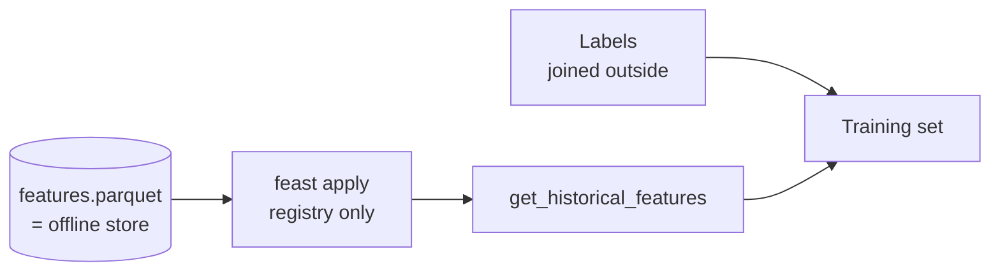

# Feature store (stage 6)

Feast registers the stage-5 table for offline retrieval only, so training can pull a point-in-time-correct set.

With a file offline store the parquet is the store: `feast apply` records metadata and copies no data. `feast materialize` is never run because `online_store: null` is set on purpose.

## Feature views

Views are grouped in `config/features/default.yaml`, and `ttl` is 0 (unlimited) so no old loan is dropped from a join. A test compares the views against the parquet's real columns, so a column cannot be silently omitted.

| View | Columns | Holds |
| --- | ---: | --- |
| `credito_solicitud` | 8 | what the applicant declares |
| `credito_bureau` | 11 | the DataCrédito block, pulled at origination |
| `credito_derivadas` | 8 | ratios, bands, contrast flags |
| `credito_faltantes` | 8 | the `falta_*` indicators |

Types are read from the parquet (`int64`, `double`, `bool`, `string`, timestamp) and mapped in `src/features/feast_types.py`, which raises on anything unknown. Categoricals are written as strings. Event timestamps are localised to UTC, since Feast needs timezone-aware values.

## Pitfalls that are tested

| Pitfall | What happens | Guard |
| --- | --- | --- |
| Stale registry | A retyped column still retrieves, but the registry claims the old type. | `stale_fields()` runs first in `make feast-verify`. |
| Row order | Results are sorted by timestamp: 299 of 300 rows of a shuffled sample moved. | Join labels on `cliente_id`, never by position. |
| Dedup and drops | Identical `(id, timestamp)` pairs merge; rows earlier than the loan are dropped. | Result can be shorter than the `entity_df`; join on the key. |

## Point-in-time correctness

`make feast-verify` asks for the same 200 loans at three moments:

| Query time | Rows | With features |
| --- | ---: | ---: |
| 1 day before disbursement | 0 | 0 |
| At disbursement | 200 | 200 |
| 30 days after | 200 | 200 |

A test also checks all 10 763 retrieved rows: `fecha_prestamo <= event_timestamp` for every one, inclusive at the boundary. `Pago_atiempo` never enters the store, so it cannot come back out.

Limitation: the entity is a loan, not a borrower, until the real client identifier arrives.
