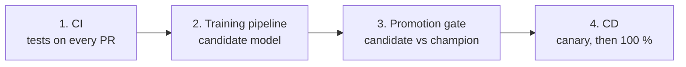
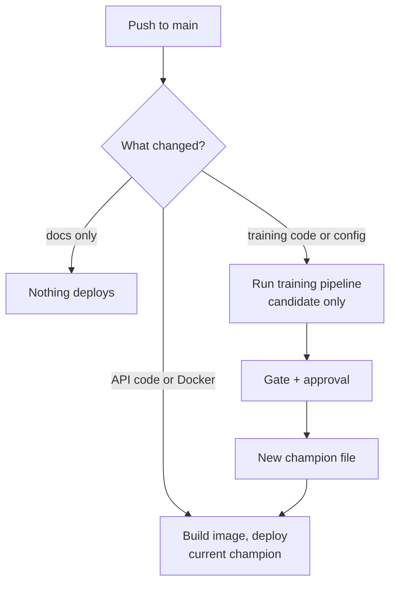
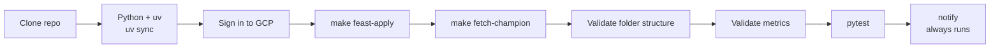
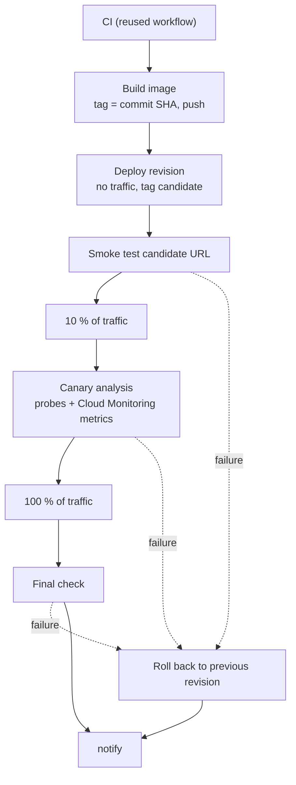

# CI/CD

The pipeline uses **GitHub Actions** with Google Cloud. Four steps, in order:

| Step | Trigger | What it does |
| --- | --- | --- |
| 1. CI | Pull request, push to `main` | Installs dependencies, runs the tests, checks folder structure and metric thresholds |
| 2. Training | Training config change, schedule, or drift | Runs the Vertex pipeline; writes a candidate model and its metrics to Cloud Storage |
| 3. Gate | After training | Compares the candidate with the champion on loans neither has seen; asks a human to approve |
| 4. CD | Code change, or a new champion | Builds the image, deploys it as a canary, promotes or rolls back |

## Code changes and model changes are different

A new model never ships because someone pushed code. It ships only after the gate and an
approval. This is done with path filters in the workflow files.

## Why no key file

The workflow signs in with Workload Identity Federation, described in
[Foundations](foundations.md). Nothing secret is stored in GitHub.

## Canary and rollback

Cloud Run keeps every deployment as a numbered revision.

1. Deploy the new revision with no traffic.
2. Send 10 % of requests to it, keep both revisions busy with probe requests for a few minutes and judge the new one
   from its Cloud Monitoring metrics (see [Canary analysis](#canary-analysis)).
3. If it passes, move to 100 %. If not, send traffic back to the previous revision, which takes seconds.

## The CI workflow

File: `.github/workflows/ci.yaml`. It runs on every pull request, on every push to `main`, and
when another workflow calls it (`workflow_call`, used by the deploy workflow).

| Step | What it does and why |
| --- | --- |
| Clone the repository | `actions/checkout`: the runner starts empty, so the first step fetches the code |
| Python, uv, `uv sync --group gcp` | Installs the exact dependencies from `uv.lock`, including the GCP group some tests import |
| Sign in to GCP | Workload Identity Federation; no key file. Needed so the tests that read the real loans can run |
| `make feast-apply` | Rebuilds the features and the feature store from the raw loans in the bucket |
| `make fetch-champion` | Downloads the champion model and its metadata into `models/` |
| Validate folder structure | `tests/test_repo_structure.py` checks every path listed in `config/ci/repo_structure.yaml` exists |
| Validate metrics | `make check-metrics` reads `models/champion.meta.json` and fails if PR-AUC or Gini are below `config/ci/metric_thresholds.yaml`, or if the file is malformed |
| pytest | The full test suite |
| notify | See below |

**Forks.** A pull request from a fork gets no identity token, so signing in would fail the whole
run. The job computes `CLOUD` (false for forks and Dependabot) and skips every cloud step
for them: the structure check and the tests that need no cloud still run. The metrics check needs the
champion, so it is skipped there too.

**Changing the rules.** To require a new folder, add a line to `repo_structure.yaml`. To tighten
the metric floor, edit `metric_thresholds.yaml`. No code changes.

### The notification

The `notify` job `needs` the test job and has `if: always()`, so it runs whether tests passed or
failed. It does two things:

1. Writes a short result to the run's **job summary** (the page you see in GitHub Actions).
2. Posts the result as a **commit comment** with `gh api`. GitHub emails the commit author when
   someone comments on their commit, so this is the email notification, with no mail server.

When deploy calls CI, CI's notify is skipped (`github.workflow == 'CI'` is false inside a called
workflow) so one run sends one message.

## The CD workflow

File: `.github/workflows/deploy.yaml`. It runs on a push to `main` that touches serving code or
configuration (path filters), by hand (`workflow_dispatch`), or when another workflow calls it
(`workflow_call`), for example the training workflow after a model promotion. A change to `docs/**`
or `README.md` matches no filter, so nothing deploys.

Plain-language notes:

- **Image tag = commit SHA.** Every image traces to the commit that built it, and a tag is never reused.
- **`--no-traffic --tag candidate`.** Cloud Run creates the revision but sends it no users. The tag gives it
  its own URL (`candidate---scoring-api-...`) to test in isolation.
- **ID token.** The service is private. The workflow asks Google for a short-lived token proving it
  is `github-ci`, with the service URL as audience, and sends it as `Authorization: Bearer`.
- **Smoke test.** `scripts/smoke_test.sh` calls `GET /health` (must say `ok` with the model loaded)
  and `POST /predict/batch` with the sample loan in `config/ci/smoke_request.json`.
- **Canary.** 10 % of requests go to the new revision, then the canary analysis runs (below), then it takes 100 %.
### Canary analysis

`src/ci/canary.py` (limits in `config/ci/canary.yaml`) runs while the candidate has 10 % of the traffic. It sends 40 probe
requests to the candidate and 40 to the previous revision (both are reachable through tagged URLs) over 2.5 minutes, waits two
minutes for Cloud Monitoring, and reads each revision's request count, share of 5xx responses and 95th percentile latency.
It fails, and so rolls back, when the candidate has fewer than 20 requests in the metrics, more than 2 % server errors, a p95
above 6 s or above twice the previous revision's, or when any probe fails. The workflow's `canary_p95_limit_ms` input
lowers the latency cap, so a manual run with the value 1 forces a failure and shows the rollback.

- **Rollback.** A final step runs only `if: failure()`: it sends 100 % of traffic back to the revision
  that served before the deploy. The run still ends red. Previous and new revision names are in the job summary.
- **`concurrency`.** Two deploys never run at once.

## Mapping to the assignment's Jenkinsfile

| Assignment requirement | GitHub Actions equivalent |
| --- | --- |
| Install Jenkins | Not needed; GitHub hosts the runners |
| `Jenkinsfile` | `.github/workflows/ci.yaml` and `deploy.yaml` |
| First step: clone the repo | `actions/checkout` |
| Tests, folder structure, metrics | `tests/test_repo_structure.py`, `make check-metrics`, `pytest` |
| Automatic trigger on merge | `on: push` to `main` |
| Notification at the end | `notify` job (`if: always()`): job summary and commit comment (email) |

## Status

| Piece | Status |
| --- | --- |
| CI: tests, folder-structure check, metric check | Built |
| Notification (job summary and commit comment) | Built |
| Workload Identity Federation and the CI identity's permissions | Built |
| CD: image build, canary deploy, canary analysis | Built and run on GitHub many times. The rollback has fired for real three times: a smoke test that timed out on a cold revision, the first canary analysis (a tagging bug of ours made the candidate unreachable) and a deliberate failure with a 1 ms latency cap. A normal run passes and moves 100 % of traffic |
| Training workflow, promotion gate and approval | Built and run; the approval pause was reached, see [Training workflow](training-workflow.md) |
| Scheduled drift check | Built and run; drift detected and a Train run started |
