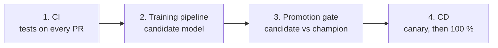
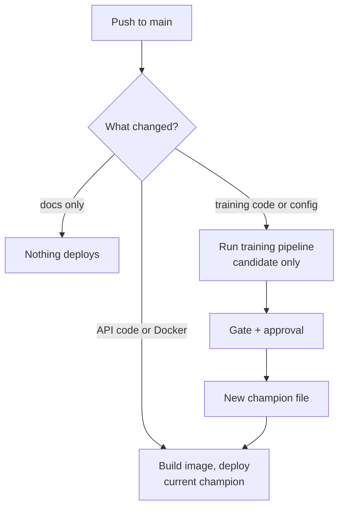

# CI/CD

The pipeline uses **GitHub Actions** with Google Cloud. Four steps, in order:

| Step | Trigger | What it does |
| --- | --- | --- |
| 1. CI | Pull request, push to `main` | Installs dependencies, runs the tests, checks folder structure and metric thresholds |
| 2. Training | Training config change, schedule, or drift | Runs the Vertex pipeline; writes a candidate model and its metrics to Cloud Storage |
| 3. Gate | After training | Compares the candidate with the champion on loans neither has seen; asks a human to approve |
| 4. CD | Code change, or a new champion | Builds the image, deploys it as a canary, promotes or rolls back |

## Code changes and model changes are different

A new model never ships because someone pushed code. It ships only after the gate and an
approval. This is done with path filters in the workflow files.

## Why no key file

The workflow signs in with Workload Identity Federation, described in
[Foundations](foundations.md). Nothing secret is stored in GitHub.

## Canary and rollback

Cloud Run keeps every deployment as a numbered revision.

1. Deploy the new revision with no traffic.
2. Send 10 % of requests to it and check health and errors.
3. If healthy, move to 100 %. If not, send traffic back to the previous revision, which takes
   seconds.

## Mapping to the assignment's Jenkinsfile

| Assignment requirement | GitHub Actions equivalent |
| --- | --- |
| Install Jenkins | Not needed; GitHub hosts the runners |
| `Jenkinsfile` | `.github/workflows/*.yaml` |
| First step: clone the repo | `actions/checkout` |
| Tests, folder structure, metrics | Test job, a structure test and a metrics threshold check |
| Automatic trigger on merge | `on: push` to `main` |
| Notification at the end | A final step that always runs |

## Status

| Piece | Status |
| --- | --- |
| Tests on push and PR | Built (pytest only) |
| Folder-structure and metric checks | Planned |
| Workload Identity Federation and the CI identity's permissions | Built |
| Image build, push and Cloud Run deploy | Planned |
| Promotion gate and approval | Planned |
| Scheduled drift check | Planned |
