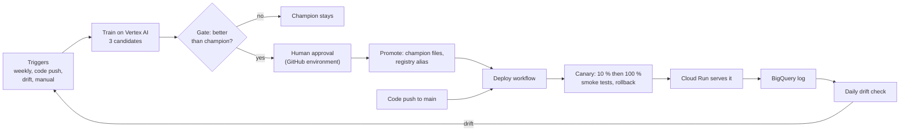
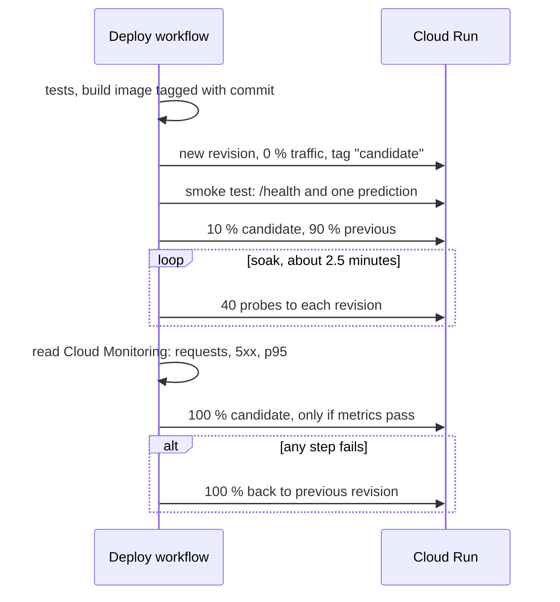

# Model lifecycle and CI/CD

This page follows one model from "someone pushes code" to "customers get scores from it" and says what decides each step. The editable diagram is [`deployment-flow.drawio`](deployment-flow.drawio) ([open it in draw.io](https://app.diagrams.net/?url=https%3A%2F%2Fraw.githubusercontent.com%2Frosvend%2FMLOps%2Fmain%2Fdocs%2Fgcp%2Fdeployment-flow.drawio)).

## 1. From trigger to promotion

Four GitHub Actions workflows do the work. They sign in with Workload Identity Federation, so no key is stored (see [overview](overview.md)).

| Workflow file | Trigger | What it does |
| --- | --- | --- |
| `ci.yaml` | Pull request, push to `main`, or called by deploy | Installs dependencies, checks folder structure, checks the champion's PR-AUC and Gini floors (`config/ci/metric_thresholds.yaml`), runs pytest, then `notify` posts a job summary and a commit comment (the email). Cloud steps are skipped for forks |
| `train.yaml` | Mondays 06:00 UTC; push touching training code, features, training config or the training image; drift; by hand (with a reason and optional `force_promote`) | Builds the training image tagged with the commit SHA, runs the Vertex pipeline as `vertex-pipeline`, runs the gate, waits for approval, promotes and starts deploy. One run at a time |
| `deploy.yaml` | Push to `main` touching serving code or config; by hand; called after a promotion | Runs CI, builds the image tagged with the commit, deploys a canary, rolls back on failure. One deploy at a time. A docs-only change deploys nothing |
| `drift-check.yaml` | Daily 07:00 UTC; on demand | Calls the API's drift endpoint with an ID token and starts a Train run if drift is found |

A code push deploys automatically after tests and smoke tests. A new model never ships because of a code push: it needs the gate and an approval.

The gate (`python -m src.gcp.gate`) scores the same rows with the candidate and the champion. It promotes only if every rule holds, and "keep" is a normal answer. All numbers are in `config/gcp_gate/default.yaml`.

| Check | Rule |
| --- | --- |
| Improvement | PR-AUC at least 0.005 higher |
| Not noise | The 95 % paired-bootstrap interval of the PR-AUC difference (1,000 redraws, fixed seed) has its lower end above 0 |
| Same contract | Same feature list, a threshold present, no missing scores |
| Sane flagging | The share flagged at the frozen threshold is between 0.5 and 2.0 times the share at fit |

If the gate says promote, the `promote` job pauses at the `production` GitHub environment until the reviewer approves. Self-review is allowed because one person works on the project. After approval the candidate's `champion.joblib`, `champion.meta.json` and `reference_data.parquet` overwrite `gs://mlops-roysandoval-data/models/champion/` (bucket versioning keeps the old files), a new version is registered and the `champion` alias moves to it ([training](training.md)), and the deploy workflow starts.

What has run for real:

| Piece | Status |
| --- | --- |
| `train.yaml` end to end (2026-11-11) | Ran in about 10 minutes. The gate answered `keep` (PR-AUC 0.1293 for both models). The first push-triggered run failed on a quota project the federated identity cannot bill, and was fixed |
| Approval and promotion (`force_promote` run) | Ran. The job paused until approved (the approval comment records that the assistant approved it at the reviewer's explicit request), copied the files, registered version 2 and moved the alias |
| Redeploy after that promotion | Completed once the GitHub incident cleared. The first retry failed on a cold-start timeout and rolled back; the second passed and served the promoted champion |
| `drift-check.yaml` | Ran. Drift was detected (the test traffic was one repeated loan) and a Train run started |
| A real `promote` decision | Never seen. Every candidate equals the champion, so the interval is [0, 0] |

## 2. Canary deployment

A new model is not special: the champion file is baked into a new container image and rolled out like code. The service is private, so the workflow sends a short-lived ID token proving it is `github-ci`.

Cloud Run keeps every revision, so a rollback moves a traffic percentage and takes seconds. The analysis (`src/ci/canary.py`, limits in `config/ci/canary.yaml`) waits two minutes for Cloud Monitoring, then rolls back if the candidate has fewer than 20 requests in the metrics, more than 2 % server errors, a p95 above 6 s or above twice the previous revision's, or if any probe fails. A smoke test that timed out on a cold revision also rolled back on its own on 2026-11-11.

The three canary runs of 2026-11-12:

| Run | Result |
| --- | --- |
| First | Failed. A tagging command of ours removed the `candidate` tag, the probes could not reach the revision, and the analysis rolled back with "only 4 requests in the metrics" |
| Normal pass, after the fix | Candidate: 45 requests, 0 % 5xx, p95 153 ms. Previous: 41 requests, p95 308 ms. The candidate took 100 % |
| Forced failure | The `canary_p95_limit_ms` input set to 1 ms failed on purpose ("p95 203 ms is above the cap of 1 ms") and traffic went back to the previous revision |

## 3. Prediction log and monitoring

Every `/predict/batch` call records what it scored in BigQuery, table `mlops-roysandoval.mlops_monitoring.predictions` (columns `scored_at` TIMESTAMP and `payload` JSON). Locally it stays SQLite. Cloud Run sets `PREDICTIONS_LOG_TYPE=bigquery`, which overrides `config/monitoring/default.yaml` without a code change.

| Option | Verdict |
| --- | --- |
| SQLite on Cloud Run | Fails: the container user cannot create `/app/data`, and the disk is ephemeral and private to each instance |
| Cloud SQL | Works, but is a server billed by the hour with networking and a password, for an append-only log |
| BigQuery | Serverless, shared by all instances, no secret needed (the runtime account is enough) |

`infra/monitoring.tf` grants the runtime account `bigquery.dataEditor` on that dataset only and `bigquery.jobUser` on the project. Cost is an estimate: a few thousand small rows per month sits far inside the free tier. The load test found a real bug here: an application that omitted an optional field was logged with a `NaN`, BigQuery's JSON type rejected the insert and the API returned a 500 ([API testing](api-testing.md)). The fix writes `null` and a logging failure can no longer fail a prediction.

Evidently runs inside the API container at `POST /monitoring/run-drift-check`. It compares logged requests with the training reference baked into the image. With fewer than 30 logged requests it answers 409, which the workflow treats as nothing to do.

Why not Vertex Model Monitoring? Evidently came first and was never swapped out. Vertex Model Monitoring is built around models on Vertex endpoints. I could not confirm from the documentation whether it supports a model served on Cloud Run, and I never tried it, so this choice was made without testing the alternative. One gap remains: on Cloud Run the HTML dashboard cannot be saved (the container cannot write to disk), so none is kept. Saving it to Cloud Storage would fix that.

## 4. AWS comparison and limits

| | AWS SageMaker reference | This project |
| --- | --- | --- |
| Source and CI | GitHub through CodeStar | GitHub Actions only |
| Pipeline | SageMaker Pipeline: preprocess, train, evaluate, register | Vertex AI Pipeline: load, train 3 candidates, compare, export. The gate is a separate GitHub job |
| Model approval | Lead data scientist approves in the registry; EventBridge and Lambda trigger the deploy | Reviewer approves in a GitHub environment; the promote job moves the alias and starts deploy |
| Environments | Staging endpoint, tests, manual approval, production | No staging: a canary revision of the same service, then 10 % and 100 % |
| Hosting and deploy tool | SageMaker endpoints, CloudFormation | Cloud Run, `gcloud run deploy`, OpenTofu |
| Secrets and events | Secrets Manager holds a GitHub token; EventBridge and Lambda connect steps | No stored secrets; workflows call each other with `gh workflow run` |

The AWS side of this comparison is built in [AWS pipeline](../aws-pipeline.md); see the [cloud comparison](../cloud-comparison.md).

Limits to keep in mind:

* The training data is one static CSV and nothing appends new loans, so weekly retraining reproduces the same model and the gate says "keep". A useful schedule needs a process that adds newly matured loans.
* The gate scores the TEST months, which were already used to choose between models. The comparison favours the model chosen on them, so a `promote` is weaker evidence than it looks. Point `evaluation_uri` at newer labelled loans when they exist.
* The canary judges mostly probe traffic, because real traffic is thin. It checks errors and speed, not prediction quality, and lasts about five minutes.
