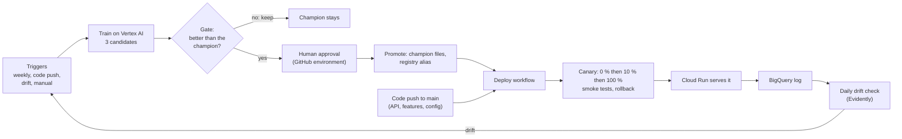
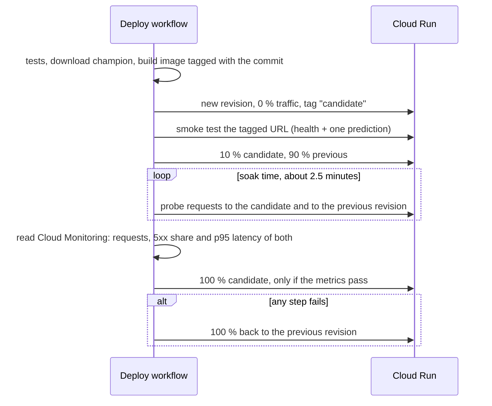

# Model lifecycle: retraining, promotion and canary deployment

This page follows one model from "someone pushes code" to "customers get scores from it", and explains who or what
decides each step. The editable diagram is [`deployment-flow.drawio`](deployment-flow.drawio)
([open it in draw.io](https://app.diagrams.net/?url=https%3A%2F%2Fraw.githubusercontent.com%2Frosvend%2FMLOps%2Fmain%2Fdocs%2Fgcp%2Fdeployment-flow.drawio)).

## How often is the model retrained?

Retraining is started by one of four triggers (`.github/workflows/train.yaml`). Only one training runs at a time.

| Trigger | When |
| --- | --- |
| Schedule | Every Monday at 06:00 UTC |
| Code or config change | A push to `main` that touches training code, features, training config or the training image (`src/gcp`, `src/models`, `src/features`, `config/training`, `config/features`, `config/gcp_pipeline`, `docker/Dockerfile.train`) |
| Drift | The daily drift check (07:00 UTC) finds drift and starts a run |
| By hand | *Run workflow* in GitHub Actions, with a reason and an optional `force_promote` |

**An honest caveat.** The training data is one fixed CSV in Cloud Storage; nothing feeds new loans into it. So a scheduled
retraining today reproduces the same model, and the gate answers "keep". The mechanism is real and has been run, but a
useful weekly retraining needs a process that appends newly matured loans to the data. That does not exist yet.

## From candidate to production

1. **Train.** The workflow builds the training image on the runner, submits the Vertex AI pipeline (running as the
   dedicated `vertex-pipeline` account) and waits. The pipeline trains logistic regression, XGBoost and LightGBM in
   parallel on the training months and picks the best by PR-AUC. Each candidate's model, metadata and drift reference are
   written under `gs://mlops-roysandoval-data/pipeline-runs/<run>/models/<name>/`.
2. **Gate.** The candidate and the current champion score the same loans, and the gate promotes only if all of this holds:

    | Check | Rule |
    | --- | --- |
    | Improvement | PR-AUC at least 0.005 higher |
    | Not noise | The 95 % paired-bootstrap interval of the PR-AUC difference has its lower end above 0 |
    | Same contract | Same feature list, a threshold present, no missing scores |
    | Sane flagging | The share flagged at the frozen threshold is between 0.5 and 2.0 times the share at fit |

    The evaluation rows are the TEST months, which have been used before for model selection, so the comparison favours
    whichever model was chosen on them. Replace `evaluation_uri` with newer labelled loans once they exist.
3. **Approval.** If the gate says promote, the `promote` job pauses at the `production` GitHub environment until the
   reviewer approves. A human decides; the gate only proposes.
4. **Promote.** After approval the candidate's files overwrite `gs://mlops-roysandoval-data/models/champion/` (the bucket
   keeps old versions, so the previous champion can be restored), a new version is registered in the Vertex AI Model
   Registry, the `champion` alias moves to it, and the Deploy workflow is started.

## How the canary deployment works

The Deploy workflow (`deploy.yaml`) runs when the API code changes or after a promotion. The "model replacement" is nothing
special: the new champion file is baked into a new container image, and the rollout is the same as for code.

Cloud Run keeps every revision, so a rollback is moving the traffic percentage and takes seconds. It has been used for real:
on 2026-11-11 a smoke test timed out on a cold revision, the workflow restored the previous revision on its own and
failed the run.

**What the canary checks.** At 10 % the workflow sends 40 probe requests to each revision over 2.5 minutes, waits two minutes
for Cloud Monitoring to catch up, and reads each revision's request count, 5xx share and 95th percentile latency. The
candidate is rolled back if it has fewer than 20 requests in the metrics, more than 2 % server errors, a p95 above 6 s or
above twice the previous revision's p95, or if any probe fails. The limits are in `config/ci/canary.yaml`.

**What the three real runs showed** (2026-11-12). The first run failed: a tagging command of ours removed the `candidate` tag, the probes
could not reach the new revision, and the analysis rolled back with "only 4 requests in the metrics". After the fix, a normal run
passed: the candidate had 45 requests, 0 % server errors and a p95 of 153 ms, against 41 requests and 308 ms for the previous
revision, and took 100 % of the traffic. A third run with the latency cap forced to 1 ms failed on purpose ("p95 203 ms is above
the cap of 1 ms") and traffic went back to the previous revision. The `canary_p95_limit_ms` input of the Deploy workflow is how
to repeat that test.

**What it still is not.** Most of the traffic it judges is probe traffic, because real traffic is thin. It looks at errors
and speed, not at the quality of the predictions, and the whole check lasts about five minutes. A canary on a busy service
would hold longer and could also compare the score distribution of the two revisions.

Code changes and model changes use different gates: a code push deploys automatically after tests and smoke tests, with no
human approval; a new model needs the gate and an approval.

## Monitoring: where Evidently runs and why not Vertex Model Monitoring

**Where.** Evidently runs *inside the API container on Cloud Run*, at `POST /monitoring/run-drift-check`. It compares the
requests logged in BigQuery with the training reference (`reference_data.parquet`, baked into the image) and returns a
JSON summary: whether the dataset drifted, which features, and the share flagged. A GitHub workflow calls that endpoint
once a day with an ID token. With fewer than 30 logged requests it answers 409, and the workflow treats that as "nothing
to do". `make monitor` runs the same code offline.

**Why Evidently and not Vertex Model Monitoring.** The honest answer is that Evidently came first and was never swapped out:
it was already working, runs identically on a laptop and in the cloud, and reads our own BigQuery log. Vertex Model
Monitoring is built around models deployed to Vertex endpoints, with BigQuery as a data source. Its documentation
describes monitoring on a schedule with default thresholds of 0.3 and a sampling rate. I could not confirm from the
documentation whether it supports a model served on Cloud Run, and I never tried it, so this was a choice made without
testing the alternative. It would be a fair experiment for a later iteration.

**A gap found while writing this.** On Cloud Run the drift check returns its result correctly, but the HTML dashboard it
tries to save afterwards fails (the container cannot write to disk), so no dashboard is kept. Saving it to Cloud Storage
would fix that.

## How this differs from the AWS SageMaker reference design

| | AWS reference | This project |
| --- | --- | --- |
| Source and CI | GitHub, connected through CodeStar | GitHub Actions only |
| Pipeline | SageMaker Pipeline: preprocess, train, evaluate, register | Vertex AI Pipeline: load, train 3 candidates, compare, export. The promotion gate is a separate GitHub job |
| Model approval | A lead data scientist approves in the registry; EventBridge and Lambda then trigger the deploy | A reviewer approves in a GitHub environment; the promote job moves the registry alias and starts the deploy |
| Environments | A staging endpoint, tests, a manual approval, then production | No staging environment: a canary revision of the same service, smoke-tested, then 10 % and 100 % |
| Deploy approval | A person approves the production deploy | Code deploys are automatic; only model promotion needs a person |
| Hosting | SageMaker endpoints | Cloud Run |
| Deploy tooling | CloudFormation | `gcloud run deploy` for the service, OpenTofu for the infrastructure |
| Secrets | Secrets Manager holds a GitHub token | None: Workload Identity Federation lets GitHub sign in without keys |
| Events | EventBridge and Lambda connect the steps | Workflows call each other (`gh workflow run`) |

## Testing the live API

- **Postman** (`tests/postman/scoring_api_cloud.postman_collection.json`): 10 requests and 26 assertions covering basic
  predictions, input validation (422 for bad input), the refusal of calls without a token, and the drift check. It passes
  against the live service. See `tests/postman/README.md` for the token and for running it with Newman.
- **Locust** (`loadtest/locustfile.py`): simulated users sending varied applications. 20 users for 60 seconds gave about 8
  requests per second, a median of 700 ms, p95 of 1.6 s and p99 of 2.8 s, with Cloud Run scaling out to both allowed
  instances. Sequential calls take about 300 ms, so under load the latency more than doubles.

What the tests found, which is the reason to run them:

1. **Cold start.** The first call after idle took 34 seconds. The service scales to zero. Keeping one instance warm would
   remove it at a standing cost.
2. **A production bug.** The first load test returned errors on 28 % of requests. An application that left out an optional
   field was logged with a `NaN`, BigQuery's JSON type rejected the whole insert, and the API turned that into a 500. The
   fix writes `null` instead, and a failure to log can no longer fail a prediction. The second run had no errors in 480
   requests. The fix reached production through the Deploy workflow.
3. **Logging adds latency.** Each prediction writes to BigQuery inside the request. I did not measure how much of the
   load-test latency that explains.
4. **Test traffic pollutes the log.** Synthetic requests are logged like real ones, so the next drift check sees them
   and reports drift.
