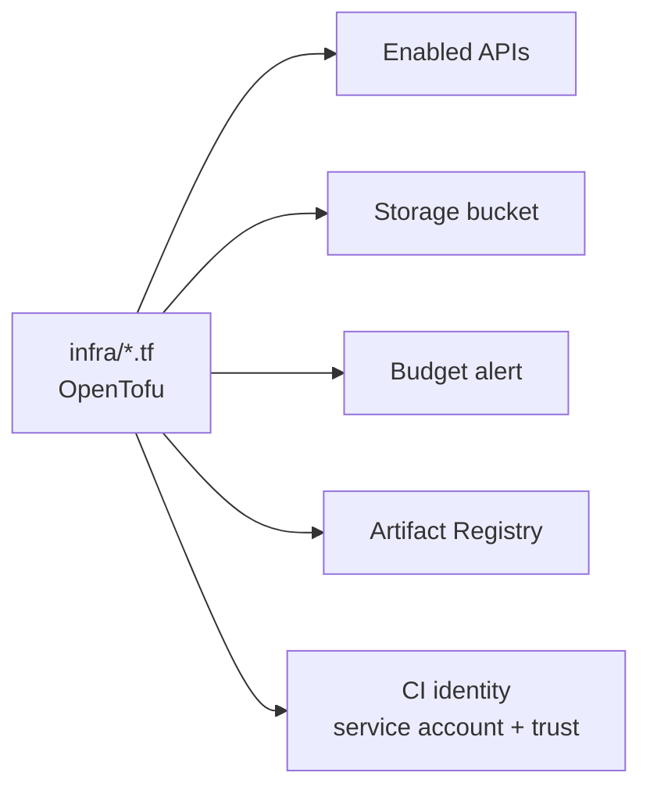
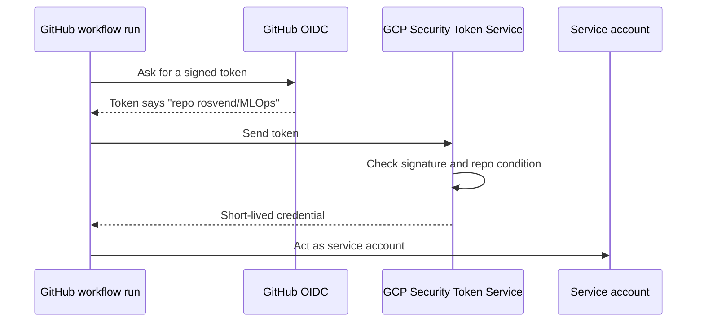

# Foundations

The cloud setup is written as code with **OpenTofu**, in `infra/`. Code can be reviewed, repeated
and torn down; clicks in a console cannot.



## What the code creates

| Resource | Purpose |
| --- | --- |
| `google_project_service` | Turns on the APIs the project uses (Vertex AI, Cloud Run, Cloud Build, Artifact Registry, Storage, IAM and others) |
| `google_storage_bucket` | The private bucket: no public access, uniform access control |
| `google_billing_budget` | An alert at 50 % and 90 % of a $100 budget. It warns; it does not stop spending |
| `google_artifact_registry_repository` | The Docker repository |
| Service account + workload identity pool | Lets GitHub Actions act in the project without a key file |

## The workflow

```bash
cd infra
tofu init     # download the Google provider
tofu plan     # show what would change; nothing happens yet
tofu apply    # make it so (type "yes")
```

Always read the plan. It lists what will be added, changed or destroyed before anything happens.

## Letting GitHub in without a key

A stored key is a secret that can leak. **Workload Identity Federation** replaces it with a
short-lived token exchange:



The security rests on one line in the provider: `attribute_condition = "assertion.repository
== 'rosvend/MLOps'"`. Without it, any GitHub repository could use the pool. The service account
starts with **no permissions** and gets only what the workflow needs, one role at a time.

## What the CI identity may do

The service account `github-ci` holds only these permissions:

| Role | Where | Why |
| --- | --- | --- |
| `artifactregistry.writer` | The Docker repository only | Push the serving image |
| `run.developer` | Project | Deploy revisions and shift traffic. Not admin, so it cannot change IAM policies |
| `iam.serviceAccountUser` | On `scoring-api` only | Deploy a service that runs as that account |
| `storage.objectViewer` | The data bucket | Read the raw loans and the champion model |
| `serviceusage.serviceUsageConsumer` | Project | Bill API calls to this project |

The API itself runs as a separate account, `scoring-api`, which starts with no permissions. If
the API is compromised, it can do only what that account was given.

**Design choice:** the serving image is built on the GitHub runner with Docker and pushed to the
registry. Building in Cloud Build would need extra roles for the build service account, a staging
bucket and log access. The runner build needs only the registry role. Cloud Build still builds the
training image for Vertex.

## Lessons from building it

- **Race on new APIs.** Creating the budget right after enabling its API can fail with
  `SERVICE_DISABLED`. The API reports "enabled" before every backend knows. Re-run `tofu apply`.
- **Wrong quota project.** Local credentials can carry another project's quota project, which
  makes bucket reads fail with `User project specified in the request is invalid`. The Makefile
  sets `GOOGLE_CLOUD_QUOTA_PROJECT=mlops-roysandoval` to bill this project.
- **Typos fail late.** A misspelled API name (`iamcredetials`) passes `plan` and fails on `apply`.
  A wrong claim name in the identity mapping (`assertion.hub` instead of `assertion.sub`) does
  not fail at all until the first login attempt.
- **Registry access.** Vertex's service agent needs `artifactregistry.reader` on the repository to
  pull the training image.
