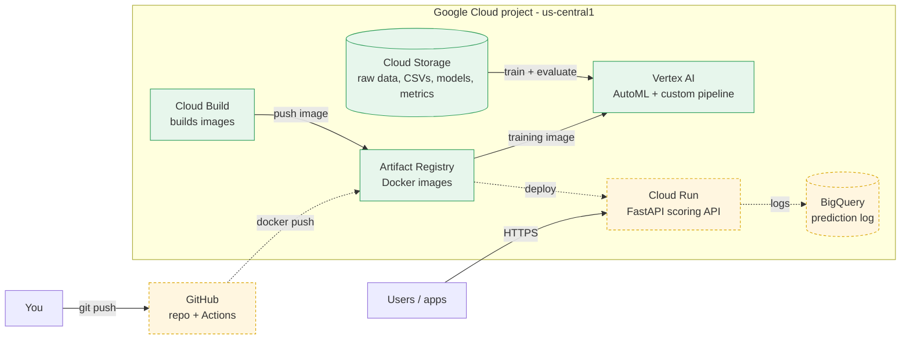
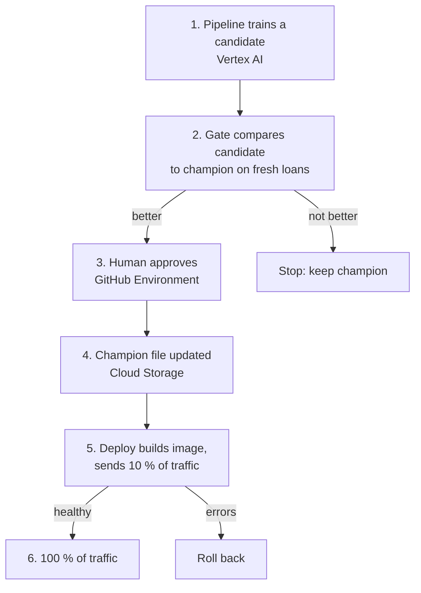

# Target architecture on Google Cloud

Everything lives in one GCP project, `mlops-roysandoval`, in `us-central1`. Keeping every
resource in one region avoids cross-region errors and transfer costs.

Solid arrows are built and working. Dashed arrows are planned (Phase 1: CI/CD and deploy).

## What each service does

| Service | Role here | Why this one |
| --- | --- | --- |
| Cloud Storage | Holds the raw loans, the time-split training file, model files and metrics | Cheap, durable, and every other service reads it |
| Vertex AI | Runs AutoML and the custom training pipeline | Managed training without owning machines |
| Cloud Build | Builds the training image that Vertex runs | No local Docker needed |
| Artifact Registry | Stores the training and serving images | One private place that Vertex and Cloud Run both pull from. The serving image is built on the GitHub runner and pushed here |
| Cloud Run | Serves the FastAPI scoring API | Runs the existing container as-is and scales to zero when idle |
| BigQuery | Keeps the prediction log for drift monitoring | Serverless and append-friendly; no database to run |

OpenTofu (`infra/`) creates the project setup: APIs, the bucket, the budget alert, the registry
and IAM. See [Foundations](foundations.md).

## How a model reaches production

The details are on the [CI/CD page](cicd.md).
