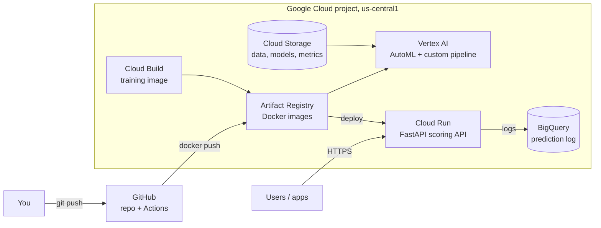
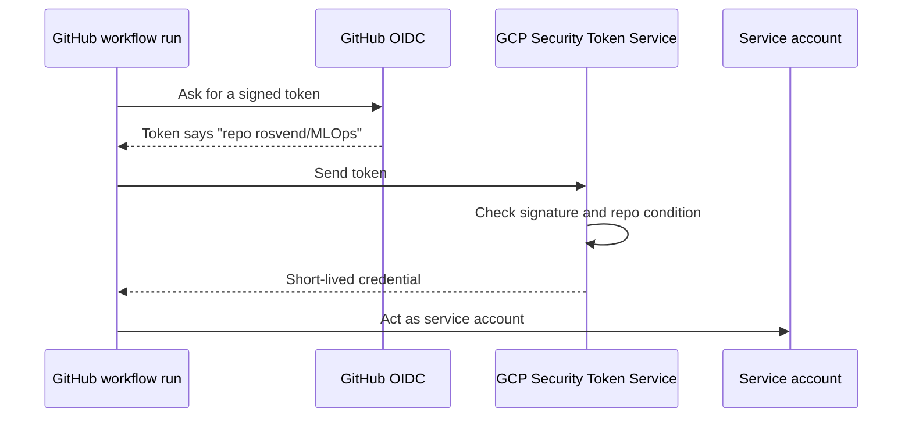

# Google Cloud architecture

One GCP project, `mlops-roysandoval`, one region, `us-central1`, holds the whole system. This page shows the services, how the project is created and why each choice was made.

Every component shown is built and has been run. GitHub Actions builds the serving image, pushes it to Artifact Registry and deploys it to Cloud Run as a canary. The API writes its prediction log to BigQuery. The full loop is on the [lifecycle page](deployment-flow.md).

## Services

| Service | Role here | Why this one |
| --- | --- | --- |
| Cloud Storage | Raw loans, the time-split training file, model files, metrics | Cheap, durable, and every other service reads it |
| Vertex AI | Runs AutoML and the custom training pipeline | Managed training without owning machines |
| Cloud Build | Builds the training image that Vertex runs | No local Docker needed |
| Artifact Registry | Stores the training and serving images | One private place that Vertex and Cloud Run both pull from |
| Cloud Run | Serves the FastAPI scoring API | Runs the existing container as it is and scales to zero when idle |
| BigQuery | Keeps the prediction log for drift monitoring | Serverless and append-friendly; no database to run |

## Setting up the project

The setup is written as code with OpenTofu in `infra/`. Code can be reviewed, repeated and torn down; clicks in a console cannot. The workflow is `tofu init`, `tofu plan` (read what will change) and `tofu apply`.

| Resource | Purpose |
| --- | --- |
| `google_project_service` | Turns on the APIs the project uses (Vertex AI, Cloud Run, Cloud Build, Artifact Registry, Storage, IAM and others) |
| `google_storage_bucket` | The private bucket: no public access, uniform access control |
| `google_billing_budget` | An alert at 50 % and 90 % of a $100 budget. It warns; it does not stop spending |
| `google_artifact_registry_repository` | The Docker repository |
| Service account and workload identity pool | Lets GitHub Actions act in the project without a key file |

A stored key is a secret that can leak. Workload Identity Federation replaces it with a short-lived token exchange.

The security rests on one line in the provider: `attribute_condition = "assertion.repository == 'rosvend/MLOps'"`. Without it, any GitHub repository could use the pool. The service account starts with no permissions and gets only what the workflow needs.

The service account `github-ci` holds only these roles:

| Role | Where | Why |
| --- | --- | --- |
| `artifactregistry.writer` | The Docker repository only | Push the serving image |
| `run.developer` | Project | Deploy revisions and shift traffic. Not admin, so it cannot change IAM policies |
| `iam.serviceAccountUser` | On `scoring-api` only | Deploy a service that runs as that account |
| `storage.objectViewer` | The data bucket | Read the raw loans and the champion model |
| `serviceusage.serviceUsageConsumer` | Project | Bill API calls to this project |

The API runs as a separate account, `scoring-api`, which starts with no permissions. If the API is compromised, it can do only what that account was given. The serving image is built on the GitHub runner and pushed to the registry because that needs only the registry role. Building it in Cloud Build would need extra roles, a staging bucket and log access. Cloud Build still builds the training image for Vertex.

Problems met while building it:

* A budget created right after enabling its API can fail with `SERVICE_DISABLED`, because the API reports "enabled" before every backend knows. Re-running `tofu apply` fixes it.
* Local credentials can carry another project's quota project, which fails bucket reads with `User project specified in the request is invalid`. The Makefile sets `GOOGLE_CLOUD_QUOTA_PROJECT=mlops-roysandoval`.
* A misspelled API name passes `plan` and fails on `apply`. A wrong claim name in the identity mapping (`assertion.hub` instead of `assertion.sub`) fails only at the first login attempt.
* Vertex's service agent needs `artifactregistry.reader` on the repository to pull the training image.

## Design decisions

Each choice, with the alternative and the reason. They are the raw material for the [cloud comparison](../cloud-comparison.md).

| Decision | Alternative | Reason |
| --- | --- | --- |
| Serve on Cloud Run | Vertex endpoint | Runs the container as it is, including `/health` and the drift endpoint, and scales to zero. A Vertex endpoint keeps at least one replica running (check current pricing) and expects a prediction contract. It fits registry-to-endpoint flows, GPUs and large models |
| Prediction log in BigQuery | Cloud SQL (Postgres) | Serverless, IAM only, append-friendly and read in bulk for drift checks. Cloud SQL is an instance that bills while it runs, plus secrets. The log sits behind an interface, so SQLite and BigQuery are swappable by config |
| CI/CD on GitHub Actions | Jenkins | Code is already on GitHub, runners are hosted, and login uses Workload Identity Federation with no keys. Jenkins fits teams with on-premise servers |
| Experiment tracking with MLflow | Vertex Experiments | MLflow works on any cloud and has a registry, so the same tracking code runs locally and in the cloud. Vertex Experiments ties you to Google Cloud (it is also used, see [training](training.md)) |
| Infrastructure with OpenTofu | Console clicks | Resources are declared in files, reviewed with `plan` and removed with `destroy`. The state file is local here; a team would keep it in a shared bucket with locking |
| Training in the cloud | Local Python | For about 10,000 rows the cloud adds time and cost without improving the model. It pays off with large data, scheduled retraining and the need for auditable runs |
| AutoML | Custom pipeline | AutoML is billed per node-hour (about $21.25 at list price, 1 node-hour minimum). It costs more than the whole custom pipeline and gives less control |
