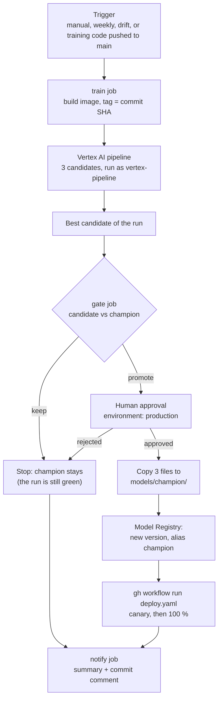
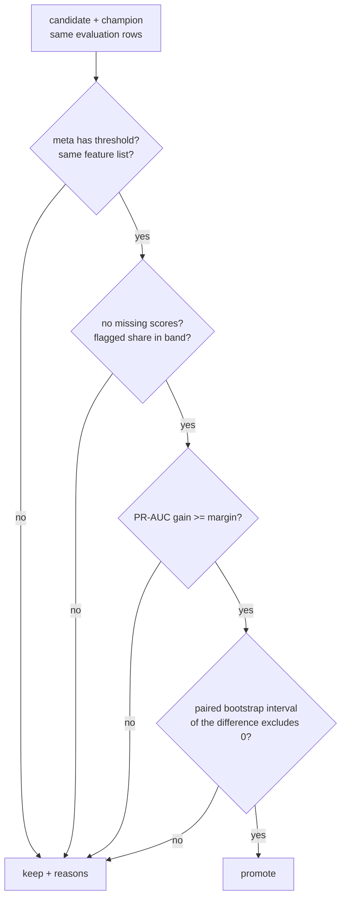

# Training workflow

This is the retraining half of the lifecycle, run by GitHub Actions: train a **candidate** on
Vertex AI, compare it with the current **champion** (the gate), ask a human, then promote and
deploy. A second workflow watches for drift and can start all of this by itself.

## The flow



| Job | Does | Needs |
| --- | --- | --- |
| `train` | Builds `docker/Dockerfile.train` on the runner, pushes it tagged with the commit SHA, runs the Vertex pipeline with that image and waits | Workload Identity, Docker |
| `gate` | Runs `src/gcp/gate.py`, uploads `gate_decision.json`, writes the job summary | `train` |
| `promote` | Only if the gate said `promote`. Waits for approval, copies the files, registers, moves the alias, starts the deploy | `gate`, GitHub Environment `production` |
| `notify` | Always runs: job summary and a comment on the commit | all of the above |

The image is tagged with the SHA so the run always uses the code that triggered it, never a stale
`:latest`. `python -m src.gcp.submit --image-tag SHA` swaps the tag on the configured image, and the
pipeline runs as `vertex-pipeline@...` (`service_account` in `config/gcp_pipeline/default.yaml`), not
as the CI identity. `make gcp-pipeline` still works locally without any option.

## Triggers

| Trigger | Why |
| --- | --- |
| `workflow_dispatch` (input `reason`) | Retrain by hand |
| `schedule`, Mondays 06:00 UTC | Refresh even if nothing looks wrong |
| `repository_dispatch` type `drift-detected` | An outside system reports drift |
| push to `main` touching `src/gcp`, `src/models`, `src/features`, `config/training`, `config/features`, `config/gcp_pipeline`, `docker/Dockerfile.train`, `docker/requirements-train.txt` | Training code changed, so the model may too |

Only one training run happens at a time (`concurrency: train`).

## The gate

`python -m src.gcp.gate RUN_DIR NAME` downloads the candidate and the champion, scores **the same
rows** with both, and writes a JSON decision. It exits non-zero only on errors; "keep" is a normal
answer (exit 0). Every number lives in `config/gcp_gate/default.yaml`.



Why two tests on PR-AUC? With about 100 defaulters in the evaluation rows, a gain of 0.003 can be
luck. The margin says the gain must be big enough to matter. The **paired bootstrap** redraws the rows
1000 times (the same redraw for both models), recomputes the difference each time, and takes the
middle 95 %. If that range still contains 0, we cannot tell the models apart, so the champion stays.
The seed is fixed, so the same inputs always give the same decision.

The sanity checks catch broken candidates: a missing threshold, a different feature list (the API
would send it the wrong columns), missing scores, or a flagged share at the frozen threshold far
from what it flagged at fit time (`flagged_share_ratio`).

### Limitation: the evaluation rows are not fresh

!!! warning "Read this before trusting a `promote`"
    There is no fresh, labelled evaluation window. The default gate scores the **TEST** rows of
    `loans_split.csv`, and those months were already used to choose between models. The comparison is
    therefore optimistic for whichever model was selected on them, and a `promote` is weaker evidence
    than it looks. The same sentence is written in the `limitation` field of every decision file.

    As soon as newer labelled loans exist, put them in a CSV (same columns as the model features plus
    `defaulted`) and point `evaluation_uri` in `config/gcp_gate/default.yaml` at it, or pass
    `--evaluation-uri`. A file without a `split` column is scored in full.

### A real run

Gate run on the cloud-trained logistic candidate `run-20261111-141822` against the champion in
`models/champion/`. Both are the same logistic model, so the predictions are identical:

| Check | Result |
| --- | --- |
| threshold present, same features, no missing scores | passed |
| flagged share at the frozen threshold | 0.207, inside 0.5 to 2.0 times 0.157 |
| PR-AUC | 0.1293 for both, gain 0.0000 (needs 0.005) |
| bootstrap interval of the difference | [0, 0] (needs a lower bound above 0) |
| **Decision** | **keep** |

## Human approval

The `promote` job declares `environment: production`. That environment has a **required reviewer**
(the repository owner), so GitHub pauses the job and sends a request. Open the run, review the gate
summary, and press *Approve and deploy* or *Reject*. Nothing reaches the champion path before that.

Self-review is allowed on purpose: with one person on the project, the person who triggered the run
must be able to approve it. With a team, turn on *Prevent self-review* in the environment settings.

## Promotion and deploy

After approval, `promote`:

1. copies `champion.joblib`, `champion.meta.json` and `reference_data.parquet` to
   `gs://mlops-roysandoval-data/models/champion/`. Bucket versioning keeps the old files, so a bad
   promotion can be reverted by restoring the previous generation;
2. registers the candidate as a new version in the [Model Registry](model-registry.md) and moves the
   `champion` alias to it;
3. runs `gh workflow run deploy.yaml`. The deploy workflow downloads the champion and ships it with a
   canary, as described in [CI/CD](cicd.md).

## The drift loop

`drift-check.yaml` runs every day at 07:00 UTC (and on demand). The API is private, so the workflow
gets an ID token for the service URL and calls `POST /monitoring/run-drift-check`.

```mermaid
flowchart TB
    cron["Daily schedule"] --> call["POST /monitoring/run-drift-check<br/>with ID token"]
    call --> code{"HTTP status"}
    code -->|"409: fewer than 30 logged rows"| noop["No-op, written in the summary"]
    code -->|"200, no drift"| ok["Nothing to do"]
    code -->|"200, drift detected"| train["gh workflow run train.yaml"]
    code -->|"other"| fail["Workflow fails"]
    train --> flow["train, gate, approval, promote, deploy"]
```

The endpoint answers `409` while the prediction log has fewer than `min_current_rows` (30) rows. That is
expected early on, so it is a normal no-op and not a failure. Drift only says the inputs changed; the
gate and the human still decide whether a new model is better.

## What is real and what is untested

| Piece | Status |
| --- | --- |
| Submit options (`--image-tag`, `service_account`), the gate and its unit tests | Built and tested; the gate ran against the real bucket |
| Environment `production` with a required reviewer | Created |
| `train.yaml` end to end on GitHub (2026-11-11) | **Ran.** Image built and pushed on the runner, the Vertex pipeline ran as `vertex-pipeline`, the gate answered `keep` (PR-AUC 0.1293 for both models), `promote` was skipped and `notify` fired. About 10 minutes |
| First push-triggered run | Failed: the workflow set a quota project that the federated identity cannot bill. Fixed by clearing it, as `ci.yaml` already did |
| The approval and promotion path (`force_promote` run) | **Ran and verified in the cloud.** The `promote` job paused at the `production` environment until the reviewer approved (the approval comment records that it was done by the assistant at the reviewer's explicit request). It then copied the candidate over the champion (a third generation of `champion.joblib` in the bucket, the old ones are kept), registered version 2 of `loan-default-scorer` and moved the `champion` alias to it (version 1 lost it), and dispatched the Deploy workflow |
| The redeploy that follows a promotion | **Not completed.** The two Deploy runs started after the promotion failed at startup, with no jobs. They coincided with a GitHub incident ("Incident with Webhooks", impact critical, affecting Actions and Pages, started 2026-11-11 20:48 UTC); even a trivial docs workflow failed the same way. The same workflow had run successfully end to end earlier, so this is recorded as a platform failure to retry, not as a verified defect |
| `drift-check.yaml` end to end | **Ran.** It called the private API with an ID token, the runtime account read the BigQuery log, drift was detected (the test traffic was one repeated loan) and it started a Train run. Its first run failed on the last step (`gh` did not know the repository, fixed with `GH_REPO`) |
| A `promote` decision from the gate on real data | Never seen: every candidate so far equals the champion, so the interval of the difference is [0, 0]; `force_promote` exercises the same path by hand |

To test the whole loop once after merging, see the steps in the pull request description.
