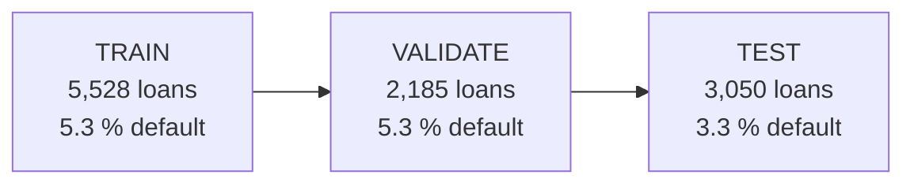

# Training on Google Cloud

The same loans are trained three ways, local Python, a Vertex custom pipeline and Vertex AutoML, and all are scored on the same held-out months.

| | Local Python | Vertex custom pipeline | Vertex AutoML |
| --- | --- | --- | --- |
| Control over the model | Full | Full | Limited |
| Setup effort | Low | High (image, pipeline, IAM) | Medium |
| Wall-clock time | About 2.5 minutes for tuning | About 6 minutes, mostly VM start-up per step | About 2 h 15 min (v1 03:55 to 06:10 UTC) |
| Cost | Free | A few cents per run (under $0.25 for all runs) | About $22 per run (estimate; check Billing) |
| Reproducibility | Depends on the machine | Container plus config | Managed; a re-run may differ (not tested) |
| Headline PR-AUC on TEST | 0.129 (logistic) | 0.129 (logistic) | 0.215 (v2) |

## 1. The split

AutoML splits randomly unless told otherwise, which would let it train on the months it is scored on. A `split` column pins every loan to a set by origination month.



TRAIN and VALIDATE (7,713 loans) are the loans the local run trains on. VALIDATE is the newest slice of the training window, so AutoML has a validation set and cannot tune on TEST. TEST is the newest 25 % and is read once, for the final comparison.

The test default rate (3.3 %) is lower than in training (5.3 %). Recent loans may not have had time to default yet, or the book may have changed. It affects every model equally. The file is built by `make export-gcp-dataset`; identifiers, the origination date and the leaky `puntaje` column are excluded.

## 2. The three runs

The custom pipeline trains logistic, XGBoost and LightGBM in parallel (one Vertex step each), then a final step compares them. Hyperparameters were copied from the local tuning runs, so nothing is re-tuned in the cloud. TEST is only scored, never fitted on, and imputation and scaling live inside the sklearn pipeline, so they are fitted on training rows only. Each step runs on a short-lived `e2-highmem-2` VM (2 vCPU, 16 GB, no GPU).

| Model on TEST | PR-AUC | Gini | ROC-AUC | F1 |
| --- | --- | --- | --- | --- |
| Logistic regression | 0.129 | 0.327 | 0.664 | 0.117 |
| LightGBM | 0.102 | 0.280 | 0.640 | 0.114 |
| XGBoost | 0.091 | 0.305 | 0.653 | 0.117 |
| Heuristic baseline (local) | 0.059 | | | |

Logistic on Vertex reproduces the local champion (PR-AUC 0.129, Gini 0.327), so the two pipelines agree. The boosted models tune better in cross-validation but generalise worse to the newest months, as they did locally. Each candidate also saves its model, metadata and drift reference under `gs://mlops-roysandoval-data/pipeline-runs/<run>/models/<name>/`, in the format the API loads. Run `run-20261111-141822` took about 6 minutes. Its logistic model scored PR-AUC 0.12928 after download. Latency (about 80 against 13 ms per 1k rows locally) was measured on a small shared VM right after start and is not a model property.

## 3. What AutoML did

AutoML searches model types and settings itself, within a budget of 1 node-hour (about $21 at list price, the minimum it allows). It used the same split column and the objective `maximize-au-prc`; no endpoint was created. The budget caps the search and not the wall clock, hence the 2 h 15 min.

Vertex's own evaluation of v1 reports PR-AUC 0.970 and ROC-AUC 0.979. Those are not comparable. They appear to pool both classes, so the 96 % of loans that do not default dominate (the confusion matrix is pooled over both classes; that the headline PR-AUC and ROC-AUC use the same pooling is **unverified**). They also cover only 2,166 of the 3,050 TEST loans. The table recomputes every model the same way.

| Model on TEST | Loans scored | PR-AUC | ROC-AUC | Gini | F1 | Recall |
| --- | --- | --- | --- | --- | --- | --- |
| Logistic champion (local and Vertex) | 3,050 | 0.129 | 0.664 | 0.327 | 0.117 | 0.337 |
| AutoML v2, imputed data | 3,050 | 0.215 | 0.790 | 0.581 | 0.169 | 0.485 |
| AutoML v1, unscored loans given score 0 | 3,050 | 0.159 | 0.595 | 0.190 | 0.138 | 0.396 |
| AutoML v1, scored loans only (not comparable) | 2,166 | 0.235 | 0.815 | 0.629 | 0.164 | 0.524 |
| Vertex's own figures, v1 (not comparable) | 2,166 | 0.970 | 0.979 | | | |

The empty-cell problem is the practical lesson. The local pipeline imputes missing values and adds "was missing" flags. AutoML v1 refused to score 884 TEST loans with an empty numeric cell ("Failed numeric transformation" on `promedio_ingresos_datacredito`, `saldo_principal`, `salario_cliente` and `edad_cliente`). Whether training also dropped those rows is **unverified**. The scored-only row looks better only because the dropped rows were the hard ones.

v2 imputes before upload: numeric columns get the TRAIN median, categorical and boolean columns get the label `missing`, and nothing from VALIDATE or TEST is used. All 3,050 loans were scored (training 14:35 to 16:48 UTC) and v2 beats the champion on every ranking metric. Vertex's own v2 figures (PR-AUC 0.973, ROC-AUC 0.977) are still not comparable: it caught only 7 of 101 defaulters at 0.5. The paired bootstrap on the [results page](results.md) says the PR-AUC gap is distinguishable from noise. It is one run, one seed, one window with 101 defaults that has been used before, and v2 was run after seeing v1, so read it as strong evidence and not as proof.

AutoML publishes a global feature importance with each evaluation:

| Feature | Share |
| --- | --- |
| `huella_consulta` (recent credit inquiries) | 15.7 % |
| `plazo_meses` (loan term) | 12.7 % |
| `puntaje_datacredito` (bureau score) | 12.6 % |
| `tendencia_ingresos`, `rango_edad`, `cant_creditosvigentes`, `cuota_pactada` | 4 % to 5 % each |

All are known at the moment of the decision (35 input columns, no label, `split` or identifier). The loan term is the non-linear effect that the [investigation](../investigation/model-signal.md) found a linear model cannot use: default risk is lowest around 11 to 12 months and highest above 24. That is a plausible explanation for the gap, not a proof.

## 4. Experiments and Model Registry

Vertex Experiments holds the experiment `loan-default`. After each pipeline run, `src/gcp/experiments.py` logs one run per candidate (`<name>-<run id>`) with its tuned parameters and metrics. Console path: Vertex AI, Experiments, region us-central1, project `mlops-roysandoval`. Creating the experiment also created an empty Vertex Tensorboard instance, which costs nothing until it holds data.

The Model Registry is the shelf of models worth keeping, where MLflow and Experiments record every run. All models share one entry, `loan-default-scorer`. Every registration adds a version that is never overwritten, and a movable alias marks the state.

| Alias | Meaning |
| --- | --- |
| `challenger` | The latest registered candidate, waiting to be judged |
| `champion` | The version considered best. Moving this alias is the promotion; it is unique per model |

Only files and metadata are registered: the artifact folder, the serving image, labels (git sha, run id, candidate) and the test metrics. The model is never deployed to a Vertex endpoint, because our container exposes `/predict/batch` and not Vertex's prediction contract. Console path: Vertex AI, Model Registry, region us-central1, then open `loan-default-scorer`. Settings are in `config/gcp_registry/default.yaml`.

```bash
make register-model RUN_DIR=gs://mlops-roysandoval-data/pipeline-runs/<run> CANDIDATE=logistic
uv run python -m src.gcp.register --promote 3
gcloud ai models list --region us-central1 --project mlops-roysandoval
```
