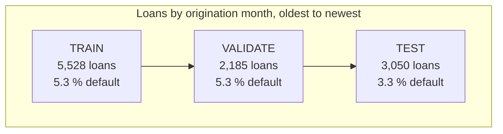

# Training on Vertex AI

Two ways of training on Google Cloud are compared with the local Python run, all on the **same
held-out loans**.

## The split

AutoML splits randomly unless told otherwise, which would let it train on the months it is
scored on. A `split` column pins every loan to a set by origination month.

- **TRAIN + VALIDATE** (7,713 loans) are the same loans the local run trains on.
- **VALIDATE** is the newest slice of the training window. AutoML needs a validation set, and
  this keeps it from tuning on TEST.
- **TEST** is the newest 25 % and is read once, for the final comparison.

The test default rate (3.3 %) is lower than in training (5.3 %). Recent loans may not have had
time to default yet, or the book may have changed. Either way it affects every model equally.

The file is built by `make export-gcp-dataset` and has the model features, a `defaulted` label
(1 = default) and the `split` column. Identifiers, the origination date and the leaky `puntaje`
column are excluded.

## Custom pipeline on Vertex Pipelines

The same three models as the local run train in parallel, then a final step compares them.
Hyperparameters were copied from the local tuning runs, so nothing is re-tuned in the cloud.
See [Custom pipeline run](custom-pipeline.md) for the steps and the commands.

| Model | PR-AUC | Gini | ROC-AUC | F1 |
| --- | --- | --- | --- | --- |
| **Logistic regression** | **0.129** | **0.327** | 0.664 | 0.117 |
| LightGBM | 0.102 | 0.280 | 0.640 | 0.114 |
| XGBoost | 0.091 | 0.305 | 0.653 | 0.117 |
| Heuristic baseline (local) | 0.059 | | | |

Logistic regression on Vertex reproduces the local champion (PR-AUC 0.129, Gini 0.327), so the
cloud pipeline and the local one agree. The gradient-boosted models tune better in
cross-validation but generalise worse to the newest months, the same finding as locally.

## AutoML Tabular

AutoML searches model types and settings itself, within a training budget of **1 node-hour**
(about $21 at list price, the minimum it allows). It uses the same split column. Its results are
added to this page once the run finishes.

## Local versus cloud

| | Local Python | Vertex custom pipeline | AutoML |
| --- | --- | --- | --- |
| Control over the model | Full | Full | Limited |
| Setup effort | Low | High (image, pipeline, IAM) | Medium |
| Wall-clock time | About 2.5 minutes for tuning | Dominated by VM start-up per step | Dominated by the training budget |
| Cost | Free | A few cents | About $21 at the minimum budget |
| Reproducibility | Depends on the machine | Container plus config | Managed |
