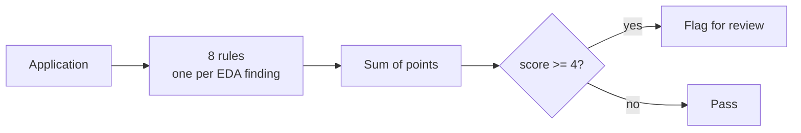

# Heuristic model: points scorecard

A rule-based baseline read straight from the EDA. It is not trained, and it sets the bar a learned model has to clear.



Points come from one formula: `round((band default rate / portfolio default rate - 1) * 4)`. A band that doubles the 4.75 % base costs +4; one that halves it pays -2. Weights and the band cut-points are frozen in `config/model/heuristic.yaml`, so one application scores the same alone or in a portfolio. A blank application scores 5, above the threshold, so maximum uncertainty goes to manual review.

## The rules

Rates measured on all 10 763 loans.

| Rule | Bands (default rate) | Points |
| --- | --- | --- |
| `bureau_score_band` | `puntaje_datacredito` < 770 (7.17 %); 770-812 (4.11 %); >= 813 (2.81 %); missing (6.92 %) | +2; -1; -2; +2 |
| `inquiry_band` | `huella_consulta` 0-3 (3.41 %); 4-6 (5.22 %); 7+ (7.45 %) | -1; 0; +2 |
| `age_band` | 18-25 (8.80 %); 26-35 (6.21 %); 36-45 (4.03 %); 46-55 (3.43 %); 56-65 (4.17 %); 66+ (3.16 %); missing (7.33 %) | +3; +1; -1; -1; 0; -1; +2 |
| `young_independent` | under 36: Independiente 9.38 % vs Empleado 5.62 % (ratio 1.67) | +3, else 0 |
| `income_gap_quartile` | declared/bureau income ratio quartiles (3.02 %; 3.84 %; 4.87 %; 5.79 %); missing | -1; -1; 0; +1; 0 |
| `decreasing_income_trend` | Decreciente (6.27 %); Estable (4.63 %); Creciente (3.91 %); missing | +1; 0; -1; 0 |
| `high_amount_long_term` | `capital_prestado` >= 3 084 840 and `plazo_meses` >= 13: 11.02 % (n = 626) | +5, else 0 |
| `missing_bureau_income` | bureau income block missing: 5.72 % vs 4.38 % | +1, else 0 |

Notes: `young_independent` only charges the extra on top of `age_band`, since employment type looks irrelevant on average (Cramér V 0.027) but is real under 36 (p = 0.0002). Salary alone has no signal (AUC 0.505); the declared-to-bureau ratio does.

### Left out on purpose

| Variable | Why |
| --- | --- |
| `puntaje` | Leakage: 87 % share the maximum value and none defaulted. |
| `tiene_mora_bureau` | 36.4 % vs 4.6 % default, but on 55 loans, and timing was unconfirmed when the scorecard was built. |
| `pti`, `dti`, `cuota_supera_salario`, `salario_cliente` | No measured signal (AUC 0.505-0.511). |
| `mes_prestamo` | Vintage-censoring control, not a predictor. |
| `saldo_total`, `saldo_principal` | rho 0.95 with each other; scale looked implausible; the business later said bureau balances are in thousands of COP (see [Architecture](architecture.md)). |

## Results

All 10 763 loans, threshold 4.

| Metric | Value | EDA benchmark |
| --- | ---: | --- |
| AUC | 0.676 | - |
| **Gini** | **0.352** | 0.248 (bureau score alone) |
| Top / bottom band default rate | 12.33 % / 1.75 % | 11.1 % / 1.4 % (best and worst manual segments) |
| Band lift | 7.06x | 7.7x (not the same measurement) |
| Flagged share | 15.7 % | - |
| Precision, recall | 10.28 % (2.17x base), 34.1 % | - |

Out-of-fold (5-fold CV) AUC and Gini equal the in-sample values, as frozen rules should. That does not remove the in-sample caveat: the weights were chosen by reading this same data. Removing any one rule lowers Gini, from -0.0262 (`high_amount_long_term`) to -0.0058 (`young_independent`).

## As a scikit-learn estimator

`src/models/estimator.py` splits the work: `HeuristicModel` ranks, `calibrated_model()` turns rank into probability.

```python
credit_pipeline().fit(X_train, y_train)   # prepare -> score -> calibrate
pipe.predict_proba(X)[:, 1]
```

| | Isotonic fitted in-sample | Cross-fitted (used) |
| --- | ---: | ---: |
| Train to test log-loss gap | 0.01715 | **0.00555** |
| Highest probability of default | 1.0000 | 0.5464 |

The ranker has no `predict_proba` because its points are not probabilities. In-sample isotonic gave small pure bands a probability of exactly 1.0, so calibration uses `CalibratedClassifierCV(method="isotonic", cv=5)`. `score()` is AUC, because accuracy would rank this scorecard below flagging nobody (95.25 % at the base rate). The estimator accepts only DataFrames: an unnamed array would make every rule take its "absent" branch. `check_estimator` skips its whole suite for DataFrame-only input, so 29 checks on the model and 16 on the preparer are run directly, with a test guarding the count.

## Limitations

- In-sample: bands and points were measured on the data they score, so the numbers are optimistic.
- Vintage censoring: the 4.75 % is a floor, as recent loans have had less time to default.
- Additive double counting: correlated signals each charge full points.
- Not monotone everywhere: scores of -1 (4.75 %) and 0 (2.71 %) are out of order.
- Not calibrated: the raw score ranks risk and is not a probability.
