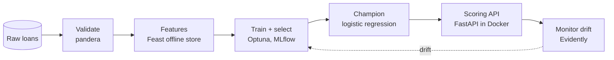

# Loan-default MLOps

A pipeline that scores bank loans for default risk, from raw data to a model served in the cloud. The data is 10,763 loans, about 4.75 % of them defaulted.

## Where to start

| If you want to... | Read |
| --- | --- |
| See how the pieces fit and why each tool was chosen | [Architecture](architecture.md) |
| See how the model was picked | [Model training](model-training.md) |
| See why the model is weak | [Why the signal is weak](investigation/model-signal.md) |
| See the cloud setup | [Target architecture](gcp/overview.md) |
| Compare local and cloud results | [Training on Vertex AI](gcp/training.md) |

## The rule behind every number

Loans are split by origination month, not at random. The oldest 75 % of months train the model and the newest 25 % test it. A shuffled split lets the model see loans from the months it is scored on, which flatters it. All results here, local or cloud, use the same held-out window.
