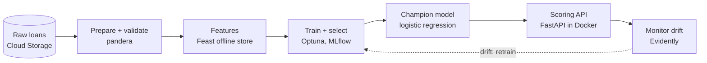

# Loan-default MLOps

A pipeline that scores bank loan applications for default risk, from raw data to a model served
in the cloud. The data is a book of 10,763 loans; about 4.75 % defaulted.

The project has two halves:

- **The pipeline** (local, Python): validation, features, training, serving, monitoring.
- **The cloud layer** (Google Cloud): training on Vertex AI, containers, CI/CD and deployment.

## The big picture

Read it left to right. Data is validated, turned into features, and used to train several
models. One wins on loans it has never seen. That champion is served behind an API, and a
monitor watches for the data changing so the loop can start again.

## Where to start

| If you want to... | Read |
| --- | --- |
| Understand why each tool was chosen | [Architecture](architecture.md) |
| See how the model was picked | [Model training](model-training.md) |
| See the cloud setup | [Target architecture](gcp/overview.md) |
| See how code reaches production | [CI/CD](gcp/cicd.md) |
| Compare local and cloud results | [Training on Vertex AI](gcp/training.md) |

## One rule that shapes everything

Loans are split **by origination month**, not at random. The oldest 75 % of months train the
model and the newest 25 % test it. A shuffled split would let a model see loans from the same
months it is scored on, which flatters it. Every number in these pages, local or cloud, uses
that same held-out window so they can be compared.
