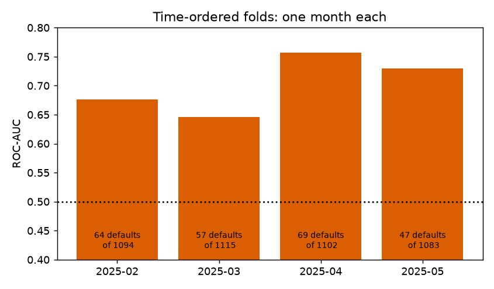
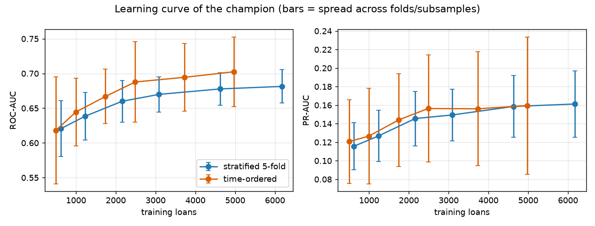
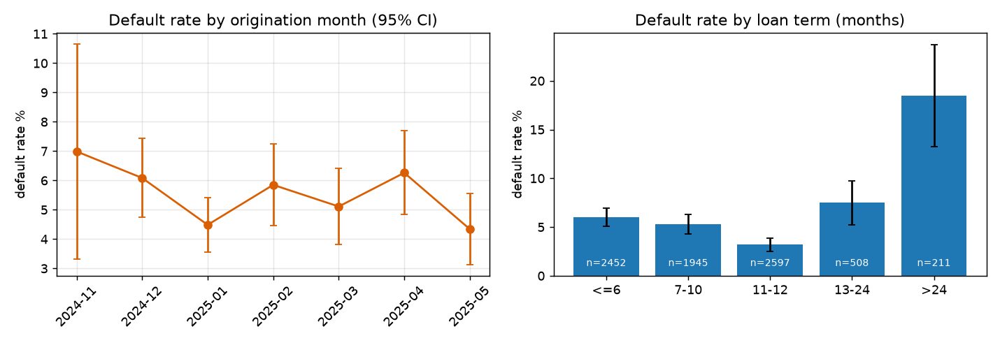
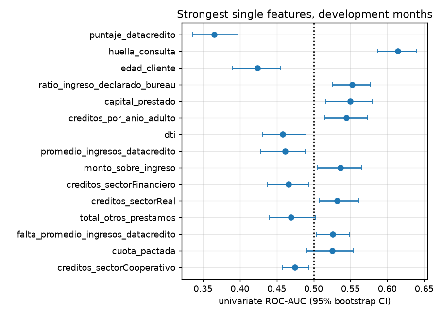
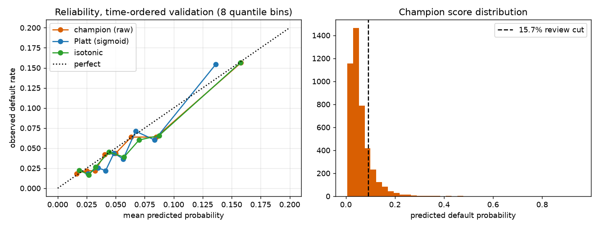

# Why is the loan-default model weak? Data ceiling or something fixable?

Question: the champion (tuned logistic regression) has out-of-time ROC-AUC 0.664 and PR-AUC 0.129.
Is that a ceiling set by the data (about 410 defaults), or did feature engineering and modelling miss something?

**Read this first: what data was used.** The newest 25 % of origination months (the TEST window,
June 2025 onward) was dropped in `experiments/signal/data.py` the moment the book was loaded, before any
look at the data. Everything below uses the 7,713 loans (410 defaults, 5.3 %) of the seven
TRAIN+VALIDATE months, 2024-11 to 2025-05. No score, plot or statistic was computed on the TEST months.
The few statements about TEST months below come from the existing project docs or calendar arithmetic.

## Method in plain words

* **Two validation schemes, same folds for every model.**
  *Time-ordered*: train on all earlier months, validate on one later month (2025-02, 03, 04, 05; 4 folds).
  This mimics production. *Stratified*: the project's 5-fold CV, repeated 3 times (15 folds).
* **Fixed recipe.** Every candidate keeps the champion's regularisation (C = 0.0869) unless it is a "family"
  test. Every transformer (caps, medians, WOE bins, target encoding, resampling, calibration) is fitted inside
  the pipeline on the training part of each fold only.
* **What counts as a real improvement.** The mean paired difference against the champion must exceed 2 standard
  errors of the fold differences, be positive in every time fold, hold in the stratified scheme too, and the
  paired bootstrap interval on the pooled time-ordered predictions must exclude zero ("confirmed").
* **Comparisons made: 29 candidates against the champion, each on 2 metrics x 2 schemes (116 paired
  tests), plus 4 near-identical-model comparisons used only to measure noise.** With that many looks,
  one or two false positives are expected by chance alone.
* Code: `experiments/signal/` (helpers tested in `tests/experiments/`). Raw tables: `docs/investigation/results/*.csv`.

## 1. Noise ceiling

With ~410 defaults the score of any model is a blurry number.

| Champion, development months | ROC-AUC | PR-AUC |
| --- | --- | --- |
| Time-ordered, pooled 4 months (237 defaults): value [95 % bootstrap CI] | 0.702 [0.668, 0.739] | 0.151 [0.115, 0.198] |
| Time-ordered, per-fold mean, sd, range (4 folds) | 0.703, 0.050, 0.646-0.757 | 0.160, 0.074, 0.097-0.259 |
| Stratified CV pooled (410 defaults) [95 % CI] | 0.682 [0.654, 0.709] | 0.152 [0.124, 0.190] |
| Stratified CV per-fold mean, sd (15 folds) | 0.681, 0.024 | 0.161, 0.036 |
| Base rate (random ranking PR-AUC) | 0.5 | 0.053 |

* A one-month fold holds only about 47-69 defaults, so single-month scores swing by several ROC points.
  Any one number, including the 0.664 / 0.129 on TEST, has an interval of roughly +/-0.03 ROC and +/-0.04 PR.
* **Size of an improvement you can distinguish from noise.** Two almost identical models (C = 0.03 vs 0.087)
  differ by a paired CI half-width of +/-0.003 ROC and +/-0.005 PR. That is the floor, for models that rank almost the same.
  For genuinely different models the paired bootstrap half-width was +/-0.01 to +/-0.03. So **a gain below
  about +0.01 ROC-AUC or +0.01 PR-AUC cannot be told apart from noise with this data; gains of +0.02 or more can.**
* **Learning curve** (`plots/learning_curve.png`): training on 10 % of the folds' data gives ROC 0.62, 50 % gives 0.67,
  100 % gives 0.68 (stratified). Going from 3,085 to 6,170 training loans added about +0.011 ROC and +0.012 PR.
  The curve is still rising slowly (about +0.01 per doubling, with large spread across folds), so more data helps
  a little, but doubling the book would not change the picture.

## 2. Label maturity and censoring

Development months only; term = `plazo_meses`.

| Origination month | loans | default % | mean term | share of loans whose term has fully elapsed by 2026-04* |
| --- | ---: | ---: | ---: | ---: |
| 2024-11 | 186 | 7.0 | 11.5 | 86 % |
| 2024-12 | 1216 | 6.1 | 11.4 | 88 % |
| 2025-01 | 1917 | 4.5 | 10.8 | 93 % |
| 2025-02 | 1094 | 5.9 | 10.6 | 91 % |
| 2025-03 | 1115 | 5.1 | 10.4 | 91 % |
| 2025-04 | 1102 | 6.3 | 10.2 | 89 % |
| 2025-05 | 1083 | 4.3 | 9.5 | 81 % |

\*Calendar arithmetic assuming the book ends April 2026 (project docs); the extraction date is not in the data.

| Term (months) | loans | default % |
| --- | ---: | ---: |
| <= 6 | 2452 | 6.0 |
| 7-10 | 1945 | 5.3 |
| 11-12 | 2597 | 3.2 |
| 13-24 | 508 | 7.5 |
| > 24 | 211 | 18.5 |

Default % by month x term (cells are small; see `results/maturity_rate_month_term.csv`):

| month | <=6 | 7-10 | 11-12 | 13-24 | >24 |
| --- | ---: | ---: | ---: | ---: | ---: |
| 2024-11 | 7.5 | 6.5 | 6.6 | 11.8 | 0.0 |
| 2024-12 | 7.1 | 7.1 | 4.2 | 7.5 | 9.3 |
| 2025-01 | 4.9 | 7.0 | 3.1 | 5.3 | 14.7 |
| 2025-02 | 7.7 | 7.1 | 2.7 | 3.0 | 16.7 |
| 2025-03 | 6.4 | 4.8 | 3.2 | 1.6 | 20.0 |
| 2025-04 | 8.0 | 3.3 | 2.5 | 11.7 | 29.6 |
| 2025-05 | 3.0 | 3.1 | 1.5 | 13.6 | 30.3 |

Findings, with the honest limits:

* **The default rate falls with origination month for the terms that should already be complete.** For terms
  <= 12 months (6,994 loans) the logistic trend is -0.078 per month in log-odds, 95 % CI [-0.146, -0.016]
  (about -7.5 % in odds per month). For all terms combined it is flat (-0.021, CI [-0.077, 0.036]) because
  long-term loans (> 24 months, 18.5 % default) became a larger, riskier part of recent months and cancel it out
  (a Simpson-style mix effect).
* **The drop is concentrated in the latest development month.** 2025-05 (the youngest, 11-12 months of age) has
  3.0 % for <= 6-month loans and 1.5 % for 11-12-month loans. Terms <= 6 months have completed in every
  development month, so pure term-censoring does not explain a fall there; the label seems to depend on
  months-on-book (or on when the book was extracted), not only on whether the term ended. The data holds no
  default date and no extraction date, so **this cannot be proved from the development months**.
* **Consequence for TEST (docs: 5.3 % -> 3.3 %).** TEST loans are 0 to 10 months old at April 2026, so
  even a 12-month loan from June 2025 has not finished its term. If defaults accrue with age, TEST labels are
  incomplete: every model's out-of-time score is depressed, and the training labels from the youngest months
  teach the model that recent-looking loans are safe. Because the effect is on labels it can distort ranking
  too (a loan that will default but has not yet is scored as a negative), not only the level.
* Term is the single clearest risk driver: 3.2 % to 18.5 %, and non-monotone (11-12 months is the safest).
  A linear term in the model cannot express this (see section 3).
* **What a fix looks like (not done here):** (1) get the default date and extraction date, then label with a fixed
  observation window (e.g. "defaulted within N months of origination") and keep only loans old enough to have
  that window; (2) otherwise restrict training and evaluation to vintages older than the longest window of interest,
  or evaluate within term groups; (3) add the term and loan age to the evaluation report so a falling default rate
  is not read as model failure. This is probably the biggest lever on the *measured* TEST numbers and costs no
  modelling, but it needs the dates from the bank.

## 3. Signal audit

Univariate ROC-AUC on development months (0.5 = no signal); full list in `results/signal_univariate.csv`.

| Feature | AUC [95 % CI] | Same sign in how many of 7 months |
| --- | --- | --- |
| puntaje_datacredito (bureau score; lower = riskier) | 0.366 [0.336, 0.397] | 7 |
| huella_consulta (bureau inquiries) | 0.614 [0.587, 0.640] | 7 |
| edad_cliente (younger = riskier) | 0.424 [0.390, 0.455] | 6 |
| ratio_ingreso_declarado_bureau | 0.552 [0.525, 0.578] | 7 |
| capital_prestado | 0.550 [0.516, 0.579] | 5 |
| creditos_por_anio_adulto | 0.544 [0.514, 0.573] | 6 |
| dti | 0.458 [0.430, 0.490] | 5 |
| plazo_meses (linear) | 0.498 [0.469, 0.523] | 5 |

* Signal is spread thin: the best single feature has AUC 0.63 (inverted), the next ~0.61, and most features sit
  in 0.52-0.55. A combined ROC of about 0.68-0.70 is what many weak features add up to. This looks like the data,
  not a missed strong feature.
* **Winsorising, log1p and imputation do not change any feature's univariate AUC** (differences below 0.0005,
  `results/signal_engineering_effect.csv`), because they are monotone. They only help the linear fit numerically.
* **Missingness.** Two flags have a lift whose CI excludes 1: `falta_promedio_ingresos_datacredito` (27 % missing,
  lift 1.27x, CI 1.02-1.53) and `falta_tendencia_ingresos` (28 %, 1.24x, CI 1.02-1.51). The six rare flags
  (1-4 % missing, lifts 1.4-2.4x) have intervals that include 1: the "1.18x-1.54x" in the feature docs is not
  statistically supported for them.
* **Does the engineering add or remove signal?** Ablations, paired against the champion
  (time-ordered mean ROC 0.7025, PR 0.1596):

| Variant | time ROC (diff) | time PR (diff, folds won) | strat PR diff | Verdict |
| --- | ---: | ---: | ---: | --- |
| raw columns only (no ratios, bands, flags) | 0.6996 (-0.003) | 0.1687 (+0.009, 4/4) | +0.007 | no real difference |
| no `falta_*` flags | 0.6994 (-0.003) | 0.1652 (+0.006, 3/4) | +0.003 | no real difference |
| no ratios / age bands | 0.7016 (-0.001) | 0.1634 (+0.004, 3/4) | +0.004 | no real difference |
| no `plazo_meses` | 0.6883 (-0.014) | 0.1488 (-0.011, 0/4) | -0.010 | term matters |

  The ratios, bands and flags **neither add nor remove measurable signal**; the 11 engineered features are not
  harmful, just not helping. Only term clearly matters.
* **Principled additions** (all computable from the application and bureau pull, all fitted in-fold):

| Variant | time ROC (diff) | time PR (diff, folds won) | strat ROC / PR diff | Confirmed? |
| --- | ---: | ---: | ---: | --- |
| **WOE bins of `plazo_meses` (5 quantile bins)** | 0.7117 (+0.009) | 0.1690 (+0.009, 4/4) | +0.005 / +0.010 | **PR yes, ROC no** |
| WOE on 12 continuous columns (kept) | 0.7081 (+0.006) | 0.1715 (+0.012, 3/4) | +0.008 / +0.015 | no |
| WOE only (replace originals) | 0.6863 (-0.016) | 0.1341 (-0.026) | +0.003 / -0.019 | worse |
| 4 interactions (term x pti, term x score, score x dti, term x amount) | 0.7019 (-0.001) | 0.1618 (+0.002) | 0.000 / -0.001 | no |
| In-fold target encoding of `tipo_credito`, `tipo_laboral` | 0.6999 (-0.003) | 0.1582 (-0.001) | -0.002 / -0.005 | no |
| WOE term + target encoding | 0.7091 (+0.007) | 0.1705 (+0.011, 2/4) | +0.003 / +0.006 | no |

  The only addition that passes the rule on the primary metric (PR-AUC) is giving term a non-linear form:
  +0.009 PR in time folds (wins 4/4), +0.010 in stratified CV. The ROC gain (+0.009) is inside the bootstrap
  noise (CI -0.004 to +0.018). **One pass out of 29 comparisons is what chance alone can produce,** so treat it as a
  well-motivated lead (the term/default relationship is plainly non-linear in section 2), not as proof.

## 4. Class imbalance (all inside the pipeline)

| Method | time ROC (diff) | time PR (diff) | strat PR diff | Real? |
| --- | ---: | ---: | ---: | --- |
| class_weight balanced | 0.7000 (-0.003) | 0.1503 (-0.009) | -0.007 | no |
| random oversample to 25 % | 0.7016 (-0.001) | 0.1610 (+0.001) | -0.002 | no |
| random oversample to 100 % | 0.6989 (-0.004) | 0.1480 (-0.012) | -0.008 | no |
| random undersample 25 % | 0.6878 (-0.015) | 0.1457 (-0.014) | -0.009 | worse |
| random undersample 100 % | 0.6752 (-0.027) | 0.1287 (-0.031) | -0.019 | worse |
| SMOTE 25 % | 0.6947 (-0.008) | 0.1588 (-0.001) | +0.001 | no |
| SMOTE 100 % | 0.6862 (-0.016) | 0.1454 (-0.014) | -0.007 | worse |

Nothing improves ranking, as expected: resampling and class weights mainly shift the predicted probabilities (and so a
fixed threshold), while the champion is evaluated by ranking and at a fixed review share. Undersampling discards
most of the already scarce data. (SMOTE was implemented in-repo; `imbalanced-learn` is not installed.)

## 5. Calibration

| Time-ordered, pooled | Brier [95 % CI] | log-loss | ECE | mean predicted vs observed | PR / ROC |
| --- | --- | ---: | ---: | --- | --- |
| Champion (raw) | 0.0489 [0.0432, 0.0544] | 0.1952 | 0.0088 | 5.9 % vs 5.4 % | 0.151 / 0.702 |
| Platt (in-fold) | 0.0490 | 0.1964 | 0.0136 | 6.2 % vs 5.4 % | 0.150 / 0.700 |
| Isotonic (in-fold) | 0.0490 | 0.1956 | 0.0097 | 6.2 % vs 5.4 % | 0.152 / 0.700 |
| Constant prevalence | 0.0503 | | | | |

* The champion is already well calibrated on average (ECE under 1 percentage point), because it uses no class weights.
  Platt and isotonic change nothing measurable (Brier differences of 0.0001, far below the CI width of about 0.01).
* **Calibration changes probabilities, not ranking.** Platt is a monotone map, so the flagged set is identical in theory;
  small differences here (93 % overlap) come from fitting the calibrator on inner folds. Isotonic creates ties and
  overlaps 89 %.
* The 15.7 % review cut sits at a predicted probability of about 0.09 (time-ordered) and the flagged group defaults at
  about 13.8 %. The review *share* does not change with calibration; only a *probability* threshold would, and none of
  the calibrators moves it by more than 0.003.
* Brier skill over predicting the base rate is just 3 % (0.0489 vs 0.0503): another way to see the weak ranking.

## 6. Model families under time-ordered validation

| Model | time ROC (diff) | time PR (diff, wins) | strat ROC / PR diff | Real? |
| --- | ---: | ---: | ---: | --- |
| logistic C = 0.01 | 0.6966 (-0.006) | 0.1617 (+0.002) | -0.001 / -0.001 | no |
| logistic C = 0.03 | 0.6997 (-0.003) | 0.1615 (+0.002) | 0.000 / 0.000 | no |
| logistic C = 0.3 | 0.7047 (+0.002) | 0.1594 (0.000) | 0.000 / -0.001 | no |
| logistic C = 1 | 0.7054 (+0.003) | 0.1574 (-0.002) | -0.001 / -0.002 | no |
| L1 logistic C = 0.05 / 0.1 | 0.6772 / 0.6934 | 0.1457 / 0.1552 | worse | worse |
| LightGBM stumps (additive) | 0.6956 (-0.007) | 0.1470 (-0.013) | +0.007 / +0.005 | no |
| LightGBM depth 2 | 0.7009 (-0.002) | 0.1725 (+0.013, 3/4) | +0.019 / +0.020 | no (time ROC CI -0.029 to +0.014) |
| LightGBM depth 3 | 0.7036 (+0.001) | 0.1714 (+0.012, 3/4) | +0.019 / +0.021 | no |
| LightGBM depth 2, monotone | 0.7015 (-0.001) | 0.1654 (+0.006) | +0.020 / +0.023 | no |
| XGBoost depth 2 | 0.7030 (+0.001) | 0.1586 (-0.001) | +0.017 / +0.018 | no |
| Random forest (leaf 50) | 0.7009 (-0.002) | 0.1528 (-0.007) | +0.010 / +0.012 | no |

* **Shallow GBMs are better in shuffled CV (+0.02 PR/ROC) but not in time-ordered folds** (spread of the paired
  difference 0.013-0.017 ROC, wins only 2/4 on ROC). That reproduces the project finding (CV flatters trees,
  time does not) with regularised trees as well. Stumps (no interactions) lose, depth 2-3 gains slightly in PR:
  any non-linearity/interaction signal is small and not stable over time.
* Re-tuning C does not matter: C from 0.03 to 1 stays within +/-0.003 ROC. The champion's tuning is not the limit.
* The C and WOE rows were scored on the same folds used to pick them, so they are slightly optimistic if anything.

## Ranked conclusion

**(a) Is it mostly a data/sample-size ceiling?** Largely yes. Single features top out at AUC ~0.63; ~410 defaults
give a +/-0.03 ROC uncertainty on any estimate; a broad family of models (linear, L1, boosted trees, forest) all land at
ROC 0.70 +/- 0.01 in time-ordered validation, which is the signature of a ceiling set by the information in the
features. The learning curve is still rising slowly (about +0.01 per doubling). Part of the *measured* weakness on
TEST is also a labelling problem (section 2), not modelling.

**(b) Fixable and worth doing, in order**
1. **Label maturity.** Obtain default dates and the extraction date, define a fixed observation window, and
   evaluate/train on mature vintages (or per term). Highest expected value for how trustworthy the numbers are.
2. **Give `plazo_meses` a non-linear form** (WOE/bins or one-hot of term bands 6, 7-10, 11-12, 13-24, >24). Term has
   a 3 %-18 % default range that a linear coefficient cannot represent. Candidate gain +0.009 PR-AUC (about 6 %
   relative) and +0.009 ROC; borderline against noise.
3. **Report intervals** (bootstrap) and time-ordered folds in model selection; stop reading 0.01 differences.

**(c) Not worth doing**
* Resampling (over, under, SMOTE) and class weights: no ranking gain, undersampling hurts.
* Platt / isotonic calibration: the champion is already calibrated; ranking and review share unchanged.
* More interaction terms, target encoding of `tipo_credito` / `tipo_laboral`, L1 selection, re-tuning C, and
  swapping to GBMs or forests: nothing beats the noise in time-ordered folds. WOE on everything is no better than
  WOE on term only, and replacing the raw columns by WOE hurts.
* Removing the ratios / bands / flags: harmless to drop but also harmless to keep; no evidence either way.

**(d) Recommendation for the champion.** Try one change: the champion pipeline plus a WOE (or banded) `plazo_meses`
step, fitted inside the pipeline. Evaluate it fairly as follows: freeze everything else (C = 0.0869, features,
folds); compare on the same rolling-origin folds **over all available vintages** and on the same TEST window **once**,
with paired differences and a bootstrap interval; require PR-AUC gain above 2 standard errors of the fold differences,
a gain in every time fold, and the same sign on the TEST window; count it as one pre-registered hypothesis, not
one among 30. Do not promote it on the strength of this investigation alone: it passed 1 of 29 comparisons.
Do the label-maturity fix first, because it changes what "better" means.

## Caveats and what is unverified

* The extraction date and the exact definition of `Pago_atiempo` are not in the data; the censoring explanation is
  a hypothesis consistent with the numbers, not demonstrated.
* Only 4 time folds (one month each, 47-69 defaults each); the 2-standard-error rule is rough with 4 folds, hence the extra
  bootstrap and stratified conditions. Stratified repeats share rows, so their SE is optimistic.
* Monotone-constraint directions (score down, arrears/dti/pti up) were set from domain sense and then agree with
  the univariate directions; only four constraints were tried.
* Nothing here used the TEST months, and nothing in the project (champion, features, configs) was changed.
