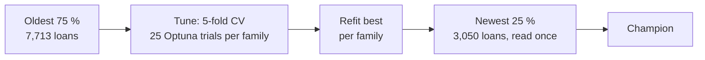
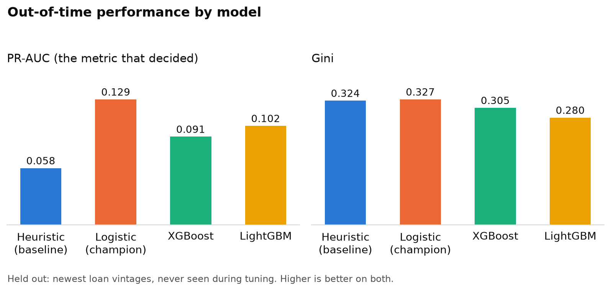
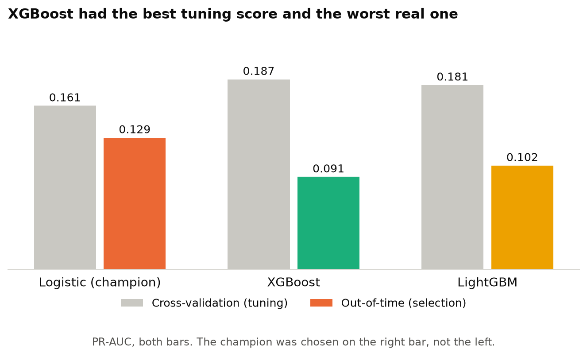
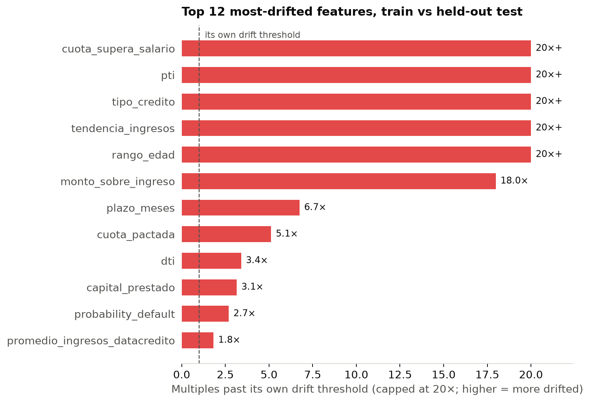
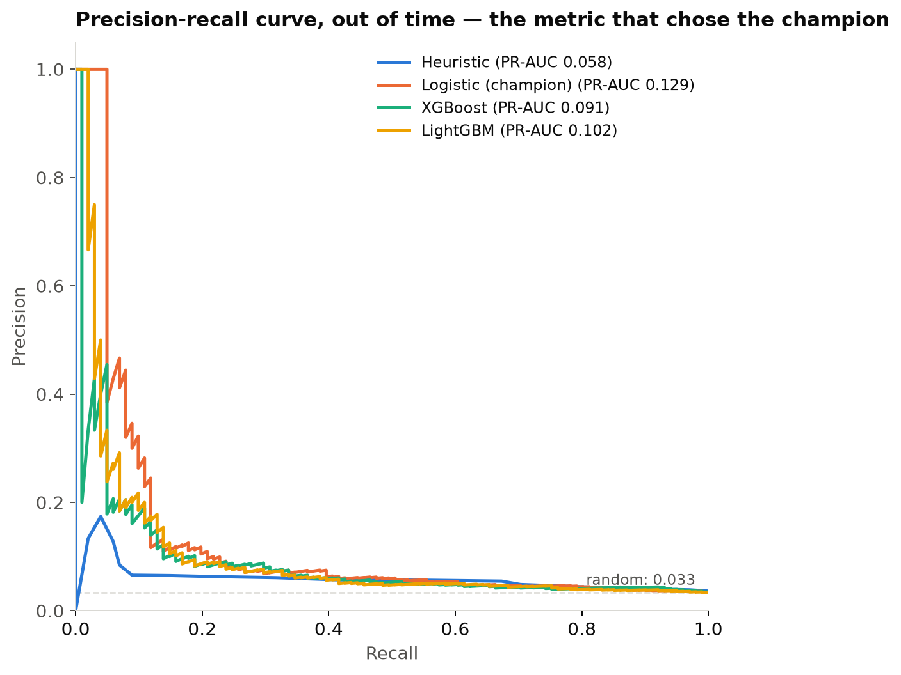

# Model training and champion selection (stage 7)

Three model families are tuned with Optuna, tracked in MLflow, and a champion is picked on a held-out window. The same run in the cloud is in [Training on Vertex AI](gcp/training.md).



## The protocol

The split is by date. Training covers loans originated before June 2025 (5.32 % default), the test window is June 2025 onward (3.31 %). Every transformer sits inside the sklearn `Pipeline`, so each fold refits its own caps, medians and encodings; two tests pin this. The lower test default rate is partly real drift and partly immature vintages, and it depresses all candidates equally.

Thresholded metrics use the business operating point, the 15.7 % of applications sent to manual review, so a probability model and a ranking model compare fairly.

| model | CV mean ± std | **PR-AUC** | ROC-AUC | **Gini** | F1 | Brier | fit s |
| --- | ---: | ---: | ---: | ---: | ---: | ---: | ---: |
| **logistic** | 0.1606 ± 0.0250 | **0.1293** | 0.6636 | **0.3272** | 0.1172 | 0.0319 | 0.17 |
| xgboost | **0.1865** ± 0.0137 | 0.0908 | 0.6525 | 0.3050 | 0.1172 | 0.0416 | 0.46 |
| lightgbm | 0.1810 ± 0.0113 | 0.1020 | 0.6398 | 0.2796 | 0.1138 | 0.1307 | 0.38 |
| heuristic | - | 0.0585 | 0.6619 | 0.3237 | 0.1022 | - | 0.005 |

Brier is withheld for the heuristic because it emits points, not probabilities.



## Why out of time matters

XGBoost has the best cross-validation score (0.1865) and the worst out-of-time PR-AUC of the learned models (0.0908, against 0.1293 for logistic). Selecting on CV would have picked the wrong model. The boosters fit vintage-specific structure that does not carry to the next months, and their lower fold variance did not warn of it.





## Champion: logistic regression

`C = 0.0869`, `class_weight = None`, standardised, on the 46 engineered features.

| Criterion | Result |
| --- | --- |
| Performance | PR-AUC 0.1293 vs 0.1020 for the next learned model and 0.0585 for the heuristic (2.2x). Gini 0.3272 vs 0.3237, a narrow win. |
| Consistency | Highest fold variance (±0.0250), the one mark against it. |
| Scalability | Fastest to fit (0.17 s) and score (12.0 ms per 1 000 rows); linear, so a declined applicant can be given a reason. |

The heuristic stays as the reference and fallback: it gets within 0.004 Gini of a tuned model with no fitted state.



## Limitations

- One 3,050-loan held-out window; rolling-origin evaluation would be stronger.
- Gini 0.33 is usable, not strong. Why it is weak is in [Why the signal is weak](investigation/model-signal.md).
- The champion is not calibrated against observed default rates; Brier 0.0319 is reported, not defended.
- Recent vintages are censored, which depresses the held-out metrics.

```bash
make train    # 25 trials x 5 folds x 3 families, about 2.5 min; 80 MLflow runs
uv run python -m src.pipelines.train training.n_trials=50
```
