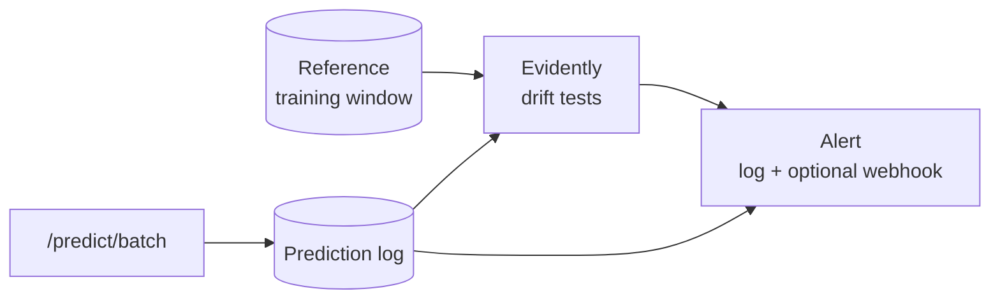

# Monitoring, drift and alerting

Detects drift against the training baseline, logs requests and raises alerts. It does not retrain and has no dashboard beyond Evidently's HTML report.



## Two report modes

A loan's outcome is unknown at scoring time, so quality drift can only be reported where labels exist.

| | `make monitor` (offline) | `POST /monitoring/run-drift-check` (live) |
| --- | --- | --- |
| Compares | training window vs held-out test window | training reference vs logged requests |
| Labels | yes | no |
| Reports | feature, prediction and quality drift (Gini, PR-AUC) | feature, prediction and operational drift only |
| Output | `reports/evidently_drift_report.html`, `evidently_metrics.json` | JSON response |

The reference is `models/reference_data.parquet` from `make export-reference`: the training window's features, the champion's predictions and the label.

## Method

| Column type | Test |
| --- | --- |
| Numeric, fewer reference rows than `numeric_sample_size_cutoff` | Kolmogorov-Smirnov |
| Numeric, at or above the cutoff | Wasserstein distance (own scale-relative threshold) |
| Categorical | Chi-square |

`alpha` is 0.05 and applies to the p-value tests only. `drift_share` is derived from the per-column tests, because Evidently's `DriftedColumnsCount` disagreed with them (6 of 35 columns drifted by one count, 20 of 35 by the other, on identical data). Nullable pandas dtypes and all-null live columns broke Evidently's type inference, so both frames are coerced to the reference's types first. Both bugs surfaced only against the containerised endpoint with real traffic.

## Logging and alerts

Each prediction's engineered features, probability and decision go to SQLite (WAL mode) at `data/monitoring/predictions.db`, stored as JSON per row because requests may omit optional fields. On Cloud Run the log is in BigQuery, see [Deployment flow](gcp/deployment-flow.md).

Alerts always log at `WARNING`, and POST to `monitoring.webhook_url` if set (one body works for Slack and Discord; a webhook failure never breaks the request). Two independent triggers:

- `dataset_drift_detected` from the drift check.
- The logged `review_flag` share exceeds `flagged_share_threshold`, a plain proportion against `flagged_share_at_fit`.

`/predict/batch` also accepts an optional `decision_threshold`. It adds `review_flag_at_custom_threshold` for what-if questions and never changes the frozen `review_flag`; a test asserts this.

## Running it

```bash
make export-champion export-reference
make monitor
docker compose up --build   # live; first run: chmod 777 data/monitoring
```

`data/monitoring/` is bind-mounted into a read-only container running as uid 1001, hence the chmod. `make tunnel` (ngrok) exposes the unauthenticated port for Postman tests; the collection is `tests/postman/credit_scoring_api.postman_collection.json`, run with `npx newman run`.

## Limitations

- One held-out window backs `make monitor`.
- With few logged requests the statistics are noisy; `min_current_rows` (30) is a floor, not a guarantee.
- No retraining trigger: acting on drift is a human decision for now.
