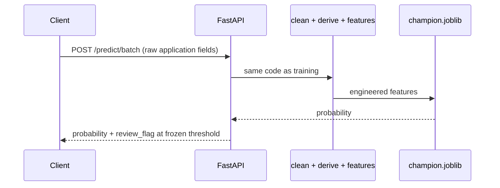

# Batch scoring (stage 9)

The champion behind a batch prediction API, in a container.



## The artifact

`make export-champion` reads `reports/champion.json`, pulls that MLflow run's pipeline and writes `models/champion.joblib` (10.6 KB) next to `champion.meta.json`. The metadata holds the model name, threshold (0.082282), flagged share at fit (0.157), calibration window (before 2025-06), MLflow run id, git SHA and feature list. Both files are gitignored build outputs.

## Design decisions

| Decision | Reason |
| --- | --- |
| Threshold is frozen at the 15.7 % training-window quantile | A per-batch quantile would make one applicant's decision depend on the others scored with them. On the newest vintages the flagged share is 20.66 %, which is information about the population. |
| API takes raw applications, not features | The caller cannot compute `dti` differently from training. A test checks that 50 real loans match the training path to within 1e-9. |
| Bureau fields optional | Missing data is handled by the `falta_*` flags, not refused. |
| Pydantic for requests, pandera for batch data | Admitting serving ids into the pandera schema would weaken a check that earns its place elsewhere. |
| `/health` reports what is true | `online_store` is `null` and the image carries no Feast, so `feature_store` says the registry is absent there. |

```bash
curl -X POST localhost:8000/predict/batch -H 'Content-Type: application/json' -d '{
  "records": [{"application_id":"APP-00002","tipo_credito":"9","capital_prestado":4200000,
    "plazo_meses":24,"edad_cliente":23,"tipo_laboral":"Independiente","salario_cliente":1200000,
    "total_otros_prestamos":3500000,"cuota_pactada":390000,"puntaje_datacredito":680,
    "cant_creditosvigentes":7,"huella_consulta":11,"tendencia_ingresos":"Decreciente"}]}'
# -> probability_default 0.7258, review_flag true, threshold 0.0823
```

## Container

| Property | Value |
| --- | --- |
| Build | Multi-stage from `uv.lock`; venv built at `/app/.venv`, the path it runs from |
| Dependencies | `serving` group only (no MLflow, XGBoost, LightGBM, Feast, Jupyter) |
| Size | 681 MB, mostly pandas, numpy, scipy, scikit-learn |
| Runtime | User `scoring` (uid 1001), read-only root filesystem, `/tmp` on tmpfs |

```bash
make export-champion && docker compose up --build -d
```

Cloud deployment is described in [Deployment flow](gcp/deployment-flow.md). Monitoring is on the [next page](monitoring.md).
