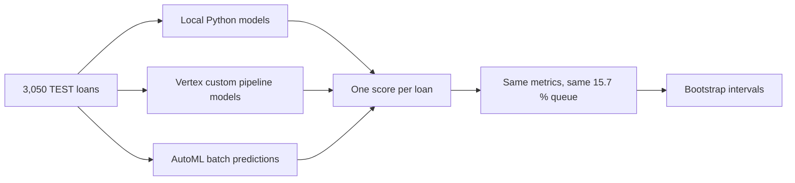

# Phase 2: results, stability and manual versus AutoML

!!! note "How this page is made"
    The tables and charts are generated by `make phase2-report` (code: `src/reports/phase2.py`, settings:
    `config/reports/phase2.yaml`, raw numbers: `reports/gcp/phase2_tables.json`). The text around them is written
    by hand from the run that produced them. Every model is scored on the **same held-out TEST window**:
    {{ n_test }} loans, {{ n_defaults }} of them defaults. TEST was only ever read to report, never to choose
    anything.

**AutoML v2 (trained on imputed data):** {{ v2_status }}.

## 1. What was measured, in plain words

A loan-default model gives every application a score. The bank cannot review everything, so we fix an
*operating point*: send the top **15.7 %** of applications by score to manual review (the same share the
training code uses in `src/pipelines/train.py`). Then we ask two kinds of questions.

* **Ranking questions** (do defaulters get higher scores than good payers?): **PR-AUC**, **ROC-AUC** and
  **Gini** (Gini = 2 x ROC-AUC - 1, the banking convention). They do not depend on the 15.7 % choice.
* **Decision questions** (what happens to the flagged group?): **precision**, **recall**, **F1** and
  **accuracy**, all at the 15.7 % operating point.



### Metrics that do not apply, and their stand-ins

* **RMSE** measures the size of errors in a number (a price, a temperature). A default is a yes or no, so there
  is no such error. The classifier's analogue is the **Brier score**: the mean squared error of the predicted
  *probabilities* (0 is perfect; lower is better). It is reported for models that output probabilities. The
  heuristic outputs points, not probabilities, so its Brier is "n/a".
* **Accuracy** is reported, but read the next section before trusting it.

## 2. Headline results

Square brackets are 95 % bootstrap intervals: we redraw the 3,050 loans with replacement 1,000 times and
re-measure; the middle 95 % of results is the interval. A wide interval means the number could easily have been
different with a different sample of loans.

{{ headline_table }}


The local and the Vertex custom-pipeline rows are the same models trained twice, in two places, so identical
numbers are the expected outcome (see section 5a). The genuinely different entries are the heuristic and AutoML.


How to read the curve: moving right means reviewing more applications (higher recall: more defaulters
caught), and precision is the share of the flagged ones that really default. The dotted line is what a
random queue achieves (3.3 %). Left of recall 0.1 the lines jump because only a handful of loans are involved.

## 3. Accuracy: why it is the wrong headline here

Only 3.3 % of the TEST loans default. A "model" that approves everybody and never flags anyone is right
96.7 % of the time, with zero use. The table and chart below show what each real model scores at the 15.7 %
queue.

{{ accuracy_table }}


| Rule | Accuracy | Defaulters caught |
|---|---|---|
| Nobody defaults (flag no one) | **{{ baseline_accuracy }}** | 0 of {{ n_defaults }} |
| Best real model (about 83 %) | about 83 % | about a third |

Every model is **below** the do-nothing baseline on accuracy, and that is not a bug. To catch defaulters we
must flag about one loan in six, and most flagged loans are good payers (precision is only about 7 to 8 %),
each counted as an "error" by accuracy. Accuracy rewards the model that never speaks up. That is why **PR-AUC
leads** in this project: it looks only at the review queue (of those we flag, how many default, at every queue
length), so the 96 % of easy "good payer" loans cannot inflate it. ROC-AUC and Gini are shown because banks
quote them, but with so few defaulters the many good payers dominate the ROC curve and flatter every model.

Brier needs a baseline too. A model that gives every loan the training default rate (5.3 %) has a Brier of
about 0.032 on this window. The logistic model's 0.032 is level with it, XGBoost's 0.042 is worse, and
LightGBM's 0.131 says its probabilities are far too high (they rank loans acceptably but are not
probabilities). Use LightGBM's scores for ordering only.

## 4. What differences are real?

With {{ n_defaults }} defaulters, the intervals are wide and they overlap almost everywhere. The paired test
below compares each model with the local logistic model on the *same* resampled loans, which is sharper than
comparing two separate intervals.

{{ paired_table }}

* Only one difference is distinguishable from noise: the hand-written heuristic has a worse PR-AUC than the
  logistic model. Its ROC-AUC (0.662 against 0.664) is the same, because its scores are only 20 distinct whole
  numbers: it ranks well overall but cannot order the loans at the very top of the queue.
* Logistic, XGBoost, LightGBM and AutoML v1 cannot be separated. The point estimates favour AutoML v1 on
  PR-AUC and F1 and the logistic model on ROC-AUC and Gini, but the intervals cover all of it. Our own
  investigation found that gains below about 0.01 cannot be told from noise on this data
  ([model-signal investigation](../investigation/model-signal.md)); the gaps here are larger than 0.01 but
  the sample is too small to say they are real.
* **No model is clearly better.** Ranking quality sits around ROC-AUC 0.64 to 0.66 whichever tool built it.

## 5. Stability and consistency

### 5a. Reproducibility: the cloud copy equals the local model

The same logistic model was trained locally and in the Vertex pipeline, then both scored the TEST loans.

{{ reproducibility_table }}

The largest difference is at the level of floating-point rounding (1e-15 is below what a computer can
distinguish for numbers of this size); the tree models are exactly identical. Earlier we also checked the
cloud logistic model through the serving API path on 400 applications: largest difference 5.6e-15, PR-AUC
0.12928 in both. What this means:

* The pipeline is **deterministic**: same data, same code, same seed, same model, on a laptop or on a Vertex VM.
* Moving training to the cloud changes **where and how fast** the work runs, not **what** is learned. A
  difference in results between platforms would therefore have to come from the method, not the platform.
* The cloud model can replace the local one without changing any decision; it is a safe swap.

### 5b. Sampling noise on TEST

This is the interval width in section 2: PR-AUC intervals are about +/-0.05 to +/-0.08 wide, ROC-AUC about
+/-0.05, F1 about +/-0.04. One extra default found or missed moves the PR-AUC noticeably. Treat the point
values as "somewhere in a range", and the ranking of models by PR-AUC as unproven.

### 5c. Cross-validation against the held-out window

Cross-validation (CV) tunes the model on the training window by repeatedly hiding a slice of it. The held-out
window is later in time, like real production.

{{ cv_table }}


The gap is positive for every model, so validation was optimistic. It is **three times larger for the trees**
(+0.08 to +0.10) than for the logistic model (+0.03). The likely reason is that trees are flexible enough to
fit quirks of the training months that do not repeat later; this matches the shuffled-versus-time-ordered
finding of the investigation. One caution: PR-AUC also depends on the default rate (5.3 % in the training
window, 3.3 % in TEST), so part of every gap is a changed baseline, not a worse model. The ranking-only
ROC-AUC tells the same story more gently: 0.68 in stratified CV and 0.70 in time-ordered folds against 0.66 on
TEST for the logistic model.

### 5d. Spread between time folds

The investigation re-validated the logistic model on four consecutive months, always training on earlier
months only. These are its numbers, reused here, not recomputed.

{{ timefold_table }}


A single month holds only 47 to 69 defaults, so one month's PR-AUC swings from 0.10 to 0.26 and ROC-AUC from
0.65 to 0.76. This month-to-month spread (a standard deviation of about 0.05 ROC and 0.07 PR) is as large as
the differences between our models, which is a second reason not to rank them. The TEST values for the
logistic model (PR-AUC 0.129, ROC-AUC 0.664) sit inside this range.

### 5e. AutoML consistency problems

* **v1 could not score 884 of the 3,050 TEST rows** (29 %) because they have empty numeric cells, which AutoML
  Tabular rejects at prediction time ("Failed numeric..." in the batch errors). Only 2,166 rows got a score.
  The table above treats the 884 rows as "never flagged" (score 0), so the comparison covers the full window.
  This is why AutoML v1 has the best PR-AUC but the worst ROC-AUC: 38 of the 101 defaults were in the
  unscored rows and are ranked at the bottom.
* On the 2,166 scored rows alone AutoML v1 reaches PR-AUC 0.235 and ROC-AUC 0.815, but that subset is
  a different mix of loans (2.9 % defaults against 3.3 %), so it **must not** be compared with the
  other rows.
* The local and custom pipelines fill missing values and add "was missing" flags inside the model, so they
  score every row. AutoML v2 repeats the run on data imputed beforehand (the same imputation fitted on
  training data only, so nothing leaks) to cover all rows. Its row is in the tables above and fills in
  automatically when the batch output exists.
* AutoML is also harder to **repeat**: we do not control its search, so a re-run may produce a different
  model (not tested here). The custom pipeline reproduces exactly (5a).

### 5f. Label maturity: a caveat we cannot prove

The default rate is 5.3 % in the training window and 3.3 % in TEST. A plausible reason is that recent loans
have not had time to default yet (their label "no default" may still change). If so, TEST is slightly
too kind to the "no default" class and every number in this page is measured against an unfinished label.
This is a **hypothesis, not a finding**: the investigation shows a pattern consistent with it but cannot
prove it. Metrics should be refreshed when TEST loans mature.

## 6. Manual versus AutoML

| Aspect | Manual (Python locally or custom Vertex pipeline) | Vertex AutoML |
|---|---|---|
| Control | Full: features, validation scheme, metric, threshold, calibration | Pick the objective and budget; the rest is hidden |
| Transparency | Every step is code; coefficients and feature importances are readable | A black-box ensemble; some explanations, no model file to inspect |
| Cost | Local: free. Custom pipeline: cents (a few minutes of a small VM) | About $21 at the 1 node-hour minimum, plus under $1 for batch prediction |
| Time | About 2.5 minutes locally; about 6 minutes in the pipeline | About 2 h 15 min of training |
| Reproducibility | Same seed gives the same model (section 5a) | Search is not controllable; a re-run can differ |
| Missing values | Handled in the pipeline (imputation plus "was missing" flags) | v1 rejected rows with empty numeric cells; needs imputing first (v2) |
| Leakage protection | We enforce it: all fitting happens on training data only | We must make sure the uploaded data already respects it |
| Skill needed | Data science and engineering | Little; good for a first baseline |
| Best for | Production models, audits, regulated credit decisions, repeated retraining | Quick baselines, teams without ML engineers, a second opinion |

What the evidence says, and what it does not:

* On this data, AutoML did **not** beat a simple logistic regression in any way we can demonstrate: its PR-AUC
  looks higher, its ROC-AUC lower, and all the intervals overlap.
* The signal in the data looks limited (ROC-AUC about 0.70 even in the best validation of the investigation);
  no tool can extract what is not there, which is consistent with the 21 dollars not buying a clear improvement.
* The case for manual is therefore mostly about **cost, control and being able to explain and repeat** a
  credit decision, not about accuracy.
* The case for AutoML is speed to a first, unbiased baseline: its result also suggests that a heavier
  search does not find hidden structure here.
* With {{ n_defaults }} defaults in TEST, one experiment per tool and an unproven label-maturity effect, we
  do not claim a winner. A fairer verdict needs more defaults (more months), repeated AutoML runs and
  matured labels.

## 7. How to regenerate

```bash
make phase2-report     # fetches the model files and batch predictions from GCS (read only), then rebuilds
```

When AutoML v2 finishes and its batch predictions are written to the output folder, run it again: the v2
row, the charts and the "pending" note update by themselves. The predictions behind the page are cached in
`reports/gcp/phase2_predictions.csv`; `uv run python -m src.reports.phase2 --offline` rebuilds the page from
that cache without touching the cloud.
