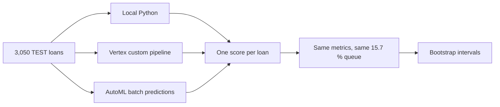

# Results: local Python, Vertex pipeline and AutoML

Every model is scored on the same held-out TEST window: {{ n_test }} loans, {{ n_defaults }} of them defaults. TEST was only read to report.

!!! note "How this page is made"
    Tables and charts come from `uv run python -m src.reports.phase2 --offline` (settings in `config/reports/phase2.yaml`, numbers in `reports/gcp/phase2_tables.json`). Do not edit this file by hand; edit `src/reports/results.template.md`.

**AutoML v2 (trained on imputed data):** {{ v2_status }}.

## 1. Headline results

The bank cannot review every application, so the top 15.7 % by score go to manual review. PR-AUC, ROC-AUC and Gini rank the scores and do not depend on that cut. F1 is measured at the 15.7 % queue. Square brackets are 95 % bootstrap intervals: the 3,050 loans are redrawn 1,000 times and the middle 95 % of results is shown.

{{ headline_table }}

Local and Vertex rows are the same models trained in two places, so equal numbers are expected. The different entries are the heuristic and AutoML.

Moving right on the curve means reviewing more applications. The dotted line is a random queue (3.3 %).

## 2. Which differences are real

With {{ n_defaults }} defaulters the intervals overlap almost everywhere. The paired test compares each model with the local logistic model on the same resampled loans, which is sharper.

{{ paired_table }}

* The heuristic is worse than logistic on PR-AUC. Its scores are only 20 distinct whole numbers, so it cannot order the top of the queue.
* Logistic, XGBoost, LightGBM and AutoML v1 cannot be separated.
* AutoML v2 is the exception: its PR-AUC gain over logistic is distinguishable from noise, and its ROC-AUC interval does not overlap.
* AutoML v1 could not score 884 of the 3,050 rows (empty numeric cells) and these were given score 0. That explains its odd mix of high PR-AUC and low ROC-AUC. v2 imputes first and scores every row.

Accuracy is the wrong headline. Only 3.3 % of TEST loans default, so a model that flags nobody is right {{ baseline_accuracy }} of the time and catches 0 of {{ n_defaults }} defaulters. Every real model sits below that, because catching defaulters means flagging about one loan in six and most flagged loans are good payers. PR-AUC leads for that reason.

{{ accuracy_table }}

A model that gives every loan the training default rate (5.3 %) has a Brier score of about 0.032. Logistic is level with it, XGBoost (0.042) is worse, and LightGBM (0.131) has probabilities far too high, so use its scores for ordering only.

## 3. Stability

* **Same model in two places.** The cloud logistic model equals the local one up to floating-point rounding. Moving training to the cloud changes where and how fast it runs, not what is learned.

{{ reproducibility_table }}

* **Sampling noise.** PR-AUC intervals are about +/-0.05 to +/-0.08 wide, so the ranking of models by PR-AUC is unproven.
* **Validation was optimistic.** The gap between cross-validation and the later window is positive for every model, and about three times larger for the trees than for logistic. Part of every gap is the lower default rate in TEST.

{{ cv_table }}

* **Month to month.** The investigation re-validated logistic on four consecutive months. One month holds only 47 to 69 defaults, so the spread is as large as the gaps between our models. These numbers are reused from the [investigation](../investigation/model-signal.md), not recomputed.

{{ timefold_table }}

## 4. Caveats

* TEST has 101 defaults, so every number is noisy, and it is one window.
* The window was already used to compare models more than once, so it is not a clean holdout.
* AutoML v2 was run after seeing v1 on the same window. Only the data preparation changed, but it is a second look.
* Label maturity is a hypothesis, not a finding. The default rate is 5.3 % in training and 3.3 % in TEST, possibly because recent loans have not had time to default. If so, every number here is measured against an unfinished label.
* AutoML cost about $21 and 2 h 15 min per training run and is a black box. Serving it would need a Vertex endpoint (always-on cost) or an export; we did neither. For that reason the champion is not replaced. See [training](training.md) for what AutoML relies on.
